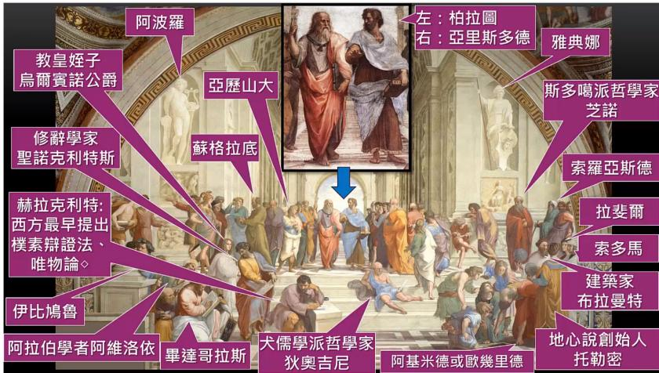
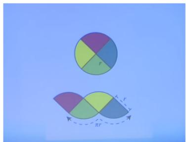
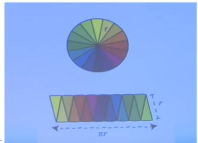
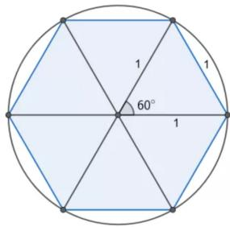
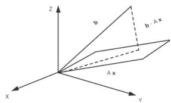

# 2026-09-27 · 证明方法与线性代数基础

高级工程数学

(Math4AI / 人工智能的数学基础)

2026-09-27

沈超敏

计算机科学与技术学院

cmshen@cs.ecnu.edu.cn

文附楼 105

先入群，实名 正式讲课前 · · · · · · 微信群（实名）、选课名单、课代表 1. 9.27 (Sun) 2. 10.4 (Sun) 3. 10.6 (Tue) 4. 10.11 (Sun) 5. 10.18 (Sun) 6. 10.25 (Sun) 7. 11.1 (Sun) 8. 11.8 (Sun) 9. 11.15 (Sun)

**教科书**

An Introduction to Optimization (Fourth Edition)

作者: Edwin K.P. Chong & Stanislaw H. Zak

出版社: Wiley, 2013 (电子版)

**今天内容**

**开场白 (第一时间段)**

一些具体的 logistics: 上课/考试形式、课件、微信群等为什么要开这门课？

本课程与整个研究生学习的关系

这门课具体内容

学习方法

正式内容: Ch. 1

Ch. 2 (视时间)

**引子：《双城记》**

It was the best of times, it was the worst of times,

it was the age of wisdom, it was the age of foolishness…

这是最好的时代，也是最坏的时代；

这是智慧的时代，也是愚昧的时代；

这是信仰的时期，也是怀疑的时期；

这是光明的季节，也是黑暗的季节...

Bill Thurston：数学的本质是推进人类的理解，而不仅仅是制造产出

**学习方法**

「學生不需要一個完美的老師他們需要一個快樂的老師，能讓他們興奮地來到學校，培養他們對學習的熱愛。」

理察·費曼美國物理學家，1918年—1988年

大疑大悟、小疑小悟、不疑不悟 《金刚经》

**问学**

例：http://faculty.bicmr.pku.edu.cn/\~dongbin/Teaching.html

**Principles of Imaging – Unified Perspectives**

Bin Dong & GPT-4

2023.09.09

Table of Content:

1. Introduction to Imaging Principles and Techniques 1.1 Role of Imaging in Different Fields 1.2 Fundamental Concepts in Imaging

2. Basics of Electromagnetic (EM) Radiaton and Mechanical Waves 2.1 Electromagnetic Waves 2.2 Wave-Particle Duality and Imaginç 2.3 Mechanical Waves

3. Wave Interaction Modalities and Imaging: Transmission, Absorption, Reflection, Scattering Diffraction

4. Imaging Modalities Based on Transmission

4.1 X-ray Imaging and Computed Tomography (CT)

**反向学习法**

**陶哲轩力荐，哈佛反向学习法火了：教会AI就是教会自己**

**Ai摘要**

哈佛教授Brenner提出创新教学法，让学生教AI完成数学作业，以锻炼学生问题拆解和提示词工程技术。他另一门课将烹饪与科学结合，打破学生固有认知。

数学大佬陶哲轩力荐，哈佛反向学习法火了：教会AI就是教会自己

Terence Tao @tao@mathstodon.xyz

A creative way by Michael Brenner to integrate LLMs into undergraduate mathematical education: ask the students to teach

数学分析 Why

高等数学 How

高中毕业时的数学水平：400 年前

学完高数的数学水平：150 年前

学完本课程后的数学水平：50 年前（部分内容前沿）

**跟随伟大人物的思想，是一门最引人入胜的科学普希金**

**数学史**

https://www.bilibili.com/video/BV1Ef4y197wQ?from=search&seid=5832620057198290064如果不知道远溯古希腊各代前辈所建立和发展的概念、方法和结果，我们就不可能理解近五十年来数学的目标，也不可能理解它的成就.——外尔 (C. H. H. Weyl, 1885–1955)

GREECE AND ITS COLONIES IN 550 B.C.

數學詞源: 希腊语 µαθηµατικζ (Mathematikós)，

意思是“学问的基础”，源于 µαθηµα (máthema，“科学，知识，学问”)

Thales （624 B.C. – 546 B.C.) 半圆内切的角度是直角

Pythagoras (570 B.C. – 495 B.C.) “数学”一词的专门化使用是源于毕达哥拉斯的想法

Euclid (325 B.C. – 265 B.C.) 公理化方法

Archimedes （287 B.C. – 212 B.C.)

有史以来最重要的 3 个数学家: Archimedes、Newton、(Euler/Gauss)

微积分的创立者：Newton、Leibnitz （Leibniz / von Leibniz）

**Archimedes 的贡献**

已知：π 的定义为 $\pi = C / d , { \mathsf { i . e . , } } C = 2 \pi r$

求证： $S = \pi r ^ { 2 }$

东京大学入学考试题 (2003)：证明 $\pi > 3.05$

比如，在一个半径为1的圆里面做一个正六边形，可知圆的周长大于正六边形的周长，也就是：

$$
2 \pi > 6
$$

因此：

$$
\pi > 3
$$

这个六边形估计只证明 $\pi>3$；要得到题目要求的 $\pi>3.05$，还需更精细的估计。

思考：或用其它方法求得更精确的 π 值

**数学史**

https://www.bilibili.com/video/BV1Ef4y197wQ?from=search&seid=5832620057198290064

已经85岁的吴先生思想十分活跃，他兴致勃勃地谈起科技发展的观点和数学的研究方向。

他说：“从‘文化大革命’以后，我的研究方向有一个很大的转变，这是受中国数学的启发。中国传统科学中，也有珍贵的宝藏。要把东西方优秀的成果结合起来，为我所用。学习中国数学的历史，我发现中国数学发展的途径、思想方法和现在的科学理论是相反的，是根本不相同的。中国是算法式的。算法是你做了第一步，就知道第二步该怎么做，做了第二步就知道第三步该怎么做。而西方的现代数学，每一步的证明都要经过思考，走了第一步不知道第二步怎么做。我受了这个启发，就想是不是在数学的许多领域也可以按照中国这种算法的方式。这在现在的实现条件，就是我们有计算机。”

**如何证明负负得正？**

可以运用：分配律、-1+1=0

Ch. 1. Methods of Proof and Some Notations
1.1 Method of Proof
1.2 Notation
Exercises

**逻辑**

## 1.1. Method of Proof

**合取与析取**

| $A$ | $B$ | $A\land B$ | $A\lor B$ |
|---|---|---|---|
| 真 | 真 | 真 | 真 |
| 真 | 假 | 假 | 真 |
| 假 | 真 | 假 | 真 |
| 假 | 假 | 假 | 假 |

**否定与德摩根律**

| $A$ | $B$ | $\neg(A\land B)$ | $\neg A\lor\neg B$ |
|---|---|---|---|
| 真 | 真 | 假 | 假 |
| 真 | 假 | 真 | 真 |
| 假 | 真 | 真 | 真 |
| 假 | 假 | 真 | 真 |

由表可见，$\neg(A\land B)\Leftrightarrow(\neg A)\lor(\neg B)$。

**蕴含 $A\Rightarrow B$ 的真值表**

| $A$ | $B$ | $A\Rightarrow B$ |
|---|---|---|
| 真 | 真 | 真 |
| 真 | 假 | 假 |
| 假 | 真 | 真 |
| 假 | 假 | 真 |

**蕴含与等价**

$A\Rightarrow B$ 表示“若 $A$ 成立，则 $B$ 成立”，等价于 $(\neg A)\lor B$。$A$ 是 $B$ 的充分条件，$B$ 是 $A$ 的必要条件。

命题 $A\Rightarrow B$ 与其逆否命题 $(\neg B)\Rightarrow(\neg A)$ 等价。

$A\Leftrightarrow B$ 表示 $(A\Rightarrow B)$ 且 $(B\Rightarrow A)$；也可表述为 “$A$ if and only if $B$” 或 “$A$ is equivalent to $B$”。

如何证明 $\mathsf { A } \Rightarrow \mathsf { B } ?$

1. The direct method

2. Proof by contraposition (证明逆否命题)

3. Proof by contradiction

4. Principle of induction

**数学归纳法需要满足 2 个条件**

例 (选自华罗庚科普著作选) 所有的正整数都相等

这个命题显然是荒谬的

但是如果我们丢开“当 n = 1 的时候，这个命题是正确的”不管，那末可以用“数学归纳法”来“证明”它

这里，第 k 号命题是：“第 k −1 个正整数等于第 k 个正整数”，就是

$$
k - 1 = k
$$

两边都加上 1，就得

$$
k = k + 1
$$

这就是说，第 k 个正整数等于第 k+1 个正整数．这不是说明了所有的正整数都相等了吗？

错误就在于，我们没有考虑 k = 1 的情况

## 1.2. Notation

标量用小写 (非黑体) 字母表示, 如 $x ;$

向量用小写 (黑体) 字母表示, 如 $\pmb { x } ; \pmb { x } = ( x _ { 1 } , \cdots , x _ { n } )$

矩阵用大写字母表示, 如 $A ;$

集合用大写 (花写) 字母表示, 如 $X , ~ { \mathcal { X } } ;$ 集合中的元素用小写字母表示, 如 $\boldsymbol { X } \ =$ $\{ x _ { 1 } , \cdot \cdot \cdot , x _ { n } \} ; X = \{ \pmb { x } _ { 1 } , \cdot \cdot \cdot , \pmb { x } _ { n } \}$

## Ch. 2. Vector Spaces and Matrices

2.1 Vector and Matrix

2.2 Rank of a Matrix

2.3 Linear Equations

2.4 Inner Products and Norms

Exercises

## 2.1. Vector and Matrix

A column n-vector: an array of n numbers

$$
\boldsymbol {a} = \left[ \begin{array}{c} a _ {1} \\ a _ {2} \\ \vdots \\ a _ {n} \end{array} \right]
$$

${ { a } _ { i } } \mathrm { : }$ the ith component of the vector ${ \pmb a } .$

A row n-vector

$$
[ a _ {1}, a _ {2}, \dots , a _ {n} ].
$$

Transpose: If

$$
\boldsymbol {a} = \left[ \begin{array}{c} a _ {1} \\ a _ {2} \\ \vdots \\ a _ {n} \end{array} \right],
$$

then

$$
\boldsymbol {a} ^ {\top} = [ a _ {1}, \dots , a _ {n} ]
$$

向量的相等: 两个向量的对应的元素均相等

The operation of addition of vectors has the following properties:

1. The operation is commutative:

$$
\boldsymbol {a} + \boldsymbol {b} = \boldsymbol {b} + \boldsymbol {a}.
$$

2. The operation is associative:

$$
(\boldsymbol {a} + \boldsymbol {b}) + \boldsymbol {c} = \boldsymbol {a} + (\boldsymbol {b} + \boldsymbol {c}).
$$

3. There is a zero vector $\mathbf { 0 } = [ 0 , 0 , . . . , 0 ] ^ { T }$ such that

$$
\boldsymbol {a} + \boldsymbol {0} = \boldsymbol {0} + \boldsymbol {a} = \boldsymbol {a}.
$$

The vector

$$
\left[ a _ {1} - b _ {1}, a _ {2} - b _ {2}, \dots , a _ {n} - b _ {n} \right] ^ {\top}
$$

is called the difference between a and b and is denoted ${ \mathbf { } } a - b .$

The vector $\mathbf { 0 } - b$ is denoted −b.

$$
\boldsymbol {b} + (\boldsymbol {a} - \boldsymbol {b}) = \boldsymbol {a}
$$

$$
- (- \boldsymbol {b}) = \boldsymbol {b}
$$

$$
- (\boldsymbol {a} - \boldsymbol {b}) = \boldsymbol {b} - \boldsymbol {a}
$$

数乘: We define an operation of multiplication of a vector $\mathbf { \pmb { a } } \in \mathbb { R } ^ { n }$ by a real scalar $\alpha \in \mathbb { R }$ as

$$
\alpha \boldsymbol {a} = [ \alpha a _ {1}, \dots , \alpha a _ {n} ] ^ {\top}.
$$

1. The operation is distributive: for any real scalars α and $\beta ,$

$$
\alpha (\boldsymbol {a} + \boldsymbol {b}) = \alpha \boldsymbol {a} + \alpha \boldsymbol {b},
$$

$$
(\alpha + \beta) \boldsymbol {a} = \alpha \boldsymbol {a} + \beta \boldsymbol {a}.
$$

$$
\alpha (\beta \boldsymbol {a}) = (\alpha \beta) \boldsymbol {a}.
$$

3. The scalar 1 satisfies 1a = a.

4. Any scalar α satisfies α0 = 0.

5. The scalar 0 satisfies $0 \pmb { a } = \mathbf { 0 }$

**杨振宁教授在清华的《普通物理》**

https://www.bilibili.com/video/BV1Fx411T7sV?p=3

(from 第 15 分钟)

**2.1. Vector and Matrix**

$$
\alpha\boldsymbol{a}=\boldsymbol{0}\quad\Longleftrightarrow\quad\alpha=0\text{ or }\boldsymbol{a}=\boldsymbol{0}.
$$

Indeed, if $\boldsymbol{a}\ne\boldsymbol{0}$, at least one component $a_k$ is nonzero, so $\alpha a_k=0$ implies $\alpha=0$. Conversely, if $\alpha\ne0$, then $\alpha a_i=0$ for every component implies $a_i=0$ for all $i$, hence $\boldsymbol{a}=\boldsymbol{0}$.

**思考题**

**解释下列现象**

例如二维空间中的 (1,2) 和 (2,1)，在换了一组基 (1,1), (0,1) 的情况下，它们的坐标分别变成了 (1,1) 和 (2,-1)，此时内积从 4 变成了 1。

这个过程哪里出问题了？

**Basis**

A basis of a subspace $V$ is a linearly independent set $\{\boldsymbol{a}_1,\ldots,\boldsymbol{a}_k\}$ that spans $V$. Every basis of $V$ contains the same number of vectors; this number is the dimension $\dim V$.

**Proposition 2.2.** Each vector $\boldsymbol{a}\in V$ has a unique representation

$$
\boldsymbol{a}=\alpha_1\boldsymbol{a}_1+\cdots+\alpha_k\boldsymbol{a}_k,
$$

where $\alpha_i\in\mathbb{R}$. For uniqueness, if the same vector also equals $\beta_1\boldsymbol{a}_1+\cdots+\beta_k\boldsymbol{a}_k$, then

$$
(\alpha_1-\beta_1)\boldsymbol{a}_1+\cdots+(\alpha_k-\beta_k)\boldsymbol{a}_k=\boldsymbol{0}.
$$

Linear independence gives $\alpha_i=\beta_i$ for every $i$. The coefficients $\alpha_i$ are the coordinates of $\boldsymbol{a}$ in this basis.

The natural basis of $\mathbb{R}^n$ is $\{\boldsymbol{e}_1,\ldots,\boldsymbol{e}_n\}$, where each $\boldsymbol{e}_i$ has a $1$ in position $i$ and zeros elsewhere.

Matrix

A matrix is a rectangular array of numbers, commonly denoted by uppercase bold letters $( \mathtt { e . g . }$ $A )$ . A matrix with m rows and n columns is called an $m \times n$ matrix, and we write

$$
A = \left[ \begin{array}{c c c c} a _ {1 1} & a _ {1 2} & \dots & a _ {1 n} \\ a _ {2 1} & a _ {2 2} & \dots & a _ {2 n} \\ \vdots & \vdots & \ddots & \vdots \\ a _ {m 1} & a _ {m 2} & \dots & a _ {m n} \end{array} \right]
$$

Transpose

$$
A ^ {\top} = \left[ \begin{array}{c c c c} a _ {1 1} & a _ {2 1} & \dots & a _ {m 1} \\ a _ {1 2} & a _ {2 2} & \dots & a _ {m 2} \\ \vdots & \vdots & \ddots & \vdots \\ a _ {1 n} & a _ {2 n} & \dots & a _ {m n} \end{array} \right]
$$

## 2.2. Rank of a Matrix

Let us denote the k-th column of $A$ by $\mathbf { \delta } _ { \mathbf { \alpha } \mathbf { \alpha } \mathbf { \alpha } \mathbf { \alpha } } \mathbf { \Xi } _ { \mathbf { \alpha } \mathbf { \alpha } \mathbf { \alpha } \mathbf { \alpha } \mathbf { \alpha } \mathbf { \alpha } \mathbf { \alpha } \mathbf { \alpha } \mathbf { \alpha } \mathbf { \alpha } \mathbf { \alpha } \mathbf { \alpha } \mathrm { ~ \textit ~ { ~ a ~ k ~ } ~ } }$ , then $A = [ \pmb { a } _ { 1 } , \cdots , \pmb { a } _ { n } ]$

The maximal number of linearly independent columns of A is called the rank of the matrix $A ,$ denoted rank A. Note that rank A is the dimension of span $[ a _ { 1 } , . . . , a _ { n } ]$

The maximal number of linearly independent columns of A is called the rank of the matrix $A ,$ denoted rank A. Note that rank A is the dimension of span $[ \pmb { a } _ { 1 } , . . . , \pmb { a } _ { n } ]$

Proposition 2.3. The rank of a matrix $A$ is invariant under the following column operations:

1. Multiplication of a column by a nonzero scalar.
2. Interchange of columns.
3. Addition to a column of a linear combination of other columns.

Each operation preserves the span of the columns. Scaling by a nonzero scalar and interchanging columns leave the span unchanged. Adding a linear combination of the other columns also leaves the span unchanged, since the operation can be reversed by subtracting that same combination. Therefore, the dimension of the column span, and hence the rank, is unchanged.

A pth-order minor of an $m \times n$ matrix A, with $p < \operatorname* { m i n } \{ m , n \}$ , is the determinant of a $p \times p$ matrix obtained from A by deleting $m - p$ rows and $n - p$ columns.

Proposition 2.4. If an $m\times n$ matrix $A$ with $m>n$ has a nonzero $n$-th order minor, then its columns are linearly independent; that is, $\operatorname{rank}A=n$.

Proof. We may assume the nonzero minor is formed from the first $n$ rows. Let $\tilde{\boldsymbol{a}}_i$ be the vector consisting of the first $n$ components of column $i$, for $i=1,\ldots,n$. If $x_1\boldsymbol{a}_1+\cdots+x_n\boldsymbol{a}_n=\boldsymbol{0}$, then

$$
x_1\tilde{\boldsymbol{a}}_1+\cdots+x_n\tilde{\boldsymbol{a}}_n=\boldsymbol{0}.
$$

The determinant of $[\tilde{\boldsymbol{a}}_1,\ldots,\tilde{\boldsymbol{a}}_n]$ is the given nonzero minor, so these truncated columns are linearly independent. Thus every $x_i=0$, and the original columns are linearly independent. □

非异阵

对方阵 $A _ { n \times n } , A$ 非异 if $\exists B _ { n \times n }$ , such that

$$
A B = B A = I _ {n}.
$$

B 称为 A 的逆阵, 记为 $B = A ^ { - 1 }$

## 2.3. Linear Equations

A system of linear equations can be written as

$$
A\boldsymbol{x}=\boldsymbol{b},
$$

where the columns of $A$ are $\boldsymbol{a}_1,\ldots,\boldsymbol{a}_n$. The augmented matrix is $[A,\boldsymbol{b}]$.

**Theorem 2.1.** The system $A\boldsymbol{x}=\boldsymbol{b}$ has a solution if and only if

$$
\operatorname{rank}A=\operatorname{rank}[A,\boldsymbol{b}].
$$

**Proof.** If $A\boldsymbol{x}=\boldsymbol{b}$ has a solution, then $\boldsymbol{b}$ is a linear combination of the columns of $A$, so adding $\boldsymbol{b}$ does not change their span or its dimension. Hence $\operatorname{rank}A=\operatorname{rank}[A,\boldsymbol{b}]$.

Conversely, suppose both ranks equal $r$. Choose $r$ linearly independent columns of $A$. They are also linearly independent columns of $[A,\boldsymbol{b}]$. Since the augmented matrix has rank $r$, every remaining column, including $\boldsymbol{b}$, is a linear combination of those $r$ columns of $A$. Therefore $A\boldsymbol{x}=\boldsymbol{b}$ has a solution. □

**Theorem 2.2.** Consider $A\boldsymbol{x}=\boldsymbol{b}$, where $A\in\mathbb{R}^{m\times n}$ and $\operatorname{rank}A=m$. A solution can be obtained by assigning arbitrary values to $n-m$ variables and solving for the remaining ones.

**Proof.** Since $\operatorname{rank}A=m$, choose $m$ linearly independent columns $\boldsymbol{a}_1,\ldots,\boldsymbol{a}_m$. Rewrite the equation as

$$
x_1\boldsymbol{a}_1+\cdots+x_m\boldsymbol{a}_m=\boldsymbol{b}-x_{m+1}\boldsymbol{a}_{m+1}-\cdots-x_n\boldsymbol{a}_n.
$$

Assign arbitrary values $x_{m+1}=d_{m+1},\ldots,x_n=d_n$, and let $B=[\boldsymbol{a}_1,\ldots,\boldsymbol{a}_m]$. Since these columns are linearly independent, $B$ is invertible, and

$$
B\begin{bmatrix}x_1\\x_2\\\vdots\\x_m\end{bmatrix}=\boldsymbol{b}-d_{m+1}\boldsymbol{a}_{m+1}-\cdots-d_n\boldsymbol{a}_n.
$$

Thus the remaining variables are determined by multiplying the right-hand side by $B^{-1}$.

**思考题**

$$
\left\{ \begin{array}{l} x + y = 2 \\ x - y = 0 \\ x + 2 y = 4 \end{array} \right.
$$

线性方程组的求解：投影的例子

$$
\left\{ \begin{array}{l l} x + y = 2 \\ x - y = 0 \\ x + 2 y = 4 \end{array} \right.
$$

归结为

$$
\left( \begin{array}{c c} 1 & 1 \\ 1 & - 1 \\ 1 & 2 \end{array} \right) \binom{x}{y} = \left( \begin{array}{c} 2 \\ 0 \\ 4 \end{array} \right)
$$

$$
\begin{array}{l} A \boldsymbol {x} = \boldsymbol {b} \\ A ^ {\top} A \boldsymbol {x} = A ^ {\top} \boldsymbol {b} \\ \boldsymbol {x} = \left(A ^ {\top} A\right) ^ {- 1} A ^ {\top} \boldsymbol {b} \end{array}
$$

**线性方程组的求解：投影的例子**

给定向量 $\boldsymbol{b}$ 和由 $\boldsymbol{a}_1,\boldsymbol{a}_2$ 张成的平面，求投影矩阵 $P$，使 $P\boldsymbol{b}$ 落在该平面内，且投影与残差正交：

$$
\boldsymbol{b}=P\boldsymbol{b}+(\boldsymbol{b}-P\boldsymbol{b}),\qquad (P\boldsymbol{b})^\top(\boldsymbol{b}-P\boldsymbol{b})=0.
$$

令 $A=(\boldsymbol{a}_1,\boldsymbol{a}_2)$。最小二乘解为 $\boldsymbol{x}^*=(A^\top A)^{-1}A^\top\boldsymbol{b}$，故 $A\boldsymbol{x}^*=P\boldsymbol{b}$，并得到

$$
P=A(A^\top A)^{-1}A^\top.
$$

验证正交性：

$$
\begin{aligned}
(P\boldsymbol{b})^\top(\boldsymbol{b}-P\boldsymbol{b})
&=(A\boldsymbol{x}^*)^\top(\boldsymbol{b}-A\boldsymbol{x}^*)\\
&=(\boldsymbol{x}^*)^\top A^\top\boldsymbol{b}-(\boldsymbol{x}^*)^\top A^\top A\boldsymbol{x}^*\\
&=(\boldsymbol{x}^*)^\top A^\top\boldsymbol{b}-(\boldsymbol{x}^*)^\top A^\top\boldsymbol{b}=0.
\end{aligned}
$$

## 2.4 Inner Products and Norms

对于绝对值, 有以下的公式:

1. $| a | = | - a | .$

2. $- |a| \leq a \leq |a|$

3. $|a+b| \leq |a|+|b|$

4. $\bigl||a|-|b|\bigr| \leq |a-b| \leq |a|+|b|$.

5. $\left| a b \right| = \left| a \right| \left| b \right|$

6. $|a| < c$ and $|b| < d$ imply that $|a+b| < c+d$.

7. $|a| < b$ is equivalent to $-b < a < b$ (i.e., $a < b$ and $-a < b$). The same holds when every occurrence of $<$ is replaced by $\leq$.

For $\boldsymbol{x},\boldsymbol{y}\in\mathbb{R}^n$, we define the Euclidean inner product by

$$
\langle \boldsymbol {x}, \boldsymbol {y} \rangle = \sum_ {i = 1} ^ {n} x _ {i} y _ {i} = \boldsymbol {x} ^ {\top} \boldsymbol {y}.
$$

**内积具有以下性质:**

1. Positivity: $\langle { \pmb x } , { \pmb x } \rangle > 0 , \langle { \pmb x } , { \pmb x } \rangle = 0$ if $\scriptstyle { \boldsymbol { x } } = 0$

2. Symmetry: $\langle { \pmb x } , { \pmb y } \rangle = \langle { \pmb y } , { \pmb x } \rangle$

3. Additivity: $\langle { \pmb x } + { \pmb y } , { \pmb z } \rangle = \langle { \pmb x } , { \pmb z } \rangle + \langle { \pmb y } , { \pmb z } \rangle$

4. Homogeneity (齐性): $\langle r { \pmb x } , { \pmb y } \rangle = r \langle { \pmb x } , { \pmb y } \rangle$ for every $r \in \mathbb { R }$

The properties of additivity and homogeneity in the second vector also hold;

$$
\langle \boldsymbol {x}, \boldsymbol {y} + \boldsymbol {z} \rangle = \langle \boldsymbol {x}, \boldsymbol {y} \rangle + \langle \boldsymbol {x}, \boldsymbol {z} \rangle ,
$$

$\langle { \pmb x } , r { \pmb y } \rangle = r \langle { \pmb x } , { \pmb y } \rangle$ for every $r \in \mathbb { R } .$

The vectors x and $\textbf {  { y } }$ are said to be orthogonal if $\langle { \pmb x } , { \pmb y } \rangle = 0$

The Euclidean norm of a vector x is defined as

$$
\| \boldsymbol {x} \| = \sqrt {\langle \boldsymbol {x} , \boldsymbol {x} \rangle} = \sqrt {\boldsymbol {x} ^ {\top} \boldsymbol {x}}
$$

Theorem 2.3 Cauchy-Schwarz Inequality. For any two vectors x and $_ { \pmb { y } }$ in $\mathbb { R } ^ { n }$ , the Cauchy Schwarz inequality

$$
| \langle \boldsymbol {x}, \boldsymbol {y} \rangle | \leq \| \boldsymbol {x} \| \cdot \| \boldsymbol {y} \|
$$

holds. Furthermore, equality holds if $\mathbf { \boldsymbol { x } } = \alpha \mathbf { \boldsymbol { y } }$ for some $\alpha \in \mathbb { R }$

Proof. First assume that x and y are unit vectors; that is, $\| { \pmb x } \| = \| { \pmb y } \| = 1$ . Then,

$$
\begin{array}{r c l} 0 \leq \| \boldsymbol {x} - \boldsymbol {y} \| ^ {2} & = & \langle \boldsymbol {x} - \boldsymbol {y}, \boldsymbol {x} - \boldsymbol {y} \rangle \\ & = & \| \boldsymbol {x} \| ^ {2} - 2 \langle \boldsymbol {x}, \boldsymbol {y} \rangle + \| \boldsymbol {y} \| ^ {2} \\ & = & 2 - 2 \langle \boldsymbol {x}, \boldsymbol {y} \rangle \end{array}
$$

or

$$
\langle \boldsymbol {x}, \boldsymbol {y} \rangle \leq 1,
$$

等号成立当且仅当 ${ \mathbf { \mathscr { x } } } = { \mathbf { \mathscr { y } } }$

Next, assuming that neither x nor $\textbf {  { y } }$ is zero (for the inequality obviously holds if one of them is zero), we replace x and $\textbf {  { y } }$ by the unit vectors ${ \boldsymbol { x } } / | | { \boldsymbol { x } } | |$ and ${ \pmb y } / | | { \pmb y } | |$ . Then

$$
\langle \boldsymbol {x}, \boldsymbol {y} \rangle \leq \| \boldsymbol {x} \| \cdot \| \boldsymbol {y} \|.
$$

Replacing $\boldsymbol{x}$ by $-\boldsymbol{x}$ gives

$$
- \langle \boldsymbol {x}, \boldsymbol {y} \rangle \leq \| \boldsymbol {x} \| \cdot \| \boldsymbol {y} \|.
$$

所以,

等号成立当且仅当 $\boldsymbol{x}$ 与 $\boldsymbol{y}$ 线性相关； that is, $\mathbf { \boldsymbol { x } } = \alpha \mathbf { \boldsymbol { y } }$ for some $\alpha \in \mathbb { R }$

The Euclidean norm has the following properties:

1. Positivity: $\|\boldsymbol{x}\|>0$ for $\boldsymbol{x}\ne 0$, and $\|\boldsymbol{x}\|=0$ iff $\boldsymbol{x}=0$.
2. Homogeneity: $\|r\boldsymbol{x}\|=|r|\,\|\boldsymbol{x}\|$ for $r\in\mathbb{R}$.
3. Triangle inequality: $\|\boldsymbol{x}+\boldsymbol{y}\|\leq\|\boldsymbol{x}\|+\|\boldsymbol{y}\|$.

三角不等式可由 Cauchy–Schwarz 不等式证明：

$$
\begin{aligned}
\|\boldsymbol{x}+\boldsymbol{y}\|^2
&=\|\boldsymbol{x}\|^2+2\langle\boldsymbol{x},\boldsymbol{y}\rangle+\|\boldsymbol{y}\|^2\\
&\leq\|\boldsymbol{x}\|^2+2\|\boldsymbol{x}\|\,\|\boldsymbol{y}\|+\|\boldsymbol{y}\|^2\\
&=(\|\boldsymbol{x}\|+\|\boldsymbol{y}\|)^2.
\end{aligned}
$$

p-norm

刚才的 Euclidean norm 是以下形式的 norm 取 $p=2$ 的情形：

$$
\|\boldsymbol{x}\|_p=\begin{cases}
(|x_1|^p+\cdots+|x_n|^p)^{1/p}, & 1\leq p<\infty,\\
\max\{|x_1|,\ldots,|x_n|\}, & p=\infty.
\end{cases}
$$

Norm 也可以用来描述连续函数。

For the complex vector space $\mathbb { C } ^ { n }$ , we define an inner product $\langle { \pmb x } , { \pmb y } \rangle$ to be $\scriptstyle \sum _ { i = 1 } ^ { n } x _ { i } { \bar { y } } _ { i }$

The inner product on $\mathbb { C } ^ { n }$ is a complex-valued function having the following properties:

1. Positivity: $\langle { \pmb x } , { \pmb x } \rangle > 0 , \langle { \pmb x } , { \pmb x } \rangle = 0 \mathrm { ~ i f f ~ } { \pmb x } = 0 .$

2. Symmetry: $\langle \pmb { x } , \pmb { y } \rangle = \overline { { \langle \pmb { y } , \pmb { x } \rangle } }$

4. Homogeneity (齐性): $\langle r { \pmb x } , { \pmb y } \rangle = r \langle { \pmb x } , { \pmb y } \rangle$ for every $r \in \mathbb { C } .$

Also,

$$
\langle \boldsymbol {x}, r _ {1} \boldsymbol {y} + r _ {2} \boldsymbol {z} \rangle = \bar {r} _ {1} \langle \boldsymbol {x}, \boldsymbol {y} \rangle + \bar {r} _ {2} \langle \boldsymbol {x}, \boldsymbol {z} \rangle .
$$

回家作业（不需提交）

给出 $\left\{ { { x + y } = 2 \atop { x - y = 0 } } \right.$ 的最优解的两种方法的等价证明。
