# 2026-10-04 课程讲义

高级工程数学

(Math4AI / 人工智能的数学基础)

2026-10-04

沈超敏

计算机科学与技术学院

cmshen@cs.ecnu.edu.cn

文附楼 105

## 今天内容

复习上次要点 / 拓展 Ch. 3 Ch. 4

Ch. 1. Methods of Proof and Some Notations
1.1 Method of Proof
1.2 Notation
Exercises

## Ch. 2. Vector Spaces and Matrices

2.1 Vector and Matrix

2.2 Rank of a Matrix

2.3 Linear Equations

2.4 Inner Products and Norms

Exercises

## 上次课堂思考题

## 解释下列现象

例如二维空间中的 (1,2) 和 (2,1)，在换了一组基 (1,1), (0,1) 的情况下，它们的坐标分别变成了 (1,1) 和 (2,-1)，此时内积从 4 变成了 1。

这个过程哪里出问题了？

上次作业（无需提交）

给定超定方程组

$$
\left\{ \begin{array}{l} x + y = 2, \\ x - y = 0, \\ x + 2 y = 4. \end{array} \right.
$$

由于三个方程无法同时精确满足，因此考虑其最小二乘解。

将其写成矩阵形式：

$$
A \mathbf {x} = b,
$$

其中

$$
A = \left[ \begin{array}{c c} 1 & 1 \\ 1 & - 1 \\ 1 & 2 \end{array} \right], \qquad \mathbf {x} = \left[ \begin{array}{c} x \\ y \end{array} \right], \qquad b = \left[ \begin{array}{c} 2 \\ 0 \\ 4 \end{array} \right].
$$

方法一：Normal Equation

最小二乘解满足正规方程

计算得到

因此

解得

$$
\boxed {x = \frac {8}{7}, \quad y = \frac {9}{7}}
$$

$$
A ^ {T} A \pmb {x} = A ^ {T} \pmb {b}.
$$

$$
A ^ {T} A = \left[ \begin{array}{c c} 3 & 2 \\ 2 & 6 \end{array} \right], \qquad A ^ {T} \boldsymbol {b} = \left[ \begin{array}{c} 6 \\ 1 0 \end{array} \right].
$$

$$
\left\{ \begin{array}{l} 3 x + 2 y = 6, \\ 2 x + 6 y = 1 0. \end{array} \right.
$$

## 方法二：最小化残差平方和

## 三个方程的残差分别为

$$
f _ {1} = x + y - 2, \quad f _ {2} = x - y, \quad f _ {3} = x + 2 y - 4.
$$

定义目标函数

$$
F (x, y) = (x + y - 2) ^ {2} + (x - y) ^ {2} + (x + 2 y - 4) ^ {2}.
$$

在最优点处，

$$
\frac {\partial F}{\partial x} = 0, \quad \frac {\partial F}{\partial y} = 0.
$$

对 x 求偏导： $2 ( x + y - 2 ) + 2 ( x - y ) + 2 ( x + 2 y - 4 ) = 0 .$ ,, 即 $3 x + 2 y = 6$

对 y 求偏导： $2 ( x + y - 2 ) - 2 ( x - y ) + 4 ( x + 2 y - 4 ) = 0$ , 即 $2 x + 6 y = 1 0$

因此同样得到

$$
\boxed {x = \frac {8}{7}, \qquad y = \frac {9}{7}}
$$

两种方法为什么等价？

残差平方和可以统一写成

展开为

对 x 求梯度：

最优点满足

因此

即

$$
F (\boldsymbol {x}) = \| A \boldsymbol {x} - \boldsymbol {b} \| _ {2} ^ {2}.
$$

$$
F (\boldsymbol {x}) = (A \boldsymbol {x} - \boldsymbol {b}) ^ {T} (A \boldsymbol {x} - \boldsymbol {b}).
$$

$$
\nabla F (\boldsymbol {x}) = 2 A ^ {T} (A \boldsymbol {x} - \boldsymbol {b}).
$$

$$
\nabla F (\mathbf {x}) = 0,
$$

$$
A ^ {T} (A \boldsymbol {x} - \boldsymbol {b}) = 0.
$$

$$
\boxed {A ^ {T} A \boldsymbol {x} = A ^ {T} \boldsymbol {b}}
$$

从投影的角度看线性方程组

$$
\left\{ \begin{array}{l} x + y = 2 \\ x - y = 0 \\ x + 2 y = 4 \end{array} \right.
$$

归结为

$$
\left( \begin{array}{c c} 1 & 1 \\ 1 & - 1 \\ 1 & 2 \end{array} \right) \binom{x}{y} = \left( \begin{array}{c} 2 \\ 0 \\ 4 \end{array} \right)
$$

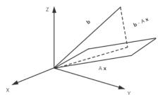

$$
\begin{array}{l} A \boldsymbol {x} = \boldsymbol {b} \\ A ^ {\top} A \boldsymbol {x} = A ^ {\top} \boldsymbol {b} \\ \boldsymbol {x} = \left(A ^ {\top} A\right) ^ {- 1} A ^ {\top} \boldsymbol {b} \\ \therefore A \boldsymbol {x} = A \left(A ^ {\top} A\right) ^ {- 1} A ^ {\top} \boldsymbol {b} \\ \therefore \boldsymbol {b} = A \boldsymbol {x} + (\boldsymbol {b} - A \boldsymbol {x}) \end{array}
$$

## 从投影的角度看线性方程组

给了一个向量 b，和一个平面（由 $\mathbf { \delta } _ { \mathbf { a } _ { 1 } }$ 和 $\mathbf { a } _ { 2 }$ 生成），要求 P，使 (Pb) 在平面内， $\mathsf { i . e . }$ $\pmb { b } = P \pmb { b } + ( - P \pmb { b } )$ ，且 $( P b ) ^ { \top } \cdot ( b - P b ) = 0$

如何求：从上张 Slide，b 就是上张的 b， $A = ( a _ { 1 } , a _ { 2 } )$ ，且： $A x = b$ 的最优解（误差最小解） $x ^ { * } = \left( A ^ { \top } A \right) ^ { - 1 } A ^ { \top } b$ , 而 $A x ^ { * }$ 就是 Pb· ∴ $A x ^ { * } = A \left( A ^ { \top } A \right) ^ { - 1 } A ^ { \top } b$ . 由 $A x ^ { * } = P b$ 得$P = A \left( A ^ { \top } A \right) ^ { - 1 } A ^ { \top }$

下面验证：

$$
(P b) ^ {\top} (b - P b) = 0
$$

验证：

$$
\begin{array}{r l r} (P b) ^ {\top} (b - P b) & = & (A x ^ {*}) ^ {\top} (b - A x ^ {*}) \\ & = & x ^ {* \top} A ^ {\top} b - x ^ {* \top} A ^ {\top} A x ^ {*} \\ & \frac {x ^ {*} = (A ^ {\top} A) ^ {- 1} A ^ {\top} b}{=} & x ^ {* \top} A ^ {\top} b - x ^ {* \top} A ^ {\top} A (A ^ {\top} A) ^ {- 1} A ^ {\top} b \\ & = & (x ^ {* \top} A ^ {\top}) b - (x ^ {* \top} A ^ {\top}) b = 0 \\ & = & (x ^ {* \top} A ^ {\top} - x ^ {* \top} A ^ {\top}) b = 0 \end{array}
$$

## 从投影的角度看线性方程组

给了一个向量 b，和一个平面（由 $\mathbf { \delta } _ { \mathbf { a } _ { 1 } }$ 和 $\mathbf { a } _ { 2 }$ 生成），要求 P，使 (Pb) 在平面内，i.e.,$\pmb { b } = P \pmb { b } + ( - P \pmb { b } )$ ，且 $( P b ) ^ { \top } \cdot ( b - P b ) = 0$

如何求：从上张 Slide，b 就是上张的 b， $A = ( a _ { 1 } , a _ { 2 } )$ ，且： $A x = b$ 的最优解（误差最小解） $x ^ { * } = \left( A ^ { \top } A \right) ^ { - 1 } A ^ { \top } b$ , 而 $A x ^ { * }$ 就是 $P b \cdot \therefore A { \mathbf { } x } ^ { * } = A \left( A ^ { \top } A \right) ^ { - 1 } A ^ { \top } b$ . 由 $A x ^ { * } = P b$ 得$P = A \left( A ^ { \top } A \right) ^ { - 1 } A ^ { \top }$

下面验证：

$$
(P b) ^ {\top} (b - P b) = 0
$$

验证：

$$
\begin{array}{r l r} (P b) ^ {\top} (b - P b) & = & (A x ^ {*}) ^ {\top} (b - A x ^ {*}) \\ & = & x ^ {* \top} A ^ {\top} b - x ^ {* \top} A ^ {\top} A x ^ {*} \\ & \underline {{\underline {{x ^ {*} = (A ^ {\top} A) ^ {- 1} A ^ {\top} b}}}} & x ^ {* \top} A ^ {\top} b - x ^ {* \top} A ^ {\top} A (A ^ {\top} A) ^ {- 1} A ^ {\top} b \\ & = & (x ^ {* \top} A ^ {\top}) b - (x ^ {* \top} A ^ {\top}) b = 0 \\ & = & (x ^ {* \top} A ^ {\top} - x ^ {* \top} A ^ {\top}) b = 0 \end{array}
$$

## 从投影的角度看线性方程组

给了一个向量 b，和一个平面（由 $\mathbf { \delta } _ { \mathbf { a } _ { 1 } }$ 和 $\mathbf { a } _ { 2 }$ 生成），要求 P，使 (Pb) 在平面内，i.e.,$\pmb { b } = P \pmb { b } + ( - P \pmb { b } )$ ，且 $( P b ) ^ { \top } \cdot ( b - P b ) = 0$

如何求：从上张 Slide，b 就是上张的 b， $A = ( a _ { 1 } , a _ { 2 } )$ ，且： $A x = b$ 的最优解（误差最小解） $x ^ { * } = \left( A ^ { \top } A \right) ^ { - 1 } A ^ { \top } b$ , 而 $A x ^ { * }$ 就是 $P b \cdot \therefore A { \mathbf { } x } ^ { * } = A \left( A ^ { \top } A \right) ^ { - 1 } A ^ { \top } b$ . 由 $A x ^ { * } = P b$ 得$P = A \left( A ^ { \top } A \right) ^ { - 1 } A ^ { \top }$

下面验证：

$$
(P \boldsymbol {b}) ^ {\top} (\boldsymbol {b} - P \boldsymbol {b}) = 0
$$

验证：

$$
\begin{array}{r l r} (P \boldsymbol {b}) ^ {\top} (\boldsymbol {b} - P \boldsymbol {b}) & = & (A \boldsymbol {x} ^ {*}) ^ {\top} (\boldsymbol {b} - A \boldsymbol {x} ^ {*}) \\ & = & \boldsymbol {x} ^ {* \top} A ^ {\top} \boldsymbol {b} - \boldsymbol {x} ^ {* \top} A ^ {\top} A \boldsymbol {x} ^ {*} \\ & \frac {x ^ {*} = (A ^ {\top} A) ^ {- 1} A ^ {\top} b}{=} & \boldsymbol {x} ^ {* \top} A ^ {\top} \boldsymbol {b} - \boldsymbol {x} ^ {* \top} A ^ {\top} A (A ^ {\top} A) ^ {- 1} A ^ {\top} \boldsymbol {b} \\ & = & (\boldsymbol {x} ^ {* \top} A ^ {\top}) \boldsymbol {b} - (\boldsymbol {x} ^ {* \top} A ^ {\top}) \boldsymbol {b} = 0 \\ & = & (\boldsymbol {x} ^ {* \top} A ^ {\top} - \boldsymbol {x} ^ {* \top} A ^ {\top}) \boldsymbol {b} = 0 \end{array}
$$

## 提问

1) 给定了一个矛盾的方程组

$$
x + y = 1
$$

$$
x - y = 1
$$

$$
x + 2 y = 3
$$

请给出最佳近似解. 所谓最佳近似解, 就是在 2-范数下 $\| A x - b \|$ 最小 (这个是个” 从烂苹果里挑”)

是不是非要 2-范数, 这道如 1-范数最小, 解是如何的?

到底 ∥Ax − b∥ 还是 ∥x∥ 的范数. 不同情况,

1）若 $A x - b = 0$ 有解, 则 $\| A x - b \| = 0$ , 则求 $\lVert x \rVert$

2）若无解, 就是 $| | A x - b | |$ 不为 0, 则求 $\operatorname* { m i n } \| A x - b \|$

提问

1) 给定了一个矛盾的方程组

$$
x + y = 1
$$

$$
x - y = 1
$$

$$
x + 2 y = 3
$$

请给出最佳近似解. 所谓最佳近似解, 就是在 2-范数下 $\| A x - b \|$ 最小 (这个是个” 从烂苹果里挑”)

是不是非要 2-范数, 这道如 1-范数最小, 解是如何的?

到底 $\| A x - b \|$ 还是 $\| \pmb { x } \|$ 的范数. 不同情况,

1）若 $A { \pmb x } - { \pmb b } = { \pmb 0 }$ 有解, 则 $\| A { \pmb x } - { \pmb b } \| = { \pmb 0 }$ , 则求 $\lVert \boldsymbol { x } \rVert$

2）若无解, 就是 $\| A x - b \|$ 不为 0, 则求 $\operatorname* { m i n } \| A \pmb { x } - \pmb { b } \|$

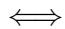

## 引伸：如何判断线性方程组是否有解？

Ax = b 有解

$$
\operatorname{rank} A = \operatorname{rank} [ A, \boldsymbol {b} ]
$$

提问（多个解中选优）

1 2 3 [x1 6 4 5 6 x2 二 15 的解集x= 1. 8 9 x3 24

问: [1,1,1]′ 是不是某种意义下的最优解? (如要证明是 2-范数下的最优解, 需要证明任何一个解 2- 范数均 &gt;= (1 1 1) 的 2-范数)

[0 3 0] 是 0-范数下的最优解

## 2.4 Inner Products and Norms

For $\ b { x } , \ b { y } \in \mathbb { R } ^ { n }$ , we define the Euclidean inner product by

$$
\langle \boldsymbol {x}, \boldsymbol {y} \rangle = \sum_ {i = 1} ^ {n} x _ {i} y _ {i} = \boldsymbol {x} ^ {\top} \boldsymbol {y}.
$$

## 内积具有以下性质:

1. Positivity: $\langle { \pmb x } , { \pmb x } \rangle &gt; 0 , \langle { \pmb x } , { \pmb x } \rangle = 0$ if $\scriptstyle { \boldsymbol { x } } = 0$

2. Symmetry: $\langle { \pmb x } , { \pmb y } \rangle = \langle { \pmb y } , { \pmb x } \rangle$

3. Additivity: $\langle { \pmb x } + { \pmb y } , { \pmb z } \rangle = \langle { \pmb x } , { \pmb z } \rangle + \langle { \pmb y } , { \pmb z } \rangle$

4. Homogeneity (齐性): $\langle r { \pmb x } , { \pmb y } \rangle = r \langle { \pmb x } , { \pmb y } \rangle$ for every $r \in \mathbb { R }$

The properties of additivity and homogeneity in the second vector also hold;

$$
\langle \boldsymbol {x}, \boldsymbol {y} + \boldsymbol {z} \rangle = \langle \boldsymbol {x}, \boldsymbol {y} \rangle + \langle \boldsymbol {x}, \boldsymbol {z} \rangle ,
$$

$\langle { \pmb x } , r { \pmb y } \rangle = r \langle { \pmb x } , { \pmb y } \rangle$ for every $r \in \mathbb { R } .$

## 2.4 Inner Products and Norms

The vectors x and y are said to be orthogonal if $\langle { \pmb x } , { \pmb y } \rangle = 0$

The Euclidean norm of a vector x is defined as

$$
\| \boldsymbol {x} \| = \sqrt {\langle \boldsymbol {x} , \boldsymbol {x} \rangle} = \sqrt {\boldsymbol {x} ^ {\top} \boldsymbol {x}}
$$

Theorem 2.3 Cauchy-Schwarz Inequality. For any two vectors x and y in R&lt;sup&gt;n&lt;/sup&gt;, the Cauchy Schwarz inequality

$$
| \langle x, y \rangle | \leq \| x \| \cdot \| y \|
$$

holds. Furthermore, equality holds if $x = \alpha y$ for some $\alpha \in \mathbb { Z }$

Proof. First assume that x and y are unit vectors; that is, $\| x \| = \| y \| = 1$ . Then,

$$
\begin{array}{r c l} 0 \leq \| x - y \| ^ {2} & = & \langle x - y, x - y \rangle \\ & = & \| x \| ^ {2} - 2 \langle x, y \rangle + \| y \| ^ {2} \\ & = & 2 - 2 \langle x, y \rangle \end{array}
$$

or

$$
\langle x, y \rangle \leq 1,
$$

## 2.4 Inner Products and Norms

The vectors x and $\textbf {  { y } }$ are said to be orthogonal if $\langle { \pmb x } , { \pmb y } \rangle = 0$

The Euclidean norm of a vector x is defined as

$$
\| \boldsymbol {x} \| = \sqrt {\langle \boldsymbol {x} , \boldsymbol {x} \rangle} = \sqrt {\boldsymbol {x} ^ {\top} \boldsymbol {x}}
$$

Theorem 2.3 Cauchy-Schwarz Inequality. For any two vectors x and $_ { \pmb { y } }$ in $\mathbb { R } ^ { n }$ , the Cauchy Schwarz inequality

$$
| \langle \boldsymbol {x}, \boldsymbol {y} \rangle | \leq \| \boldsymbol {x} \| \cdot \| \boldsymbol {y} \|
$$

holds. Furthermore, equality holds if $\mathbf { \boldsymbol { x } } = \alpha \mathbf { \boldsymbol { y } }$ for some $\alpha \in \mathbb { R }$

Proof. First assume that x and y are unit vectors; that is, $\| { \pmb x } \| = \| { \pmb y } \| = 1$ . Then,

$$
\begin{array}{r c l} 0 \leq \| \boldsymbol {x} - \boldsymbol {y} \| ^ {2} & = & \langle \boldsymbol {x} - \boldsymbol {y}, \boldsymbol {x} - \boldsymbol {y} \rangle \\ & = & \| \boldsymbol {x} \| ^ {2} - 2 \langle \boldsymbol {x}, \boldsymbol {y} \rangle + \| \boldsymbol {y} \| ^ {2} \\ & = & 2 - 2 \langle \boldsymbol {x}, \boldsymbol {y} \rangle \end{array}
$$

or

$$
\langle \boldsymbol {x}, \boldsymbol {y} \rangle \leq 1,
$$

等号成立当且仅当 ${ \mathbf { \mathscr { x } } } = { \mathbf { \mathscr { y } } }$

## 2.4 Inner Products and Norms

Next, assuming that neither x nor $\textbf {  { y } }$ is zero (for the inequality obviously holds if one of them is zero), we replace x and $\textbf {  { y } }$ by the unit vectors ${ \boldsymbol { x } } / | | { \boldsymbol { x } } | |$ and ${ \pmb y } / | | { \pmb y } | |$ . Then

$$
\langle \boldsymbol {x}, \boldsymbol {y} \rangle \leq \| \boldsymbol {x} \| \cdot \| \boldsymbol {y} \|.
$$

Replacing x ${ \mathrm { b y } } - { \pmb x } $ , we have

$$
- \langle \boldsymbol {x}, \boldsymbol {y} \rangle \leq \| \boldsymbol {x} \| \cdot \| \boldsymbol {y} \|.
$$

所以,

$$
| \langle \boldsymbol {x}, \boldsymbol {y} \rangle | \leq \| \boldsymbol {x} \| \cdot \| \boldsymbol {y} \|
$$

等号成立当且仅当 $\pmb { x } / \| \pmb { x } \| = \pmb { y } / \| \pmb { y } \|$ ; that is, $\mathbf { \boldsymbol { x } } = \alpha \mathbf { \boldsymbol { y } }$ for some $\alpha \in \mathbb { R }$

## 2.4 Inner Products and Norms

The Euclidean norm of a vector $\| \pmb { x } \|$ has the following properties:

1. Positivity: $\| { \pmb x } \| &gt; 0 , \| { \pmb x } \| = { \bf 0 }$ if x = 0.

2. Homogeneity: $\| r \pmb { x } \| = | r | \cdot \| \pmb { x } \| , r \in \mathbb { R } .$

3. Triangle inequality: $\| { \pmb x } + { \pmb y } \| \leq \| { \pmb x } \| + \| { \pmb y } \|$

三角不等式可用 Cauchy-Schwarz 不等式证明:

$$
\begin{array}{r c l} \| x + y \| ^ {2} & \stackrel {{d e f}} {{=}} & \| x \| ^ {2} + 2 \langle x, y \rangle + \| y \| ^ {2} \\ & \stackrel {{C - S}} {{\leq}} & \| x \| ^ {2} + 2 \| x \| \| y \| + \| y \| ^ {2} \\ & = & (\| x \| + \| y \|) ^ {2} \end{array}
$$

## 2.4 Inner Products and Norms

The Euclidean norm of a vector $\| \pmb { x } \|$ has the following properties:

1. Positivity: $\| { \pmb x } \| &gt; 0 , \| { \pmb x } \| = { \bf 0 }$ if x = 0.

2. Homogeneity: $\| r \pmb { x } \| = | r | \cdot \| \pmb { x } \| , r \in \mathbb { R }$

3. Triangle inequality: $\| { \pmb x } + { \pmb y } \| \leq \| { \pmb x } \| + \| { \pmb y } \|$

三角不等式可用 Cauchy-Schwarz 不等式证明:

$$
\begin{array}{r c l} \| \boldsymbol {x} + \boldsymbol {y} \| ^ {2} & \stackrel {{d e f}} {{=}} & \| \boldsymbol {x} \| ^ {2} + 2 \langle \boldsymbol {x}, \boldsymbol {y} \rangle + \| \boldsymbol {y} \| ^ {2} \\ & \overset {C - S} {\leq} & \| \boldsymbol {x} \| ^ {2} + 2 \| \boldsymbol {x} \| \| \boldsymbol {y} \| + \| \boldsymbol {y} \| ^ {2} \\ & = & (\| \boldsymbol {x} \| + \| \boldsymbol {y} \|) ^ {2} \end{array}
$$

## 2.4 Inner Products and Norms

The Euclidean norm of a vector $\| \pmb { x } \|$ has the following properties:

1. Positivity: $\| { \pmb x } \| &gt; 0 , \| { \pmb x } \| = { \bf 0 }$ if x = 0.

2. Homogeneity: $\| r \pmb { x } \| = | r | \cdot \| \pmb { x } \| , r \in \mathbb { R }$

3. Triangle inequality: $\| { \pmb x } + { \pmb y } \| \leq \| { \pmb x } \| + \| { \pmb y } \|$

三角不等式可用 Cauchy-Schwarz 不等式证明:

$$
\begin{array}{r c l} \| \boldsymbol {x} + \boldsymbol {y} \| ^ {2} & \stackrel {{d e f}} {{=}} & \| \boldsymbol {x} \| ^ {2} + 2 \langle \boldsymbol {x}, \boldsymbol {y} \rangle + \| \boldsymbol {y} \| ^ {2} \\ & \overset {C - S} {\leq} & \| \boldsymbol {x} \| ^ {2} + 2 \| \boldsymbol {x} \| \| \boldsymbol {y} \| + \| \boldsymbol {y} \| ^ {2} \\ & = & (\| \boldsymbol {x} \| + \| \boldsymbol {y} \|) ^ {2} \end{array}
$$

## 2.4 Inner Products and Norms

p-norm

刚才的 Euclidean norm 是以下形式的 norm 取 $p = 2$ 的情形

$$
\| \boldsymbol {x} \| _ {p} = \left\{ \begin{array}{l l} (| x _ {1} | ^ {p} + \dots + | x _ {n} | ^ {p}) ^ {1 / p} & \text {if} 1 \leq p <   \infty \\ \max \{| x _ {1} |, \ldots , | x _ {n} | \} & \text {if} p = \infty \end{array} \right.
$$

## 2.4 Inner Products and Norms

p-norm

刚才的 Euclidean norm 是以下形式的 norm 取 $p = 2$ 的情形

$$
\| \boldsymbol {x} \| _ {p} = \left\{ \begin{array}{l l} (| x _ {1} | ^ {p} + \dots + | x _ {n} | ^ {p}) ^ {1 / p} & \text { if } 1 \leq p <   \infty \\ \max \{| x _ {1} |, \ldots , | x _ {n} | \} & \text { if } p = \infty \end{array} \right.
$$

## 内积和范数的小结

内积和范数的一些公式和性质. 推广: 柯西-施瓦茨不等式（Cauchy-Schwarz）推出的两边之和大于第三边和勾股定理

关于欧氏范数，范数取 $p = 2$ 情况下的一些定义，范数也可以描述连续函数，还可以运用让 $\| x - x ^ { * } \|$ 取最小，即最接近解, 进而得出最优解

根据线性方程组求最优解，都需要用到内积和范式，运用性质得出最优解，其目的是让我们知道解方程组不是仅仅得出无解就可以了，而是让我们理解优化的过程，往最优的方向努力。

应用

Jacobi 法

例子

$$
A \boldsymbol {x} = \boldsymbol {b},
$$

其中 A 是方阵，

$$
A = \left( \begin{array}{c c c} 1 0 & - 1 & 2 \\ - 1 & 1 1 & - 1 \\ 2 & - 1 & 1 0 \end{array} \right), \quad \boldsymbol {x} = \left( \begin{array}{c} x \\ y \\ z \end{array} \right), \quad \boldsymbol {b} = \left( \begin{array}{c} 6 \\ 2 5 \\ - 1 1 \end{array} \right).
$$

直接求解可以用高斯消元或矩阵分解，但当维度很大、矩阵稀疏时，迭代法（如 Jacobi）往往更合适。

## Jacobi 迭代的基本思想

将每一行方程写成：

$$
a _ {i i} x _ {i} = b _ {i} - \sum_ {j \neq i} a _ {i j} x _ {j},
$$

从而得到

$$
x _ {i} = \frac {1}{a _ {i i}} \left(b _ {i} - \sum_ {j \neq i} a _ {i j} x _ {j}\right).
$$

Jacobi 迭代的核心：

第 k +1 次迭代中，用第 k 次迭代的旧值更新所有分量；

所有分量在同一轮迭代中“同时”更新（不立刻使用新值）；

在矩阵形式上可写成

$$
\boldsymbol {x} ^ {(k + 1)} = D ^ {- 1} \big (\boldsymbol {b} - (L + U) \boldsymbol {x} ^ {(k)} \big),
$$

其中 $A = D + L + U$ ，D 为对角部分。

## Jacobi 迭代的基本思想

将每一行方程写成：

$$
a _ {i i} x _ {i} = b _ {i} - \sum_ {j \neq i} a _ {i j} x _ {j},
$$

从而得到

$$
x _ {i} = \frac {1}{a _ {i i}} \left(b _ {i} - \sum_ {j \neq i} a _ {i j} x _ {j}\right).
$$

Jacobi 迭代的核心：

第 k +1 次迭代中，用第 k 次迭代的旧值更新所有分量；

所有分量在同一轮迭代中“同时”更新（不立刻使用新值）；

在矩阵形式上可写成

$$
\boldsymbol {x} ^ {(k + 1)} = D ^ {- 1} \big (\boldsymbol {b} - (L + U) \boldsymbol {x} ^ {(k)} \big),
$$

其中 $A = D + L + U$ ，D 为对角部分。

## 对具体方程组写出迭代公式

$$
\left\{ \begin{array}{l} 1 0 x - y + 2 z = 6, \\ - x + 1 1 y - z = 2 5, \\ 2 x - y + 1 0 z = - 1 1. \end{array} \right.
$$

将每个变量解出来：

$$
\begin{array}{l} x = \frac {1}{1 0} (6 + y - 2 z), \\ y = \frac {1}{1 1} (2 5 + x + z), \\ z = \frac {1}{1 0} (- 1 1 - 2 x + y). \end{array}
$$

在第 k +1 次迭代中，用第 k 次迭代值：

$$
\left\{ \begin{array}{l} x ^ {(k + 1)} = \frac {1}{1 0} \Big (6 + y ^ {(k)} - 2 z ^ {(k)} \Big), \\ y ^ {(k + 1)} = \frac {1}{1 1} \Big (2 5 + x ^ {(k)} + z ^ {(k)} \Big), \\ z ^ {(k + 1)} = \frac {1}{1 0} \Big (- 1 1 - 2 x ^ {(k)} + y ^ {(k)} \Big). \end{array} \right.
$$

## 对具体方程组写出迭代公式

$$
\left\{ \begin{array}{l} 1 0 x - y + 2 z = 6, \\ - x + 1 1 y - z = 2 5, \\ 2 x - y + 1 0 z = - 1 1. \end{array} \right.
$$

将每个变量解出来：

$$
x = \frac {1}{1 0} (6 + y - 2 z),
$$

$$
y = \frac {1}{1 1} (2 5 + x + z),
$$

$$
z = \frac {1}{1 0} (- 1 1 - 2 x + y).
$$

在第 k +1 次迭代中，用第 k 次迭代值：

$$
\left\{ \begin{array}{l} x ^ {(k + 1)} = \frac {1}{1 0} \Big (6 + y ^ {(k)} - 2 z ^ {(k)} \Big), \\ y ^ {(k + 1)} = \frac {1}{1 1} \Big (2 5 + x ^ {(k)} + z ^ {(k)} \Big), \\ z ^ {(k + 1)} = \frac {1}{1 0} \Big (- 1 1 - 2 x ^ {(k)} + y ^ {(k)} \Big). \end{array} \right.
$$

## 对具体方程组写出迭代公式

$$
\left\{ \begin{array}{l} 1 0 x - y + 2 z = 6, \\ - x + 1 1 y - z = 2 5, \\ 2 x - y + 1 0 z = - 1 1. \end{array} \right.
$$

将每个变量解出来：

$$
\begin{array}{l} x = \frac {1}{1 0} (6 + y - 2 z), \\ y = \frac {1}{1 1} (2 5 + x + z), \\ z = \frac {1}{1 0} (- 1 1 - 2 x + y). \end{array}
$$

在第 k +1 次迭代中，用第 k 次迭代值：

$$
\left\{ \begin{array}{l} x ^ {(k + 1)} = \frac {1}{1 0} \Big (6 + y ^ {(k)} - 2 z ^ {(k)} \Big), \\ y ^ {(k + 1)} = \frac {1}{1 1} \Big (2 5 + x ^ {(k)} + z ^ {(k)} \Big), \\ z ^ {(k + 1)} = \frac {1}{1 0} \Big (- 1 1 - 2 x ^ {(k)} + y ^ {(k)} \Big). \end{array} \right.
$$

## 初始值与第一次迭代

取初始向量

第一次迭代：

因此

$$
\boldsymbol {x} ^ {(0)} = (x ^ {(0)}, y ^ {(0)}, z ^ {(0)}) ^ {\mathsf {T}} = (0, 0, 0) ^ {\mathsf {T}}.
$$

$$
x ^ {(1)} = \frac {1}{1 0} (6 + 0 - 2 \cdot 0) = 0. 6,
$$

$$
y ^ {(1)} = \frac {1}{1 1} (2 5 + 0 + 0) \approx 2. 2 7 2 7,
$$

$$
z ^ {(1)} = \frac {1}{1 0} (- 1 1 - 2 \cdot 0 + 0) = - 1. 1.
$$

$$
\boldsymbol {x} ^ {(1)} \approx (0. 6, 2. 2 7 2 7, - 1. 1) ^ {\top}.
$$

## 初始值与第一次迭代

取初始向量

第一次迭代：

因此

$$
\boldsymbol {x} ^ {(0)} = (x ^ {(0)}, y ^ {(0)}, z ^ {(0)}) ^ {\mathsf {T}} = (0, 0, 0) ^ {\mathsf {T}}.
$$

$$
x ^ {(1)} = \frac {1}{1 0} (6 + 0 - 2 \cdot 0) = 0. 6,
$$

$$
y ^ {(1)} = \frac {1}{1 1} (2 5 + 0 + 0) \approx 2. 2 7 2 7,
$$

$$
z ^ {(1)} = \frac {1}{1 0} (- 1 1 - 2 \cdot 0 + 0) = - 1. 1.
$$

$$
\boldsymbol {x} ^ {(1)} \approx (0. 6, 2. 2 7 2 7, - 1. 1) ^ {\top}.
$$

## 初始值与第一次迭代

取初始向量

第一次迭代：

因此

$$
\boldsymbol {x} ^ {(0)} = (x ^ {(0)}, y ^ {(0)}, z ^ {(0)}) ^ {\mathsf {T}} = (0, 0, 0) ^ {\mathsf {T}}.
$$

$$
x ^ {(1)} = \frac {1}{1 0} (6 + 0 - 2 \cdot 0) = 0. 6,
$$

$$
y ^ {(1)} = \frac {1}{1 1} (2 5 + 0 + 0) \approx 2. 2 7 2 7,
$$

$$
z ^ {(1)} = \frac {1}{1 0} (- 1 1 - 2 \cdot 0 + 0) = - 1. 1.
$$

$$
\boldsymbol {x} ^ {(1)} \approx (0. 6, 2. 2 7 2 7, - 1. 1) ^ {\mathsf {T}}.
$$

## 第二次与第三次迭代

用 $\pmb { x } ^ { ( 1 ) }$ 继续迭代：

$$
x ^ {(2)} = \frac {1}{1 0} \Big (6 + y ^ {(1)} - 2 z ^ {(1)} \Big) \approx 1. 0 4 7 3,
$$

$$
y ^ {(2)} = \frac {1}{1 1} \Big (2 5 + x ^ {(1)} + z ^ {(1)} \Big) \approx 2. 2 2 7 3,
$$

$$
z ^ {(2)} = \frac {1}{1 0} \left(- 1 1 - 2 x ^ {(1)} + y ^ {(1)}\right) \approx - 0. 9 9 2 7.
$$

$$
\boldsymbol {x} ^ {(2)} \approx (1. 0 4 7 3, 2. 2 2 7 3, - 0. 9 9 2 7) ^ {\mathsf {T}}.
$$

再迭代一次（略计算过程）可得

$$
\boldsymbol {x} ^ {(3)} \approx (1. 0 2 1 3, 2. 2 7 7 7, - 1. 0 8 6 7) ^ {\top}.
$$

可以看到，迭代向量逐渐收敛到精确解附近。

## 第二次与第三次迭代

用 $\pmb { x } ^ { ( 1 ) }$ 继续迭代：

$$
x ^ {(2)} = \frac {1}{1 0} \Big (6 + y ^ {(1)} - 2 z ^ {(1)} \Big) \approx 1. 0 4 7 3,
$$

$$
y ^ {(2)} = \frac {1}{1 1} \Big (2 5 + x ^ {(1)} + z ^ {(1)} \Big) \approx 2. 2 2 7 3,
$$

$$
z ^ {(2)} = \frac {1}{1 0} \left(- 1 1 - 2 x ^ {(1)} + y ^ {(1)}\right) \approx - 0. 9 9 2 7.
$$

$$
\boldsymbol {x} ^ {(2)} \approx (1. 0 4 7 3, 2. 2 2 7 3, - 0. 9 9 2 7) ^ {\mathsf {T}}.
$$

再迭代一次（略计算过程）可得

$$
\boldsymbol {x} ^ {(3)} \approx (1. 0 2 1 3, 2. 2 7 7 7, - 1. 0 8 6 7) ^ {\mathsf {T}}.
$$

可以看到，迭代向量逐渐收敛到精确解附近。

## Jacobi 迭代小结

Jacobi 迭代是一种求解 Ax = b 的经典迭代方法；

每次迭代使用上一轮的全部分量来更新新解；

对角占优矩阵上往往可以证明收敛；

## 这个简单例子展示了：

如何从方程组推出 Jacobi 迭代公式；

如何从初值出发, 逐步逼近线性方程组的解。

## Jacobi 方法失效的例子

$$
\left( \begin{array}{c c} {1} & {2} \\ {3} & {4} \end{array} \right) \binom{{x}}{{y}} = \binom{{5}}{{6}}. \quad \text {解} \quad \pmb {x} = \binom{{- 4}}{{4. 5}}
$$

该矩阵既不是对角占优，也不是严格行对角占优：

$$
| 1 | <   | 2 |,
$$

Jacobi 迭代格式为

$$
\left\{ \begin{array}{l} x ^ {(k + 1)} = 5 - 2 y ^ {(k)}, \\ y ^ {(k + 1)} = \frac {6 - 3 x ^ {(k)}}{4}. \end{array} \right. \quad \text {i.e.,} \quad \boldsymbol {x} ^ {(k + 1)} = B   \boldsymbol {x} ^ {(k)} + \boldsymbol {c}, \qquad B = \left( \begin{array}{c c} 0 & - 2 \\ - \frac {3}{4} & 0 \end{array} \right).
$$

计算谱半径（最大特征值）：

$$
\rho (B) = \sqrt {1 . 5} > 1.
$$

因为 $\rho ( B ) &gt; 1$ ，Jacobi 必然发散。（原因下页）

取初始值 $( x ^ { ( 0 ) } , y ^ { ( 0 ) } ) = ( 0 , 0 )$ )，前几步迭代为：

$$
(0, 0) \rightarrow (5, 1. 5) \rightarrow (2, 0. 3 7 5) \rightarrow (4. 2 5, 0. 1 8 7 5) \rightarrow (4. 6 2 5, - 0. 5 9 3 7 5) \rightarrow \dots
$$

可以看到，序列不收敛且逐渐震荡，说明 方法在此例中完全失效。

## Jacobi 方法收敛条件的几何解释

$$
\boldsymbol {x} ^ {(k + 1)} = B \boldsymbol {x} ^ {(k)} + \boldsymbol {c}, \quad B = - D ^ {- 1} (L + U).
$$

若真实解满足 $\pmb { x } ^ { * } = { \cal B } \pmb { x } ^ { * } + \pmb { c } ,$ 则误差满足：

$$
\boldsymbol {e} ^ {(k + 1)} = \boldsymbol {x} ^ {(k + 1)} - \boldsymbol {x} ^ {*} = B \boldsymbol {e} ^ {(k)}.
$$

Jacobi 是否收敛，完全取决于误差的迭代：

$$
\pmb {e} ^ {(k)} = B ^ {k} \pmb {e} ^ {(0)}.
$$

几何解释：

矩阵 B 会把误差向量 $e ^ { ( k ) }$ 线性映射到新方向；

其特征值 λ 决定了沿特征方向的“伸缩比例”；

如果对某个特征方向有 $\vert \lambda \vert &gt; 1 ,$ ，误差会被“放大”；

若所有特征值满足 $| \lambda | &lt; 1$ ，误差在每方向都被“压缩”；

因此：

$$
\rho (B) = \max | \lambda_ {i} | <   1 \quad \Longleftrightarrow \quad \| B ^ {k} \| \to 0 \quad \Longleftrightarrow \quad e ^ {(k)} \to 0.
$$

## 几何意义总结：

Jacobi 方法可以视为不断把误差向量压向原点的线性变换。当且仅当 在所有特征方向上都是“收缩映射”（即 $\rho ( B ) &lt; 1 )$ 时，误差趋于零，迭代收敛。若存在方向被拉长 $( | \lambda | &gt; 1 )$ 误差会被放大，迭代发散。

## Jacobi 方法收敛条件的几何解释

$$
\boldsymbol {x} ^ {(k + 1)} = B \boldsymbol {x} ^ {(k)} + \boldsymbol {c}, \quad B = - D ^ {- 1} (L + U).
$$

若真实解满足 $\pmb { x } ^ { * } = \pmb { B } \pmb { x } ^ { * } + \pmb { c } ,$ ，则误差满足：

$$
\boldsymbol {e} ^ {(k + 1)} = \boldsymbol {x} ^ {(k + 1)} - \boldsymbol {x} ^ {*} = B \boldsymbol {e} ^ {(k)}.
$$

Jacobi 是否收敛，完全取决于误差的迭代：

$$
\pmb {e} ^ {(k)} = B ^ {k} \pmb {e} ^ {(0)}.
$$

## 几何解释：

矩阵 B 会把误差向量 $e ^ { ( k ) }$ 线性映射到新方向；

其特征值 λ 决定了沿特征方向的“伸缩比例”；

如果对某个特征方向有 $| \lambda | &gt; 1$ ，误差会被“放大”；

若所有特征值满足 $| \lambda | &lt; 1$ ，误差在每方向都被“压缩”；

因此：

$$
\rho (B) = \max | \lambda_ {i} | <   1 \quad \Longleftrightarrow \quad \| B ^ {k} \| \to 0 \quad \Longleftrightarrow \quad e ^ {(k)} \to \mathbf {0}.
$$

## 几何意义总结：

Jacobi 方法可以视为不断把误差向量压向原点的线性变换。当且仅当 在所有特征方向上都是“收缩映射”（即 $\rho ( B ) &lt; 1 )$ 时，误差趋于零，迭代收敛。若存在方向被拉长 $( | \lambda | &gt; 1 )$ 误差会被放大，迭代发散。

## Jacobi 方法收敛条件的几何解释

$$
\boldsymbol {x} ^ {(k + 1)} = B \boldsymbol {x} ^ {(k)} + \boldsymbol {c}, \quad B = - D ^ {- 1} (L + U).
$$

若真实解满足 $\pmb { x } ^ { * } = \pmb { B } \pmb { x } ^ { * } + \pmb { c } ,$ ，则误差满足：

$$
\boldsymbol {e} ^ {(k + 1)} = \boldsymbol {x} ^ {(k + 1)} - \boldsymbol {x} ^ {*} = B \boldsymbol {e} ^ {(k)}.
$$

Jacobi 是否收敛，完全取决于误差的迭代：

$$
\boldsymbol {e} ^ {(k)} = B ^ {k} \boldsymbol {e} ^ {(0)}.
$$

## 几何解释：

矩阵 B 会把误差向量 $e ^ { ( k ) }$ 线性映射到新方向；

其特征值 λ 决定了沿特征方向的“伸缩比例”；

如果对某个特征方向有 $| \lambda | &gt; 1$ ，误差会被“放大”；

若所有特征值满足 $| \lambda | &lt; 1$ ，误差在每方向都被“压缩”；

因此：

$$
\rho (B) = \max | \lambda_ {i} | <   1 \quad \Longleftrightarrow \quad \| B ^ {k} \| \to 0 \quad \Longleftrightarrow \quad e ^ {(k)} \to \mathbf {0}.
$$

## 几何意义总结：

Jacobi 方法可以视为不断把误差向量压向原点的线性变换。当且仅当 在所有特征方向上都是“收缩映射”（即 $\rho ( B ) &lt; 1 )$ 时，误差趋于零，迭代收敛。若存在方向被拉长 $( | \lambda | &gt; 1 )$ ），误差会被放大，迭代发散。

写一个函数，输入 A 的 $n ^ { 2 }$ 个元素和 b,

1) 判断是否可用 Jacobi 法

2）若可用 Jacobi 法，给出迭代过程和最终解

## Gauss–Seidel 方法的基本思想

Gauss–Seidel 方法是求解线性方程组 Ax = b 的经典迭代算法，其核心思想是：在第 k +1步中，立即使用已经更新的新分量。

给定分解 A = D +L+U（D 为对角，L 为严格下三角，U 为严格上三角），Gauss–Seidel迭代写成：

$$
\boldsymbol {x} ^ {(k + 1)} = - (D + L) ^ {- 1} U \boldsymbol {x} ^ {(k)} + (D + L) ^ {- 1} \boldsymbol {b}.
$$

## 与 Jacobi 的主要区别：

Jacobi：所有分量在每一轮中同步使用旧值；

Gauss–Seidel：每更新一个分量，就立刻用于下一个分量的计算；

通常比 Jacobi 收敛更快。

## Gauss–Seidel 的分量迭代公式

对于线性方程组 $A { \boldsymbol { \mathbf { \mathit { x } } } } = \mathbf { \boldsymbol { \mathbf { b } } }$ ，其中 $A = [ a _ { i j } ] _ { n \times n }$ ，Gauss–Seidel 的第 k + 1 次迭代为：

$$
x _ {i} ^ {(k + 1)} = \frac {1}{a _ {i i}} \left(b _ {i} - \sum_ {j <   i} a _ {i j} x _ {j} ^ {(k + 1)} - \sum_ {j > i} a _ {i j} x _ {j} ^ {(k)}\right).
$$

特点：

使用 $j &lt; i$ 的新值 $x _ { j } ^ { ( k + 1 ) }$

使用 $j &gt; i$ 的旧值 $x _ { j } ^ { ( k ) }$

即“从左往右扫一遍，每更新一个就立刻用上”。

因此 Gauss–Seidel 也称为 前向替代（forward substitution）的迭代形式。

Jacobi：同步更新

$$
\boldsymbol {x} ^ {(k + 1)} = D ^ {- 1} (\boldsymbol {b} - (L + U) \boldsymbol {x} ^ {(k)})
$$

每一轮所有分量都用旧值；

需要存两份向量；

收敛速度较慢。

## Gauss–Seidel：逐点更新

$$
\boldsymbol {x} ^ {(k + 1)} = - (D + L) ^ {- 1} U \boldsymbol {x} ^ {(k)} + (D + L) ^ {- 1} \boldsymbol {b}
$$

新值立即更新并使用；

内存更高效；

通常收敛更快，尤其是稀疏矩阵。

$$
\left( \begin{array}{c c} 1 & - 1 \\ 0 & 1 \end{array} \right) \binom{x _ {1}}{x _ {2}} = \binom{2}{3}
$$

Ch. 3. Transformations
3.1 Linear Transformations
3.2 Eigenvalues and Eigenvectors
3.3 Orthogonal Projections
3.4 Quadratic Forms
3.5 Matrix Norms
Exercises
34 / 89

## 3.1 Linear Transformations

A function $\mathcal { L } : \mathbb { R } ^ { n }  \mathbb { R } ^ { m }$ is called a linear transformation if:

1. ${ \mathcal { L } } ( a \mathbf { x } ) = a { \mathcal { L } } ( \mathbf { x } )$ for every $\mathbf { \boldsymbol { x } } \in \mathbb { R } ^ { n }$ and $a \in \mathbb { R }$

2. ${ \mathcal { L } } ( \mathbf { \boldsymbol { x } } _ { 1 } + \mathbf { \boldsymbol { x } } _ { 2 } ) = { \mathcal { L } } ( \mathbf { \boldsymbol { x } } _ { 1 } ) + { \mathcal { L } } ( \mathbf { \boldsymbol { x } } _ { 2 } ) { \mathrm { ~ f o r ~ } } \mathbf { \boldsymbol { x } } _ { 1 } , \mathbf { \boldsymbol { x } } _ { 2 } \in \mathbb { R } ^ { n } .$

If we fix the bases for R&lt;sup&gt;n&lt;/sup&gt; and R&lt;sup&gt;m&lt;/sup&gt;, then the linear transformation L can be represented by a matrix.

Suppose that $x \in \mathbb { R } ^ { n }$ is a given vector, and x′ is the representation of x with respect to the given basis for $\mathbb { R } ^ { n }$ . If $y = \mathcal { L } ( x )$ , and $y ^ { \prime }$ is the representation of y with respect to the given basis for $\mathbb { R } ^ { m }$ . If there exists $A \in \mathbb { R } ^ { m \times n }$ such that the following representation holds, then

$$
y ^ {\prime} = A x ^ {\prime}.
$$

We call A the matrix representation of L with respect to the given bases for $\mathbb { R } ^ { n }$ and $\mathbb { R } ^ { m }$ . In the special case where we assume the natural bases for $\mathbb { R } ^ { n }$ and $\mathbb { R } ^ { m }$ , the matrix representation A satisfies

$$
\mathcal {L} (x) = A x.
$$

## 3.1 Linear Transformations

A function $\mathcal { L } : \mathbb { R } ^ { n }  \mathbb { R } ^ { m }$ is called a linear transformation if:

1. ${ \mathcal { L } } ( a \mathbf { x } ) = a { \mathcal { L } } ( \mathbf { x } )$ for every $\mathbf { \boldsymbol { x } } \in \mathbb { R } ^ { n }$ and $a \in \mathbb { R }$

2. $\begin{array} { r } { \mathscr { L } ( \pmb { x } _ { 1 } + \pmb { x } _ { 2 } ) = \mathscr { L } ( \pmb { x } _ { 1 } ) + \mathscr { L } ( \pmb { x } _ { 2 } ) \mathrm { ~ f o r ~ } \pmb { x } _ { 1 } , \pmb { x } _ { 2 } \in \mathbb { R } ^ { n } . } \end{array}$

If we fix the bases for $\mathbb { R } ^ { n }$ and $\mathbb { R } ^ { m }$ , then the linear transformation $\mathcal { L }$ can be represented by a matrix.

Suppose that $\mathbf { x } \in \mathbb { R } ^ { n }$ is a given vector, and $\mathbf { x } ^ { \prime }$ is the representation of x with respect to the given basis for $\mathbb { R } ^ { n }$ . If $\begin{array} { r } { \pmb { y } = \pmb { \mathcal { L } } ( \pmb { x } ) } \end{array}$ , and $\boldsymbol { y } ^ { \prime }$ is the representation of $_ { \textit { \textbf { y } } }$ with respect to the given basis for $\mathbb { R } ^ { m }$ . If there exists $A \in \mathbb { R } ^ { m \times n }$ such that the following representation holds, then

$$
\boldsymbol {y} ^ {\prime} = A \boldsymbol {x} ^ {\prime}.
$$

We call A the matrix representation of $\mathcal { L }$ with respect to the given bases for $\mathbb { R } ^ { n }$ and $\mathbb { R } ^ { m }$ . In the special case where we assume the natural bases for $\mathbb { R } ^ { n }$ and $\mathbb { R } ^ { m }$ , the matrix representation satisfies

$$
\mathcal {L} (\boldsymbol {x}) = A \boldsymbol {x}.
$$

## 3.1 Linear Transformation

这本书上用以下记号 (同华师大大一线性代数教科书不同)

Let $\{ e _ { 1 } , e _ { 2 } , . . . , e _ { n } \}$ and $\{ e _ { 1 } ^ { \prime } , e _ { 2 } ^ { \prime } , . . . , e _ { n } ^ { \prime } \}$ be two bases for $\mathbb { R } ^ { n }$ . Define the matrix

$$
T = [ \pmb {e} _ {1} ^ {\prime}, \pmb {e} _ {2} ^ {\prime}, \dots , \pmb {e} _ {n} ^ {\prime} ] ^ {- 1} [ \pmb {e} _ {1}, \pmb {e} _ {2}, \dots , \pmb {e} _ {n} ].
$$

We call T the transformation matrix from $\{ e _ { 1 } , e _ { 2 } , . . . , e _ { n } \} \mathrm { ~ t o ~ } \{ e _ { 1 } ^ { \prime } , e _ { 2 } ^ { \prime } , . . . , e _ { n } ^ { \prime } \}$ . It is clear that

$$
[ \boldsymbol {e} _ {1} ^ {\prime}, \boldsymbol {e} _ {2} ^ {\prime},..., \boldsymbol {e} _ {n} ^ {\prime} ] T = [ \boldsymbol {e} _ {1}, \boldsymbol {e} _ {2},..., \boldsymbol {e} _ {n} ];
$$

i.e., T 的第 i 列是 $e _ { i }$ 在基 $\{ e _ { 1 } ^ { \prime } , \cdots , e _ { n } ^ { \prime } \}$ 下的坐标.

我们大一教科书

$$
\left(\boldsymbol {\eta} _ {1}, \boldsymbol {\eta} _ {2}, \dots , \boldsymbol {\eta} _ {n}\right) = \left(\varepsilon_ {1}, \varepsilon_ {2}, \dots , \varepsilon_ {n}\right) C,
$$

我们称矩阵C为由基 ${ \pmb { \varepsilon } } _ { 1 } , { \pmb { \varepsilon } } _ { 2 } , \cdots , { \pmb { \varepsilon } } _ { n }$ 到基 ${ \pmb { \eta } } _ { 1 } , { \pmb { \eta } } _ { 2 } , \cdots , { \pmb { \eta } } _ { n }$ 36 / 89

## 3.1 Linear Transformations

对 $\mathbb { R } ^ { n }$ 中的一个向量 v, 如 x 为其在 $\{ e _ { 1 } , \cdots , e _ { n } \}$ 下的坐标,$\mathbf { { x } ^ { \prime } }$ 为其在 $\{ e _ { 1 } ^ { \prime } , \cdots , e _ { n } ^ { \prime } \}$ 下的坐标,

它们之间有什么关系？

## 3.1 Linear Transformations

定理7.4 设 ${ \pmb { \alpha } } _ { 1 } , { \pmb { \alpha } } _ { 2 } , \cdots , { \pmb { \alpha } } _ { n }$ 和 $\pmb { \beta } _ { 1 } , \pmb { \beta } _ { 2 } , \cdots , \pmb { \beta } _ { n }$ 是n维线性空间V的两组基，V中的线性变换在这两组基下的矩阵分别为A和B，且从 $\mathcal { A }$ ${ \pmb { \alpha } } _ { 1 } , { \pmb { \alpha } } _ { 2 } , \cdots , { \pmb { \alpha } } _ { n }$ 到 ${ \pmb \beta } _ { 1 } , { \pmb \beta } _ { 2 } , \cdots$ $\pmb { \beta } _ { n }$ 的过渡矩阵为C，那么

$$
B = C ^ {- 1} A C.\tag{7.7}
$$

证据定理的条件可知

$$
\mathcal {A} \left(\boldsymbol {\alpha} _ {1}, \boldsymbol {\alpha} _ {2}, \dots , \boldsymbol {\alpha} _ {n}\right) = \left(\boldsymbol {\alpha} _ {1}, \boldsymbol {\alpha} _ {2}, \dots , \boldsymbol {\alpha} _ {n}\right) A,
$$

$$
\mathcal {A} \left(\boldsymbol {\beta} _ {1}, \boldsymbol {\beta} _ {2}, \dots , \boldsymbol {\beta} _ {n}\right) = \left(\boldsymbol {\beta} _ {1}, \boldsymbol {\beta} _ {2}, \dots , \boldsymbol {\beta} _ {n}\right) B,
$$

$$
\left(\boldsymbol {\beta} _ {1}, \boldsymbol {\beta} _ {2}, \dots , \boldsymbol {\beta} _ {n}\right) = \left(\boldsymbol {\alpha} _ {1}, \boldsymbol {\alpha} _ {2}, \dots , \boldsymbol {\alpha} _ {n}\right) C,
$$

于是由的线性性质

$$
\mathcal {A} \left(\boldsymbol {\beta} _ {1}, \boldsymbol {\beta} _ {2}, \dots , \boldsymbol {\beta} _ {n}\right) = \mathcal {A} \left[ \left(\boldsymbol {\alpha} _ {1}, \boldsymbol {\alpha} _ {2}, \dots , \boldsymbol {\alpha} _ {n}\right) C \right] = \left[ \mathcal {A} \left(\boldsymbol {\alpha} _ {1}, \boldsymbol {\alpha} _ {2}, \dots , \boldsymbol {\alpha} _ {n}\right) \right] C
$$

## 3.2 Eigenvalues and Eigenvectors （1/6）

Let A be an $n \times n$ real square matrix. A scalar λ (possibly complex) and a nonzero vector v satisfying the equation Av = λv are said to be, respectively, an eigenvalue and an eigenvector of A.

For λ to be an eigenvalue it is necessary and suficient for the matrix λI − A to be singular; that is, det[λI − A] = 0, where I is the n × n identity matrix. This leads to an nth-order polynomial equation

$$
\det [ \lambda I - A ] = \lambda^ {n} + a _ {n - 1} \lambda^ {n - 1} + \dots + a _ {1} \lambda + a _ {0} = 0
$$

det[λI−A] 称为 A 的特征多项式; 方程称为特征方程

方程有 n 个复数根 (可能有相同的). 若有 n 个不同的特征根, 则有 n 个独立的特征向量

## 3.2 Eigenvalues and Eigenvectors （1/6）

Let A be an $n \times n$ real square matrix. A scalar λ (possibly complex) and a nonzero vector v satisfying the equation $A \pmb { v } = \lambda \pmb { v }$ are said to be, respectively, an eigenvalue and an eigenvector of A.

For λ to be an eigenvalue it is necessary and suficient for the matrix λI − A to be singular; that is, $\operatorname* { d e t } [ \lambda I - A ] = 0$ , where I is the $n \times n$ identity matrix. This leads to an nth-order polynomial equation

$$
\det [ \lambda I - A ] = \lambda^ {n} + a _ {n - 1} \lambda^ {n - 1} + \dots + a _ {1} \lambda + a _ {0} = 0
$$

## $\operatorname* { d e t } [ \lambda I - A ]$ 称为 A 的特征多项式; 方程称为特征方程

方程有 n 个复数根 (可能有相同的). 若有 n 个不同的特征根, 则有 n 个独立的特征向量.

## 3.2 Eigenvalues and Eigenvectors （2/6）

Theorem 3.1 Suppose that the characteristic equation $\operatorname* { d e t } [ \lambda I - A ] = 0$ has n distinct roots $\lambda _ { 1 } , \lambda _ { 2 } , . . . , \lambda _ { n }$ . Then, there exist n linearly independent vectors $\boldsymbol { v } _ { 1 } , . . . , \boldsymbol { v } _ { n }$ such that

$$
A \boldsymbol {v} _ {i} = \lambda_ {i} \boldsymbol {v} _ {i}, \quad i = 1, 2, \dots , n
$$

Proof. We now prove the linear independence of $\{ \pmb { v } _ { 1 } , \pmb { v } _ { 2 } , . . . , \pmb { v } _ { n } \}$ . To do this, let $c _ { 1 } , . . . , c _ { n }$ be scalars such that $\textstyle \sum _ { i = 1 } ^ { n } c _ { i } { \pmb v } _ { i } = 0$ . We show that $c _ { i } = 0 , i = 1 , . . . , n$

$$
Z = (\lambda_ {2} I - A) (\lambda_ {3} I - A) \dots (\lambda_ {n} I - A).
$$

1) $c _ { 1 } = 0 .$ . 理由

$$
\begin{array}{r c l} Z \boldsymbol {v} _ {n} & = & (\lambda_ {2} I - A) (\lambda_ {3} I - A) \dots (\lambda_ {n} I - A) \boldsymbol {v} _ {n} \\ & = & (\lambda_ {2} I - A) (\lambda_ {3} I - A) \dots (\lambda_ {n} \boldsymbol {v} _ {n} - A \boldsymbol {v} _ {n}) \\ & = & \mathbf {0} \end{array}
$$

同理: $Z \pmb { v } _ { k } = 0 \mathrm { ~ f o r ~ } k = 2 , 3 , \cdots , n$

## 3.2 Eigenvalues and Eigenvectors （3/6）

$$
\begin{array}{r c l} Z \boldsymbol {v} _ {1} & = & (\lambda_ {2} I - A) (\lambda_ {3} I - A) \dots (\lambda_ {n} I - A) \boldsymbol {v} _ {1} \\ & = & (\lambda_ {2} I - A) (\lambda_ {3} I - A) \dots (\lambda_ {n - 1} \boldsymbol {v} _ {1} - A \boldsymbol {v} _ {1}) (\lambda_ {n} - \lambda_ {1}) \\ & \vdots \\ & = & (\lambda_ {2} - \lambda_ {1}) (\lambda_ {3} - \lambda_ {1}) \dots (\lambda_ {n - 1} - \lambda_ {1}) (\lambda_ {n} - \lambda_ {1}) \boldsymbol {v} _ {1} \end{array}
$$

所以

$$
\begin{array}{r c l} Z (\sum_ {i = 1} ^ {n} c _ {i} \boldsymbol {v} _ {i}) & = & \sum_ {i = 1} ^ {N} c _ {i} Z \boldsymbol {v} _ {i} \\ & = & c _ {1} Z \boldsymbol {v} _ {1} \\ & = & c _ {1} (\lambda_ {2} - \lambda_ {1}) (\lambda_ {3} - \lambda_ {1}) \dots (\lambda_ {n} - \lambda_ {1}) \boldsymbol {v} _ {1} = \mathbf {0} \end{array}
$$

所以, $c _ { 1 } = 0$

3.2 Eigenvalues and Eigenvectors （4/6）

若 A 的 n 个线性无关的特征向量是 $\mathbf { } { \boldsymbol { v } } _ { 1 } , \cdots , { \boldsymbol { v } } _ { n }$ , 则

$$
(\boldsymbol {v} _ {1}, \dots , \boldsymbol {v} _ {n}) ^ {- 1} A (v _ {1}, \dots , \boldsymbol {v} _ {n}) = \left[ \begin{array}{c c c c} \lambda_ {1} & & & \\ & \lambda_ {2} & & \\ & & \ddots & \\ & & & \lambda_ {n} \end{array} \right]
$$

## 3.2 Eigenvalues and Eigenvectors （5/6）

Theorem 3.2 实对称阵 $( A = A ^ { \top } )$ 的所有特征值是实的.

证因为 $A { \pmb x } = \lambda { \pmb x } \ \mathrm { f o r } \ { \pmb x } \neq { \bf 0 }$ , 则

$$
\langle A \boldsymbol {x}, \boldsymbol {x} \rangle = \langle \lambda \boldsymbol {x}, \boldsymbol {x} \rangle = \lambda \langle \boldsymbol {x}, \boldsymbol {x} \rangle .
$$

另一方面,

$$
\langle A \boldsymbol {x}, \boldsymbol {x} \rangle = \langle \boldsymbol {x}, A ^ {\top} \boldsymbol {x} \rangle = \langle \boldsymbol {x}, A \boldsymbol {x} \rangle = \langle \boldsymbol {x}, \lambda \boldsymbol {x} \rangle = \bar {\lambda} \langle \boldsymbol {x}, \boldsymbol {x} \rangle .
$$

因为 $\langle { \pmb x } , { \pmb x } \rangle$ 是实的, 所以 &gt; 0. 因此 $\lambda = \bar { \lambda }$

## 3.2 Eigenvalues and Eigenvectors $( 6 / 6 )$

Theorem 3.3 Any real symmetric $n \times n$ matrix has a set of n eigenvectors that are mutually orthogonal.

证这里只证 n 个特征值不同的情形.

Suppose that $A { \pmb v } _ { 1 } = \lambda _ { 1 } { \pmb v } _ { 1 } , A { \pmb v } _ { 2 } = \lambda _ { 2 } { \pmb v } _ { 2 }$ , where $\lambda _ { 1 } \neq \lambda _ { 2 }$ . Then

$$
\langle A \boldsymbol {v} _ {1}, \boldsymbol {v} _ {2} \rangle = \left\langle \lambda_ {1} \boldsymbol {v} _ {1}, \boldsymbol {v} _ {2} \right\rangle = \lambda_ {1} \left\langle \boldsymbol {v} _ {1}, \boldsymbol {v} _ {2} \right\rangle .
$$

因为 $A = A ^ { \top }$

$$
\langle A \boldsymbol {v} _ {1}, \boldsymbol {v} _ {2} \rangle = \left\langle \boldsymbol {v} _ {1}, A ^ {\top} \boldsymbol {v} _ {2} \right\rangle = \left\langle \boldsymbol {v} _ {1}, A \boldsymbol {v} _ {2} \right\rangle = \lambda_ {2} \left\langle \boldsymbol {v} _ {1}, \boldsymbol {v} _ {2} \right\rangle .
$$

所以

$$
\lambda_ {1} \langle \boldsymbol {v} _ {1}, \boldsymbol {v} _ {2} \rangle = \lambda_ {2} \langle \boldsymbol {v} _ {1}, \boldsymbol {v} _ {2} \rangle .
$$

因为 $\lambda _ { 1 } \neq \lambda _ { 2 }$ , 所以 $\langle { \pmb v } _ { 1 } , { \pmb v } _ { 2 } \rangle = 0$

## 本次课提问

习题 3.5 对 $A = { \left[ \begin{array} { l l l l } { - 1 } & { 0 } & { 0 } & { 0 } \\ { 1 } & { 1 } & { 0 } & { 0 } \\ { 2 } & { 5 } & { 2 } & { 1 } \\ { - 1 } & { 1 } & { 0 } & { 3 } \end{array} \right] }$ 给出的 linear transform, 找一组基, 使在这组基下 A 对应的矩阵是对角阵.

解: 该题意思是:A 代表一个变换, 将 x 变成 y, 即 Ax = y(这里 A 就是变换对应的矩阵,A,x,y, 均在自然基下表示).

该题问，如果换了一组基, 在新基下 A 对应的矩阵如记成 B, 要使 B 是对角阵, 基应如何取法.

claim: 新基就是 A 的特征向量 $\left\{ v _ { 1 } , v _ { 2 } , v _ { 3 } , . . . . v _ { n } \right\}$ (如果他们构成基),B 就是 A 的特征值构成的 $\left[ \begin{array} { c c c } { { } } & { { \lambda _ { 1 } } } & { { } } & { { } } \\ { { } } & { { \cdot } } & { { } } & { { } } \\ { { } } & { { } } & { { \lambda _ { n } } } \end{array} \right]$

理由:x 在 $\{ e _ { 1 } , \cdots e _ { n } \}$ 下的坐标是 $\left[ { \begin{array} { l } { x _ { 1 } } \\ { \vdots } \\ { x _ { n } } \end{array} } \right]$ , 在 $\{ \pmb { v } _ { 1 } , \cdots \pmb { v } _ { n } \}$ 下坐标 $\left[ \begin{array} { l } { a _ { 1 } } \\ { \vdots } \\ { a _ { n } } \end{array} \right] .$ （\*）y 在 $\{ e _ { 1 } , \cdots e _ { n } \}$ 下的坐标是 $\left[ \begin{array} { l } { y _ { 1 } } \\ { \vdots } \\ { y _ { n } } \end{array} \right]$ , 在 $\{ \pmb { v } _ { 1 } , \cdots \pmb { v } _ { n } \}$ 下坐标 $\left[ { \begin{array} { c } { b _ { 1 } } \\ { . } \\ { . } \\ { b _ { n } } \end{array} } \right] ^ { - } . ( * * )$ 则 $\{ e _ { 1 } , \cdot \cdot \cdot e _ { n } \} \left[ \begin{array} { c } { { x _ { 1 } } } \\ { { \vdots } } \\ { { x _ { n } } } \end{array} \right] = \{ \pmb { v _ { 1 } } , \cdot \cdot \cdot \pmb { v _ { n } } \} \left[ \begin{array} { c } { { a _ { 1 } } } \\ { { \vdots } } \\ { { a _ { n } } } \end{array} \right] \Longrightarrow V \left[ \begin{array} { c } { { a _ { 1 } } } \\ { { \vdots } } \\ { { a _ { n } } } \end{array} \right]$ .(1)$\{ e _ { 1 } , \cdot \cdot \cdot e _ { n } \} \left[ \begin{array} { c } { { \bar { y _ { 1 } } } } \\ { { \vdots } } \\ { { } } \\ { { y _ { n } } } \end{array} \right] = V \left[ \begin{array} { c } { { \bar { b _ { 1 } } } } \\ { { \vdots } } \\ { { } } \\ { { b _ { n } } } \end{array} \right]$ (2)

对 (1) 两端左乘 A, 得

$$
\boldsymbol {A} \left[ \begin{array}{c} x _ {1} \\ \vdots \\ \ddots \end{array} \right] = \boldsymbol {A} \boldsymbol {V} \left[ \begin{array}{c} a _ {1} \\ \vdots \\ \ddots \end{array} \right] = \boldsymbol {V} \left[ \begin{array}{c c c c} & \lambda_ {1} & & \\ & \ddots & & \\ & & \lambda \end{array} \right] \left[ \begin{array}{c} a _ {1} \\ \vdots \\ \ddots \end{array} \right]
$$

$$
\left[ \begin{array}{c} x _ {1} \\ \vdots \\ x _ {n} \end{array} \right] = \boldsymbol {y} \stackrel {{(2)}} {{=}} \boldsymbol {V} \left[ \begin{array}{c} b _ {1} \\ \vdots \\ b _ {n} \end{array} \right].
$$

所以，

$$
\boldsymbol {V} \left[ \begin{array}{c c c} & \lambda_ {1} & \\ & \ddots & \\ & & \lambda_ {n} \end{array} \right] \left[ \begin{array}{c} a _ {1} \\ \vdots \\ a _ {n} \end{array} \right] = \boldsymbol {V} \left[ \begin{array}{c} b _ {1} \\ \vdots \\ b _ {n} \end{array} \right]
$$

$$
\left[ \begin{array}{c c c c} & \lambda_ {1} & & \\ & \ddots & \\ & & \lambda_ {n} \end{array} \right] \left[ \begin{array}{c} a _ {1} \\ \vdots \\ a _ {n} \end{array} \right] = \left[ \begin{array}{c} b _ {1} \\ \vdots \\ b _ {n} \end{array} \right]
$$

所以在 V 下,A 对应的 B 是对角阵.

## 3.3 Orthogonal Projections (1/3)

V is a subspace of $\mathbb { R } ^ { n }$ if ${ \pmb x } _ { 1 } , { \pmb x } _ { 2 } \in \mathcal { V } \Rightarrow \alpha { \pmb x } _ { 1 } + \beta { \pmb x } _ { 2 } \in \mathcal { V }$ for all α, $\beta \in \mathbb { R }$

Furthermore, the dimension of a subspace V is equal to the maximum number of linearly independent vectors in V. If V is a subspace of $\mathbb { R } ^ { n }$ , then the orthogonal complement of V, denoted $\mathcal { V } ^ { \perp }$ , consists of all vectors that are orthogonal to every vector in V. Thus,

$$
\mathcal {V} ^ {\perp} = \{\boldsymbol {x}: \boldsymbol {v} ^ {\top} \boldsymbol {x} = 0 \text {   for   all   } \boldsymbol {v} \in \mathcal {V} \}.
$$

V and $\mathcal { V } ^ { \perp }$ span 成 $\mathbb { R } ^ { n }$ , i.e., $\forall \mathbf { x } \in \mathbb { R } ^ { n }$ 可唯一表为

$$
\pmb {x} = \pmb {x} _ {1} + \pmb {x} _ {2},
$$

where $\pmb { x } _ { 1 } \in \mathcal { V }$ and $\pmb { x } _ { 2 } \in \mathcal { V } ^ { \perp }$ . 正交分解. $\mathbf { \boldsymbol { x } } _ { 1 }$ and $\mathbf { \boldsymbol { x } } _ { 2 }$ are orthogonal projections of x onto the subspaces V and $\mathcal { V } ^ { \perp }$ , respectively. $\mathbb { R } ^ { n } = \mathcal { V } \oplus \mathcal { V } ^ { \perp }$

A linear transformation $P$ is an orthogonal projector onto V if for all $\mathbf { x } \in \mathbb { R } ^ { n }$ , we have $P x \in \mathcal { V }$ 48 / 89

## 3.3 Orthogonal Projections (2/3)

Let $A \in \mathbb { R } ^ { m \times n }$ . Let the range, or image, of A be denoted

$$
\mathcal {R} (A) = \{A \boldsymbol {x}: \boldsymbol {x} \in \mathbb {R} ^ {n} \},
$$

and the nullspace, or kernel, of A be denoted

$$
\mathcal {N} (A) = \{\boldsymbol {x} \in \mathbb {R} ^ {n}: A \boldsymbol {x} = \boldsymbol {0} \}.
$$

Note that $\mathcal { R } ( A )$ and ${ \mathcal { N } } ( A )$ are subspaces.

Theorem 3.4 Let A be a given matrix. Then, 1) $\mathcal { R } ( A ) ^ { \perp } = \mathcal { N } ( A ^ { \top } )$ , and 2) $\mathcal { N } ( A ) ^ { \perp } = \mathcal { R } ( A ^ { \top } )$

Proof. 1) Suppose that ${ \pmb x } \in \mathcal { R } ( A ) ^ { \perp }$ . Then, $\pmb { y } ^ { \top } ( \pmb { A } ^ { \top } \pmb { x } ) = ( \pmb { A } \pmb { y } ) ^ { \top } \pmb { x } = 0$ for all y, so that $A ^ { \top } { \pmb x } = { \bf 0 }$ . Hence, $\pmb { x } \in \mathcal { N } ( \ b { A } ^ { \top } )$ . This implies that $\mathcal { R } ( A ) ^ { \top } \subset \mathcal { N } ( A ^ { \top } )$

If now $\pmb { x } \in \mathcal { N } ( A ^ { \top } )$ , then $( A { \pmb y } ) ^ { \top } { \pmb x } = { \pmb y } ^ { \top } ( A ^ { \top } { \pmb x } ) = 0$ for all y, so that ${ \pmb x } \in \mathcal { R } ( A ) ^ { \perp }$ , and consequently, ${ \mathcal { N } } ( A ^ { \top } ) \subset { \mathcal { R } } ( A ) ^ { \perp }$ . Thus, $\mathcal { R } ( A ) ^ { \perp } = \mathcal { N } ( A ^ { \top } )$

2) 利用 1), and $( \mathcal { V } ^ { \bot } ) ^ { \bot } = \mathcal { V }$

## 3.3 Orthogonal Projections (3/3)

Theorem 3.5 A matrix P is an orthogonal projector [onto the subspace $\mathcal { V } = \mathcal { R } ( P ) ] \quad \Longleftrightarrow$ $P ^ { 2 } = P = P ^ { \top }$

$$
P = A \left(A ^ {\top} A\right) ^ {- 1} A ^ {\top}
$$

证: 利用 1) $x = P x + ( x - P x )$

2) $\mathcal { R } ( P ) ^ { \perp } = \mathcal { N } ( P ^ { \top } )$

⇒ 由 1) $\mathcal { R } ( I - P ) \subset \mathcal { R } ( P ) ^ { \perp }$ , 由 $2 ) \ \mathscr { R } ( P ) ^ { \perp } = \mathscr { N } ( P ^ { \perp } )$ , 所以 $\mathcal { R } ( I - p ) \subset N ( P ^ { \top } )$ . 所以$P ^ { \intercal } ( I - P ) y = 0 { \mathrm { ~ f o r ~ a l l ~ } } y ,$ , 所以 $P ^ { \top } ( I - P ) = O$ . 所以 $P ^ { \top } = P ^ { \top } P , { \mathrm { i . e . , } } P = P ^ { \top } = P ^ { 2 }$

⇐若 $P = P ^ { \dagger } = P ^ { 2 }$ , 对任意x, 我们有 $( P y ) ^ { \top } ( I - P ) x = y ^ { \top } P ^ { \top } ( I - P ) x = y ^ { T } P ( I - P ) x = 0$ for any y. Thus, $( I - P ) x \in \mathcal { R } ( P ) ^ { \perp }$ , 这即意味着 P 是 orthogonal projector.

## 3.3 Orthogonal Projections (3/3)

Theorem 3.5 A matrix P is an orthogonal projector [onto the subspace $\mathcal { V } = \mathcal { R } ( P ) ] \quad \Longleftrightarrow$ $P ^ { 2 } = P = P ^ { \top }$

$$
P = A \left(A ^ {\top} A\right) ^ {- 1} A ^ {\top}
$$

证: 利用 1) $x = P x + ( x - P x )$

2) $\mathcal { R } ( P ) ^ { \perp } = \mathcal { N } ( P ^ { \top } )$

⇒ 由 1) $\mathcal { R } ( I - P ) \subset \mathcal { R } ( P ) ^ { \perp }$ , 由 $2 ) \ \mathscr { R } ( P ) ^ { \perp } = \mathscr { N } ( P ^ { \perp } )$ , 所以 $\mathcal { R } ( I - p ) \subset N ( P ^ { \top } )$ . 所以$P ^ { \intercal } ( I - P ) y = 0 { \mathrm { ~ f o r ~ a l l ~ } } y ,$ , 所以 $P ^ { \top } ( I - P ) = O$ . 所以 $P ^ { \top } = P ^ { \top } P , { \mathrm { i . e . , } } P = P ^ { \top } = P ^ { 2 }$

⇐ 若 $P = P ^ { \dagger } = P ^ { 2 }$ , 对任意 $x ,$ 我们有 $( P y ) ^ { \top } ( I - P ) x = y ^ { \top } P ^ { \top } ( I - P ) x = y ^ { T } P ( I - P ) x = 0$ for any y. Thus, $( I - P ) x \in \mathcal { R } ( P ) ^ { \perp }$ , 这即意味着 P 是 orthogonal projector.

## 3.3 Orthogonal Projections (3/3)

Theorem 3.5 A matrix P is an orthogonal projector [onto the subspace $\mathcal { V } = \mathcal { R } ( P ) ] \quad \Longleftrightarrow$ $P ^ { 2 } = P = P ^ { \top }$

$$
P = A \left(A ^ {\top} A\right) ^ {- 1} A ^ {\top}
$$

证: 利用 1) ${ \pmb x } = P { \pmb x } + ( { \pmb x } - P { \pmb x } )$

2) $\mathcal { R } ( P ) ^ { \perp } = \mathcal { N } ( P ^ { \top } )$

⇒ 由 1) $\mathcal { R } ( I - P ) \subset \mathcal { R } ( P ) ^ { \perp }$ , 由 2) $\mathcal { R } ( P ) ^ { \perp } = \mathcal { N } ( P ^ { \top } )$ , 所以 $\mathcal { R } ( I - p ) \subset N ( P ^ { \top } )$ . 所以$P ^ { \top } ( I - P ) \pmb { y } = 0 \mathrm { ~ f o r ~ } \mathsf { a l l } \ \pmb { y } ,$ , 所以 $P ^ { \top } ( I - P ) = O$ . 所以 $P ^ { \top } = P ^ { \top } P , { \mathfrak { i . e . , } } P = P ^ { \top } = P ^ { 2 }$

⇐ 若 $P = P ^ { \top } = P ^ { 2 }$ , 对任意x, 我们有 $( P y ) ^ { \top } ( I - P ) \mathbf { { x } } = { { y } ^ { \top } } P ^ { \top } ( I - P ) \mathbf { { x } } = { { y } ^ { T } } P ( I - P ) \mathbf { { x } } = 0$ for any y. Thus, $( I - P ) \pmb { x } \in \mathcal { R } ( P ) ^ { \bot }$ , 这即意味着 P 是 orthogonal projector. □

## 补充例题

文，经正交变换 $( Q ^ { \prime } Q = I )$ 变成y，

问可的长度和文的长变的关系.….

解：看y=Q文的长度可通过内积

51 / 89

## 今天内容 Ch. 3. Transformations

3.1 Linear Transformations

3.2 Eigenvalues and Eigenvectors

3.3 Orthogonal Projections

3.4 Quadratic Forms

3.5 Matrix Norms

Exercises

## 3.4 Quadratic Forms $( 1 / 9 )$

A quadratic form $f : \mathbb { R } ^ { n }  \mathbb { R }$ is a function

$$
f (\boldsymbol {x}) = \boldsymbol {x} ^ {\top} Q \boldsymbol {x},
$$

where $Q$ is an $n \times n$ real matrix.

假设 Q 是对称的.

称 quadratic form $\pmb { x } ^ { \top } Q \pmb { x }$ 是 positive definite, if ${ \pmb x } ^ { \top } Q { \pmb x } &gt; 0$ for all nonzero x. Semidefinite if ${ \pmb x } ^ { \top } Q { \pmb x } \geq 0$ for all nonzero x.

Negative definite, negative semidefinite.

## 3.4 Quadratic Forms $( 2 / 9 )$

顺序主子式 (leading principal minors) $\Delta _ { 1 } , \cdots , \Delta _ { n }$

Theorem 3.6 (Sylvester’s Criterion). A quadratic form $\mathbf { { \boldsymbol { x } } } ^ { \top } \boldsymbol { { Q } } \mathbf { { \boldsymbol { x } } } , \boldsymbol { { Q } } = \boldsymbol { { Q } } ^ { \top }$ , is positive definite ⇐⇒ the leading principal minors of $Q$ are positive.

Proof. Key idea: 构造

$$
\frac {\Delta_ {0}}{\Delta_ {1}} \widetilde {\boldsymbol {x}} _ {1} ^ {2} + \frac {\Delta_ {1}}{\Delta_ {2}} \widetilde {\boldsymbol {x}} _ {2} ^ {2} + \dots + \frac {\Delta_ {n - 1}}{\Delta_ {n}} \widetilde {\boldsymbol {x}} _ {n} ^ {2},
$$

where $\widetilde { \pmb { x } } _ { i }$ are the coordinates of x in the new basis, $\Delta _ { 0 } = 1$

为此, 考虑 $\mathbf { { \boldsymbol { x } } } ^ { \top } \boldsymbol { { Q } } \mathbf { { \boldsymbol { x } } } , \boldsymbol { { Q } } = \boldsymbol { { Q } } ^ { \top }$ . 令 $\{ e _ { 1 } , \cdots , e _ { n } \}$ 为标准正交基, 令

$$
\boldsymbol {x} = x _ {1} \boldsymbol {e} _ {1} + \dots + x _ {n} \boldsymbol {e} _ {n}.
$$

令 $\{ \pmb { v } _ { 1 } , \cdots , \pmb { v } _ { n } \}$ 为另一组基. 则

$$
\boldsymbol {x} = \left[ \boldsymbol {v} _ {1}, \dots , \boldsymbol {v} _ {n} \right] \widetilde {x} \triangleq V \widetilde {x}.
$$

则

$$
\boldsymbol {x} ^ {\top} Q \boldsymbol {x} = \widetilde {\boldsymbol {x}} ^ {\top} V ^ {\top} Q V \widetilde {\boldsymbol {x}} = \widetilde {\boldsymbol {x}} ^ {\top} \widetilde {Q} \widetilde {\boldsymbol {x}}
$$

## 3.4 Quadratic Forms $( 3 / 9 )$

where

$$
\tilde {\boldsymbol {Q}} = \boldsymbol {V} ^ {\top} \boldsymbol {Q} \boldsymbol {V} = \left[ \begin{array}{c c c} \tilde {q} _ {1 1} & \dots & \tilde {q} _ {1 n} \\ \vdots & \ddots & \vdots \\ \tilde {q} _ {n 1} & \dots & \tilde {q} _ {n n} \end{array} \right].
$$

Note that $\tilde { q } _ { i j } = \langle v _ { i } , Q v _ { j } \rangle$ . Our goal is to determine conditions on the new basis $\{ v _ { 1 } , v _ { 2 } , \ldots , v _ { n } \}$ such that $\tilde { q } _ { i j } = 0$ for $i \neq j$

We seek the new basis in the form

$$
\begin{array}{c} \boldsymbol {v} _ {1} = \alpha_ {1 1} \boldsymbol {e} _ {1}, \\ \boldsymbol {v} _ {2} = \alpha_ {2 1} \boldsymbol {e} _ {1} + \alpha_ {2 2} \boldsymbol {e} _ {2}, \\ \vdots \\ \boldsymbol {v} _ {n} = \alpha_ {n 1} \boldsymbol {e} _ {1} + \alpha_ {n 2} \boldsymbol {e} _ {2} + \dots + \alpha_ {n n} \boldsymbol {e} _ {n}. \end{array}
$$

Observe that for $j = 1 , \ldots , i - 1 ,$ , if

$$
\langle \boldsymbol {v} _ {i}, \boldsymbol {Q} \boldsymbol {e} _ {j} \rangle = 0,
$$

then

$$
\langle \boldsymbol {v} _ {i}, \boldsymbol {Q} \boldsymbol {v} _ {j} \rangle = 0.
$$

## 3.4 Quadratic Forms $( 4 / 9 )$

In this case, we get

$$
\tilde {Q} = \left[ \begin{array}{c c c} \alpha_ {1 1} & \dots & 0 \\ \vdots & \ddots & \vdots \\ 0 & \dots & \alpha_ {n n} \end{array} \right].
$$

For each $i \ = \ 1 , \ldots , n$ , the i relations above determine the coefficients $\alpha _ { 2 1 } , \ldots , \alpha _ { i i }$ in a unique way. Indeed, upon substituting the expression for ${ \boldsymbol { v } } _ { i }$ into the equations above, we obtain the set of equations

$$
\begin{array}{c} \alpha_ {i 1} q _ {1 1} + \alpha_ {i 2} q _ {1 2} + \dots + \alpha_ {i i} q _ {1 i} = 0, \\ \vdots \\ \alpha_ {i 1} q _ {i - 1   1} + \alpha_ {i 2} q _ {i - 1   2} + \dots + \alpha_ {i i} q _ {i - 1   i} = 0, \\ \alpha_ {i 1} q _ {i 1} + \alpha_ {i 2} q _ {i 2} + \dots + \alpha_ {i i} q _ {i i} = 1. \end{array}
$$

## 3.4 Quadratic Forms $( 5 / 9 )$

The set of equations above can be expressed in matrix form as

$$
\left[ \begin{array}{c c c c} q _ {1 1} & q _ {1 2} & \dots & q _ {1 i} \\ q _ {2 1} & q _ {2 2} & \dots & q _ {2 i} \\ \vdots & \vdots & \ddots & \vdots \\ q _ {i 1} & q _ {i 2} & \dots & q _ {i i} \end{array} \right] \left[ \begin{array}{c} \alpha_ {i 1} \\ \alpha_ {i 2} \\ \vdots \\ \alpha_ {i i} \end{array} \right] = \left[ \begin{array}{c} 0 \\ 0 \\ \vdots \\ 1 \end{array} \right].
$$

If the leading principal minors of the matrix $\pmb { Q }$ do not vanish, then the coefficients $\alpha _ { i j }$ can be obtained using Cramer's rule. In particular

$$
\alpha_ {i i} = \frac {1}{\Delta_ {i}} \det \left[ \begin{array}{c c c c} q _ {1 1} & \dots & q _ {1   i - 1} & 0 \\ \vdots & \ddots & \vdots & 0 \\ q _ {i - 1   1} & \dots & q _ {i - 1   i - 1} & 0 \\ q _ {i 1} & \dots & q _ {i   i - 1} & 1 \end{array} \right] = \frac {\Delta_ {i - 1}}{\Delta_ {i}}.
$$

Hence,

$$
\tilde {Q} = \left[ \begin{array}{c c c c} \frac {1}{\Delta_ {1}} & & & 0 \\ & \frac {\Delta_ {1}}{\Delta_ {2}} & & \\ & & \ddots & \\ 0 & & & \frac {\Delta_ {n - 1}}{\Delta_ {n}} \end{array} \right].
$$

## 3.4 Quadratic Forms $( 6 / 9 )$

In the new basis, the quadratic form can be expressed as a sum of squares

$$
\boldsymbol {x} ^ {\top} \boldsymbol {Q} \boldsymbol {x} = \tilde {\boldsymbol {x}} ^ {\top} \tilde {\boldsymbol {Q}} \tilde {\boldsymbol {x}} = \frac {1}{\Delta_ {1}} \tilde {x} _ {1} ^ {2} + \frac {\Delta_ {1}}{\Delta_ {2}} \tilde {x} _ {2} ^ {2} + \dots + \frac {\Delta_ {n - 1}}{\Delta_ {n}} \tilde {x} _ {n} ^ {2}.
$$

We now show that a necessary and sufficient condition for the quadratic form to be positive definite is $\Delta _ { i } &gt; 0 , i = 1 , \ldots , n$

Sufficiency is clear, for if $\Delta _ { i } &gt; 0 , i = 1 , \ldots , n .$ , then by the previous argument there is a basis such that

$$
\boldsymbol {x} ^ {\top} \boldsymbol {Q} \boldsymbol {x} = \tilde {\boldsymbol {x}} ^ {\top} \tilde {\boldsymbol {Q}} \tilde {\boldsymbol {x}} > 0
$$

for any $\mathbf { \Delta } _ { \mathbf { x } \neq \mathbf { 0 } }$ (or, equivalently, any $\widetilde { \pmb { x } } \neq \pmb { 0 } )$ 1

## 3.4 Quadratic Forms $( 7 / 9 )$

To prove necessity, we first show that for $i = 1 , \ldots , n ,$ , we have $\Delta _ { i } \neq 0$ . To see this, suppose that $\Delta _ { k } = 0$ for some k. Note that $\Delta _ { k } = \operatorname* { d e t } Q _ { k }$

$$
\boldsymbol {Q} _ {k} = \left[ \begin{array}{c c c} q _ {1 1} & \dots & q _ {1 k} \\ \vdots & \ddots & \vdots \\ q _ {k 1} & \dots & q _ {k k} \end{array} \right].
$$

Then, there exists a vector $v \in \mathbb { R } ^ { k } , v \neq 0$ , such that ${ \pmb v } ^ { \top } { \pmb Q } _ { k } = { \pmb 0 }$ . Now let $\pmb { x } \in \mathbb { R } ^ { n }$ be given by $\pmb { x } = [ \pmb { v } ^ { \top } , \pmb { 0 } ^ { \top } ] ^ { \top }$ . Then,

$$
\boldsymbol {x} ^ {\top} \boldsymbol {Q} \boldsymbol {x} = \boldsymbol {v} ^ {\top} \boldsymbol {Q} _ {k} \boldsymbol {v} = 0.
$$

But $\mathbf { \Delta } _ { \mathbf { \boldsymbol { x } } } \neq \mathbf { \boldsymbol { 0 } } .$ , which contradicts the fact that the quadratic form f is positive definite. Therefore, if ${ \pmb x } ^ { \top } { \pmb Q } { \pmb x } &gt; { \bf 0 } .$ , then $\Delta _ { i } \neq 0 , i = 1 , \ldots , n .$ . Then, using our previous argument, we may write

$$
\boldsymbol {x} ^ {\top} \boldsymbol {Q} \boldsymbol {x} = \tilde {\boldsymbol {x}} ^ {\top} \tilde {\boldsymbol {Q}} \tilde {\boldsymbol {x}} = \frac {1}{\Delta_ {1}} \tilde {x} _ {1} ^ {2} + \frac {\Delta_ {1}}{\Delta_ {2}} \tilde {x} _ {2} ^ {2} + \dots + \frac {\Delta_ {n - 1}}{\Delta_ {n}} \tilde {x} _ {n} ^ {2},
$$

where $\pmb { \tilde { x } } = [ \pmb { v } _ { 1 } , \ldots , \pmb { v } _ { n } ] \pmb { x } ,$ . Hence, if the quadratic form is positive definite, then all leading principal minors must be positive.

## 3.4 Quadratic Forms (8/9)

二次型是 positive semidefinite ⇒ 顺序主子式非负

(注意: Sylvester 准则是严格正)

反之不然

3.16 Let

$$
\boldsymbol {A} = \left[ \begin{array}{l l l} 2 & 2 & 2 \\ 2 & 2 & 2 \\ 2 & 2 & 0 \end{array} \right].
$$

Show that although all leading principal minors of A are nonnegative, A is not positive semidefinite

## 3.16

The leading principal minors are $\Delta _ { 1 } = 2 , \Delta _ { 2 } = 0 , \Delta _ { 3 } = 0 ,$ which are all nonnegative However. the eigenvalues of A are 0. -1.4641. 5.4641 (for example, use Matlab to quickly check this). This implies that the matrix A is indefinite (by Theorem 3.7). An alternative way to show that A is not positive semidefinite is to find a vector x such that $x ^ { \top } A x &lt; 0 . \mathrm { S o } ,$ let x be an eigenvector of A corresponding to its negative eigenvalue $\lambda = - 1 . 4 6 4 1$ . Then. $x ^ { \top } A x = x ^ { \top } ( \lambda x ) = \lambda x ^ { \top } x = \lambda \| x \| ^ { 2 } &lt; 0 .$ For this example, we can take $\boldsymbol { x } = [ 0 . 3 2 5 1 , 0 . 3 2 5 1 , - 0 . 8 8 8 1 ] ^ { \top }$ , for which we can verify that $x ^ { \top } A x = - 1 . 4 6 4 3$

## 3.4 Quadratic Forms (9/9)

Theorem 3.7 A symmetric matrix Q is positive definite (or positive semidef inite) if and only if all eigenvalues of Q are positive (or nonnegative). □

Proof. For any x, let $\pmb { y } = \pmb { T } ^ { - 1 } \pmb { x } = \pmb { T } ^ { \top } \pmb { x } ,$ where $_ { \pmb { T } }$ is an orthogonal matrix whose columns are eigenvectors of $\pmb { Q }$ . Then, $\mathbf { \boldsymbol { x } } ^ { \top } \mathbf { \boldsymbol { Q } } \mathbf { \boldsymbol { x } } = \mathbf { \boldsymbol { y } } ^ { \top } \mathbf { \boldsymbol { T } } ^ { \top } \mathbf { \boldsymbol { Q } } \mathbf { \boldsymbol { T } } \mathbf { \boldsymbol { y } } =$ $\scriptstyle \sum _ { i = 1 } ^ { n } \lambda _ { i } y _ { i } ^ { 2 }$ . From this, the result follows.

Through diagonalization, we can show that a symmetric positive semidefi nite matrix $\pmb { Q }$ has a positive semidefinite (symmetric) square root $Q ^ { 1 / 2 }$ satisfying $Q ^ { 1 / 2 } Q ^ { 1 / 2 } = Q$ . For this, we use T as above and define

$$
\boldsymbol {Q} ^ {1 / 2} = \boldsymbol {T} \left[ \begin{array}{c c c c c} \lambda_ {1} ^ {1 / 2} & & & & 0 \\ & \lambda_ {2} ^ {1 / 2} & & & \\ & & \ddots & & \\ 0 & & & & \lambda_ {n} ^ {1 / 2} \end{array} \right] \boldsymbol {T} ^ {\top},
$$

which is easily verified to have the desired properties. Note that the quadratic form $\pmb { x } ^ { \top } \pmb { Q x }$ can be expressed as $\| Q ^ { 1 / 2 } x \| ^ { \frac { 1 } { 2 } }$

In summary, we have presented two tests for definiteness of quadratic forms and symmetric matrices. We point out again that nonnegativity of leading principal minors is a necessary but not a sufficient condition for positive semidefiniteness.

## 3.5 Matrix Norms (1/9)

The norm of a matrix may be chosen in a variety of ways. Because the set of matrices $\mathbb { R } ^ { m \times n }$ can be viewed as the real vector space $\mathbb { R } ^ { m n }$ , matrix norms should be no diferent from regular vector norms. Therefore, we define the norm of a matrix $A ,$ denoted $\| A \|$ , to be any function $\| \cdot \|$ that satisfies the following conditions:

$\| A \| &gt; 0 { \mathrm { ~ i f ~ } } A \neq O$ , and $\| \pmb { O } \| = \mathbf { 0 }$ , where $^ o$ is a matrix with all entries equal to zero.

2. $\| c A \| = | c | \| A \|$ , for any $c \in \mathbb { R } .$

3 $\| A + B \| \leq \| A \| + \| B \| .$

An example of a matrix norm is the Frobenius norm, defined as

$$
\| \boldsymbol {A} \| _ {F} = \left(\sum_ {i = 1} ^ {m} \sum_ {j = 1} ^ {n} (a _ {i j}) ^ {2}\right) ^ {\frac {1}{2}},
$$

where $\pmb { { A } } \in \mathbb { R } ^ { m \times n }$ . Note that the Frobenius norm is equivalent to the Euclidean norm on $\mathbb { R } ^ { m n }$

For our purposes, we consider only matrix norms that satisfy the following additional condition

$$
\| \boldsymbol {A} \boldsymbol {B} \| \leq \| \boldsymbol {A} \| \| \boldsymbol {B} \|.
$$

It turns out that the Frobenius norm satisfies condition 4 as well

## 3.5 Matrix Norms (2/9)

In many problems, both matrices and vectors appear simultaneously Therefore, it is convenient to construct the norm of a matrix in such a way that it will be related to vector norms. To this end we consider a special class of matrix norms, called induced norms. Let $\| \cdot \| _ { ( n ) }$ and $\| \cdot \| _ { ( m ) }$ be vector norms on $\mathbb { R } ^ { n }$ and $\mathbb { R } ^ { m }$ , respectively. We say that the matrix norm is induced by, or is compatible with, the given vector norms if for any matrix $\pmb { A } \in \mathbb { R } ^ { m \times n }$ and any vector $\pmb { x } \in \mathbb { R } ^ { n }$ , the following inequality is satisfied

$$
\| \boldsymbol {A} \boldsymbol {x} \| _ {(m)} \leq \| \boldsymbol {A} \| \| \boldsymbol {x} \| _ {(n)}.
$$

We can define an induced matrix norm as

$$
\| \boldsymbol {A} \| = \max _ {\| \boldsymbol {x} \| _ {(n)} = 1} \| \boldsymbol {A x} \| _ {(m)};
$$

that is, $\| A \|$ is the maximum of the norms of the vectors Ax where the vector x runs over the set of all vectors with unit norm. When there is no ambiguity, we omit the subscripts $( m )$ and $( n )$ from $\| \cdot \| _ { ( m ) }$ and $\| \cdot \| _ { ( n ) }$

Because of the continuity of a vector norm (see Exercise 2.10), for each matrix A the maximum

$$
\max _ {\| \boldsymbol {x} \| = 1} \| \boldsymbol {A x} \|
$$

is attainable; that is, a vector $\scriptstyle { \pmb x } _ { 0 }$ exists such that $\| \pmb { x } _ { 0 } \| = 1$ and $\| A x _ { 0 } \| = \left| \left| A \right| \right|$ This fact follows from the theorem of Weierstrass (see Theorem 4.2)

## 3.5 Matrix Norms (3/9)

The induced norm satisfies conditions 1 to 4 and the compatibility condition, as we prove below.

Proof of Condition 1. Let $A \neq O$ . Then, a vector $\pmb { x } , \| \pmb { x } \| = 1$ , can be found such that $\mathbf { \nabla } \mathbf { A } \mathbf { x } \neq \mathbf { 0 }$ , and thus $\| A { \pmb x } \| \neq 0$ . Hence, $\| A \| = \operatorname* { m a x } _ { \| x \| = 1 } \left\| A x \right\| \neq 0$ If, on the other hand, $\pmb { A } = \pmb { O }$ , then $\| \pmb { A } \| = \operatorname* { m a x } _ { \| \pmb { x } \| = 1 } \| \pmb { O } \pmb { x } \| = 0$

Proof of Condition 2.By definition, $\| c \pmb { A } \| \ = \ \operatorname* { m a x } _ { \| \pmb { x } \| = 1 } \| c \pmb { A } \pmb { x } \|$ . Obviously, $\| c A x \| ~ = ~ \| c \| \| A x \|$ , and therefore $\| c \pmb { A } \| = \operatorname* { m a x } _ { \| \pmb { x } \| = 1 } | c | \| \pmb { A } \pmb { x } \| =$ $| c | \operatorname* { m a x } _ { \| x \| = 1 } | | A x \| = | c | \| A \|$

Proof of Compatibility Condition. Let $\textbf { \textit { y } } { \neq } \textbf { 0 }$ be any vector. Then, ${ \textbf { \em x } } =$ ${ \pmb y } / | | { \pmb y } | |$ satisfies the condition $\| \pmb { x } \| = 1$ . Consequently, $\| A y \| = \| A ( \| y \| x ) \| =$ $\| { \pmb { y } } \| \| { \pmb { A } } { \pmb { x } } \| \leq \| { \pmb { y } } \| \| { \pmb { A } } \| \| { \pmb { A } } \|$

## 3.5 Matrix Norms $( 4 / 9 )$

Proof of Condition 3. For the matrix $\mathbf { A } + \mathbf { B } .$ , we can find a vector $\scriptstyle { \pmb x } _ { 0 }$ such that $\| A + B \| = \| ( A + B ) x _ { 0 } \|$ and $\| \pmb { x } _ { 0 } \| = 1$ . Then, we have

$$
\begin{array}{r l} \| \boldsymbol {A} + \boldsymbol {B} \| & = \| (\boldsymbol {A} + \boldsymbol {B}) \boldsymbol {x} _ {0} \| \\ & = \| \boldsymbol {A} \boldsymbol {x} _ {0} + \boldsymbol {B} \boldsymbol {x} _ {0} \| \\ & \leq \| \boldsymbol {A} \boldsymbol {x} _ {0} \| + \| \boldsymbol {B} \boldsymbol {x} _ {0} \| \\ & \leq \| \boldsymbol {A} \| \| \boldsymbol {x} _ {0} \| + \| \boldsymbol {B} \| \| \boldsymbol {x} _ {0} \| \\ & = \| \boldsymbol {A} \| + \| \boldsymbol {B} \|, \end{array}
$$

which shows that condition 3 holds

Proof of Condition $\it 4 .$ For the matrix $_ { A B }$ , we can find a vector $\scriptstyle { \pmb x } _ { 0 }$ such that $\| \pmb { x } _ { 0 } \| = 1$ and $\| A B x _ { 0 } \| = \| A B \|$ . Then, we have

$$
\begin{array}{r l} \| \boldsymbol {A B} \| & = \| \boldsymbol {A B x _ {0}} \| \\ & = \| \boldsymbol {A (B x _ {0})} \| \\ & \leq \| \boldsymbol {A} \| \| \boldsymbol {B x _ {0}} \| \\ & \leq \| \boldsymbol {A} \| \| \boldsymbol {B} \| \| \boldsymbol {x _ {0}} \| \\ & = \| \boldsymbol {A} \| \| \boldsymbol {B} \|, \end{array}
$$

which shows that condition 4 holds.

## 3.5 Matrix Norms (5/9)

Theorem 3.8 Let

$$
\| \boldsymbol {x} \| = \left(\sum_ {k = 1} ^ {n} | x _ {k} | ^ {2}\right) ^ {1 / 2} = \sqrt {\langle \boldsymbol {x} , \boldsymbol {x} \rangle}.
$$

The matrix norm induced by this vector norm is

$$
\| \boldsymbol {A} \| = \sqrt {\lambda_ {1}},
$$

where $\lambda _ { 1 }$ is the largest eigenvalue of the matrix $\pmb { A } ^ { \top } \pmb { A }$

## 3.5 Matrix Norms (6/9)

Proof. We have

$$
\left\| \boldsymbol {A} \boldsymbol {x} \right\| ^ {2} = \langle \boldsymbol {A} \boldsymbol {x}, \boldsymbol {A} \boldsymbol {x} \rangle = \langle \boldsymbol {x}, \boldsymbol {A} ^ {\top} \boldsymbol {A} \boldsymbol {x} \rangle .
$$

The matrix $A ^ { \top } A$ is symmetric and positive semidefinite. Let $\lambda _ { 1 } \geq \lambda _ { 2 } \geq$ $\cdots \geq \lambda _ { n } \geq 0$ be its eigenvalues and $x _ { 1 } , x _ { 2 } , \ldots , x _ { n }$ the orthonormal set of the eigenvectors corresponding to these eigenvalues. Now, we take an arbitrary vector x with $\| \mathbf { x } \| = 1$ and represent it as a linear combination of $x _ { i } , \ i =$ $1 , \ldots , n ;$

$$
\boldsymbol {x} = c _ {1} \boldsymbol {x} _ {1} + c _ {2} \boldsymbol {x} _ {2} + \dots + c _ {n} \boldsymbol {x} _ {n}.
$$

Note that

$$
\langle \boldsymbol {x}, \boldsymbol {x} \rangle = c _ {1} ^ {2} + c _ {2} ^ {2} + \dots + c _ {n} ^ {2} = 1.
$$

Furthermore,

$$
\begin{array}{r l} \| \boldsymbol {A} \boldsymbol {x} \| ^ {2} & = \langle \boldsymbol {x}, \boldsymbol {A} ^ {\top} \boldsymbol {A} \boldsymbol {x} \rangle \\ & = \langle c _ {1} \boldsymbol {x} _ {1} + \dots + c _ {n} \boldsymbol {x} _ {n}, c _ {1} \lambda_ {1} \boldsymbol {x} _ {1} + \dots + c _ {n} \lambda_ {n} \boldsymbol {x} _ {n} \rangle \\ & = \lambda_ {1} c _ {1} ^ {2} + \dots + \lambda_ {n} c _ {n} ^ {2} \\ & \leq \lambda_ {1} (c _ {1} ^ {2} + \dots + c _ {n} ^ {2}) \\ & = \lambda_ {1}. \end{array}
$$

For the eigenvector $x _ { 1 }$ of $\boldsymbol { A } ^ { \top } \boldsymbol { A }$ corresponding to the eigenvalue $\lambda _ { 1 } ,$ we have

$$
\left\| \boldsymbol {A} \boldsymbol {x} _ {1} \right\| ^ {2} = \left\langle \boldsymbol {x} _ {1}, \boldsymbol {A} ^ {\top} \boldsymbol {A} \boldsymbol {x} _ {1} \right\rangle = \left\langle \boldsymbol {x} _ {1}, \lambda_ {1} \boldsymbol {x} _ {1} \right\rangle = \lambda_ {1},
$$

and hence

$$
\max _ {\| \boldsymbol {x} \| = 1} \| \boldsymbol {A} \boldsymbol {x} \| = \sqrt {\lambda_ {1}}.
$$

This completes the proof

## 3.5 Matrix Norms (7/9)

Using arguments similar to the above, we can deduce the following important inequalities.

Rayleigh's Inequalities. If an $n \times n$ matrix P is real symmetric positive definite, then

$$
\lambda_ {\min} (\boldsymbol {P}) \| \boldsymbol {x} \| ^ {2} \leq \boldsymbol {x} ^ {\top} \boldsymbol {P} \boldsymbol {x} \leq \lambda_ {\max} (\boldsymbol {P}) \| \boldsymbol {x} \| ^ {2},
$$

where $\lambda _ { \mathrm { m i n } } ( P )$ denotes the smallest eigenvalue of P, and $\lambda _ { \operatorname* { m a x } } ( P )$ denotes the largest eigenyalue of P.

## 3.5 Matrix Norms (8/9)

Example 3.1 Consider the matrix

$$
\boldsymbol {A} = \left[ \begin{array}{c c} 2 & 1 \\ 1 & 2 \end{array} \right],
$$

and let the norm in $\Re ^ { 2 }$ be given by

$$
\| \boldsymbol {x} \| = \sqrt {x _ {1} ^ {2} + x _ {2} ^ {2}}.
$$

Then,

$$
\boldsymbol {A} ^ {\top} \boldsymbol {A} = \left[ \begin{array}{c c} 5 & 4 \\ 4 & 5 \end{array} \right],
$$

and de $\begin{array} { r } { [ \lambda I _ { 2 } - \boldsymbol { A } ^ { \top } \boldsymbol { A } ] = \lambda ^ { 2 } - 1 0 \lambda + 9 = ( \lambda - 1 ) ( \lambda - 9 ) , \mathrm { \ T h u s } , \| \boldsymbol { A } \| = \sqrt { 9 } = 3 . } \end{array}$

The eigenvector of $A ^ { \top } A$ corresponding to $\lambda _ { 1 } = 9 { \mathrm { ~ i s } }$

$$
\boldsymbol {x} _ {1} = \frac {1}{\sqrt {2}} \left[ \begin{array}{c} 1 \\ 1 \end{array} \right].
$$

Note that $\| A { \pmb x } _ { 1 } \| = \| A \|$ . Indeed,

$$
\begin{array}{r l} \| \boldsymbol {A x} _ {1} \| & = \left\| \frac {1}{\sqrt {2}} \left[ \begin{array}{l l} 2 & 1 \\ 1 & 2 \end{array} \right] \left[ \begin{array}{l} 1 \\ 1 \end{array} \right] \right\| \\ & = \frac {1}{\sqrt {2}} \left\| \left[ \begin{array}{l} 3 \\ 3 \end{array} \right] \right\| \\ & = \frac {1}{\sqrt {2}} \sqrt {3 ^ {2} + 3 ^ {2}} \\ & = 3. \end{array}
$$

Because $\boldsymbol { A } = \boldsymbol { A } ^ { \top }$ in this example, we also have $\| A \| = \operatorname* { m a x } _ { 1 \leq i \leq n } | \lambda _ { i } ( A ) |$ where $\lambda _ { 1 } ( A ) , \ldots , \lambda _ { n } ( A )$ are the eigenvalues of A (possibly repeated).

## 3.5 Matrix Norms (9/9)

Warning: In general $\operatorname* { m a x } _ { 1 \leq i \leq n } | \lambda _ { i } ( A ) | \neq \| A \|$ . Instead, we have $\| A \| \geq$ $\operatorname* { m a x } _ { 1 \leq i \leq n } \left| \lambda _ { i } ( A ) \right|$ , as illustrated in the following example (see also Exercise 5.2).

Example 3.2 Let

$$
\boldsymbol {A} = \left[ \begin{array}{l l} 0 & 1 \\ 0 & 0 \end{array} \right];
$$

then

$$
\boldsymbol {A} ^ {\top} \boldsymbol {A} = \left[ \begin{array}{l l} 0 & 0 \\ 0 & 1 \end{array} \right]
$$

and

$$
\det [ \lambda I _ {2} - A ^ {\top} A ] = \det \left[ \begin{array}{c c} \lambda & 0 \\ 0 & \lambda - 1 \end{array} \right] = \lambda (\lambda - 1).
$$

Note that 0 is the only eigenvalue of A. Thus, for $i = 1 , 2 , \| { \cal A } \| = 1 &gt;$ $\left| \lambda _ { i } ( { \pmb A } ) \right| = 0$

Concepts from Geometry
4.1 Line Segments
4.2 Hyperplanes and Linear Varieties
4.3 Convex Sets
4.4 Neighborhoods
4.5 Polytopes and Polyhedra

## 4.1 Line Segments

The line segment between two points x and $\textbf {  { y } }$ in $\mathbb { R } ^ { n }$ is the set of points on the straight line joining points x and $\mathbf { \pmb { y } } .$ . Note that if $_ z$ lies on the line segment between $_ { \pmb { x } }$ and $^ { y , }$ , then

$$
\boldsymbol {z} - \boldsymbol {y} = \alpha (\boldsymbol {x} - \boldsymbol {y}),
$$

where $\alpha$ is a real number from the interval [0,1]. The equation above can be rewritten as ${ \pmb z } = \alpha { \pmb x } + ( 1 - \alpha ) { \pmb y }$ . Hence, the line segment between x and $\textbf {  { y } }$ can be represented as

$$
\{\alpha \boldsymbol {x} + (1 - \alpha) \boldsymbol {y}: \alpha \in [ 0, 1 ] \}.
$$

## 4.2 Hyperplanes and Linear Varieties $( 1 / 4 )$

Let $u _ { 1 } , u _ { 2 } , . . . , u _ { n } \in \mathbb { R }$ , where at least one of the $u _ { i }$ is nonzero. The set of all points ${ \textbf { \em x } } =$ $[ x _ { 1 } , x _ { 2 } , . . . , x _ { n } ] ^ { \top }$ that satisfy the linear equation

$$
u _ {1} x _ {1} + u _ {2} x _ {2} + \dots + u _ {n} x _ {n} = v
$$

is called a hyperplane of the space $\mathbb { R } ^ { n }$ . i.e.,

$$
\{\boldsymbol {x} \in \mathbb {R} ^ {n}: \boldsymbol {u} ^ {\top} \boldsymbol {x} = v \}.
$$

A hyperplane is not necessarily a subspace of $\mathbb { R } ^ { n }$ since, in general, it does not contain the origin.

For $n = 2$ , the equation of the hyperplane has the form $u _ { 1 } x _ { 1 } + u _ { 2 } x _ { 2 } = v$ , which is the equation of a straight line. Thus, straight lines are hyperplanes in $\mathbb { R } ^ { 2 }$

In $\mathbb { R } ^ { 3 }$ (three-dimensional space), hyperplanes are ordinary planes. By translating a hyperplane so that it contains the origin of $\mathbb { R } ^ { n }$ , it becomes a subspace of $\mathbb { R } ^ { n }$ . Because the dimension of this subspace is $n - 1$ , we say that the hyperplane has dimension $n - 1$

## 4.2 Hyperplanes and Linear Varieties $( 2 / 4 )$

The hyperplane $H = \{ { \pmb x } : u _ { 1 } x _ { 1 } + \dots + u _ { n } x _ { n } = v \}$ divides $\mathbb { R } ^ { n }$ into two halfspaces. One of these half-spaces consists of the points satisfying the inequality $u _ { 1 } x _ { 1 } + \cdot \cdot \cdot + u _ { n } x _ { n } &gt; v$ , denoted

$$
H _ {+} = \{\boldsymbol {x} \in \mathbb {R} ^ {n}: \boldsymbol {u} ^ {\top} \boldsymbol {x} > v \}.
$$

The other half-space consists of the points satisfying the inequality $u _ { 1 } x _ { 1 } + \cdot \cdot \cdot + u _ { n } x _ { n } &lt; v$ denoted

$$
H _ {-} = \{\boldsymbol {x} \in \mathbb {R} ^ {n}: \boldsymbol {u} ^ {\top} \boldsymbol {x} <   v \}.
$$

The half-space $H _ { + }$ is called the positive half-space

The half-space $H _ { - }$ is called the negative half-space.

## 4.2 Hyperplanes and Linear Varieties (3/4)

Let $\mathbf { \Omega } ^ { a } = [ a _ { 1 } , a _ { 2 } , \ldots , a _ { n } ] ^ { \top }$ be an arbitrary point of the hyperplane H. Thus, $\pmb { u } ^ { \top } \pmb { a } - \pmb { v } = 0$ We can write

$$
\begin{array}{r l} \boldsymbol {u} ^ {\top} \boldsymbol {x} - v & = \boldsymbol {u} ^ {\top} \boldsymbol {x} - v - (\boldsymbol {u} ^ {\top} \boldsymbol {a} - v) \\ & = \boldsymbol {u} ^ {\top} (\boldsymbol {x} - \boldsymbol {a}) \\ & = u _ {1} (x _ {1} - a _ {1}) + u _ {2} (x _ {2} - a _ {2}) + \dots + u _ {n} (x _ {n} - a _ {n}) = 0. \end{array}
$$

The numbers $( x _ { i } - a _ { i } ) , i = 1 , \ldots , n ,$ are the components of the vector ${ \pmb x } - { \pmb a } ,$ Therefore, the hyperplane H consists of the points x for which $\begin{array} { r } { \langle { \pmb u } , { \pmb x } - { \pmb a } \rangle = 0 . } \end{array}$ In other words, the hyperplane H consists of the points x for which the vectors u and ${ \pmb x } - { \pmb a }$ are orthogonal (see Figure 4.3). We call the vector u the normal to the hyperplane H. The set $H _ { + }$ consists of those points x for which $\langle { \pmb u } , { \pmb x } - { \pmb a } \rangle \geq 0$ , and H\_ consists of those points x for which $\langle { \pmb u } , { \pmb x } - { \pmb a } \rangle \leq 0$

## 4.2 Hyperplanes and Linear Varieties $( 4 / 4 )$

A linear variety is a set of the form

$$
\{\boldsymbol {x} \in \mathbb {R} ^ {n}: \boldsymbol {A x} = \boldsymbol {b} \}
$$

for some matrix $\pmb { A } \in \mathbb { R } ^ { m \times n }$ and vector $\pmb { b } \in \mathbb { R } ^ { m }$ . If dim $\boldsymbol { \mathcal { N } } ( \boldsymbol { \mathbf { A } } ) = \boldsymbol { r }$ , we say that the linear variety has dimension r. A linear variety is a subspace if and only if $\pmb { b } = \pmb { 0 }$ . If $\mathbf { A } = O$ , the linear variety is $\mathbb { R } ^ { n }$ . If the dimension of the linear variety is less than n, then it is the intersection of a finite number of hyperplanes.

## 4.3 Convex Sets （1/3）

Recall that the line segment between two points $\pmb { u } , \pmb { v } \in \mathbb { R } ^ { n }$ is the set $\{ w \in$ $\mathbb { R } ^ { n } : w = \alpha \pmb { u } + ( 1 - \alpha ) \pmb { v } , \alpha \in [ 0 , 1 ] \}$ . A point ${ \pmb w } = \alpha { \pmb u } + ( 1 - \alpha ) { \pmb v }$ (where $\alpha \in [ 0 , 1 ] )$ is called a convex combination of the points u and v.

A set $\boldsymbol \Theta \subset \mathbb { R } ^ { n }$ is convex if for all $u , v \in \Theta$ , the line segment between u and v is in Θ. Figure 4.4 gives examples of convex sets, whereas Figure 4.5 gives examples of sets that are not convex. Note that Θ is convex if and only if $\alpha { \pmb u } + ( 1 - \alpha ) { \pmb v } \in { \pmb \Theta }$ for all $u , v \in \Theta$ and $\alpha \in ( 0 , 1 )$ 1

Examples of convex sets include the following

• The empty set

A subspace

A set consisting of a single point

• A hyperplane

• A line or a line segment

• A linear variety

• A half-space

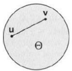

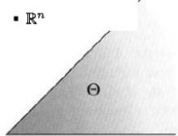

## 4.3 Convex Sets （2/3）

Theorem 4.1 Convex subsets of $\mathbb { R } ^ { n }$ have the following properties:

a. If Θ is a convex set and β is a real number, then the set

$$
\beta \Theta = \{\boldsymbol {x}: \boldsymbol {x} = \beta \boldsymbol {v}, \boldsymbol {v} \in \Theta \}
$$

is also convex.

b. ${ \cal I } f \Theta _ { 1 }$ and $\Theta _ { 2 }$ are convex sets, then the set

$$
\Theta_ {1} + \Theta_ {2} = \left\{\boldsymbol {x}: \boldsymbol {x} = \boldsymbol {v} _ {1} + \boldsymbol {v} _ {2}, \boldsymbol {v} _ {1} \in \Theta_ {1}, \boldsymbol {v} _ {2} \in \Theta_ {2} \right\}
$$

is also convex.

c. The intersection of any collection of convex sets is convex (see Figure $\it 4 . 6$ for an illustration of this result for two sets). □

Proof.

a. Let $\beta v _ { 1 } , \beta v _ { 2 } \in \beta \Theta$ , where ${ \pmb v } _ { 1 } , { \pmb v } _ { 2 } \in \Theta$ . Because $\Theta$ is convex, we have $\alpha \pmb { v } _ { 1 } + ( 1 - \alpha ) \pmb { v } _ { 2 } \in \Theta$ for any $\alpha \in ( 0 , 1 )$ . Hence,

$$
\alpha \beta \boldsymbol {v} _ {1} + (1 - \alpha) \beta \boldsymbol {v} _ {2} = \beta (\alpha \boldsymbol {v} _ {1} + (1 - \alpha) \boldsymbol {v} _ {2}) \in \beta \Theta ,
$$

and thus $\beta \Theta$ is convex.

## 4.3 Convex Sets （3/3）

A point x in a convex set Θ is said to be an extreme point of Θ if there are no two distinct points u and v in Θ such that ${ \pmb x } = \alpha { \pmb u } + ( 1 - \alpha ) { \pmb v }$ for some $\alpha \in ( 0 , 1 )$ . For example, in Figure 4.4, any point on the boundary of the disk is an extreme point, the vertex (corner) of the set on the right is an extreme point, and the endpoint of the half-line is also an extreme point

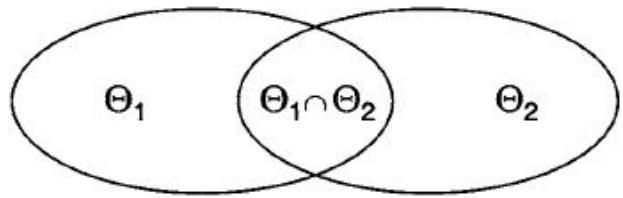

## 4.4 Neighborhoods $( 1 / 4 )$

A neighborhood of a point $\pmb { x } \in \mathbb { R } ^ { n }$ is the set

$$
\left\{\boldsymbol {y} \in \mathbb {R} ^ {n}: \| \boldsymbol {y} - \boldsymbol {x} \| <   \varepsilon \right\},
$$

where ε is some positive number. The neighborhood is also called a ball with radius ε and center x.

In the plane $\mathbb { R } ^ { 2 }$ , a neighborhood of $\pmb { x } = [ x _ { 1 } , x _ { 2 } ] ^ { \top }$ consists of all the points inside a disk centered at x. In $\mathbb { R } ^ { 3 }$ , a neighborhood of $\mathbf { \boldsymbol { x } } = [ x _ { 1 } , x _ { 2 } , x _ { 3 } ] ^ { \top }$ consists of all the points inside a sphere centered at x (see Figure 4.7)

## 4.4 Neighborhoods $( 2 / 4 )$

A point $\pmb { x } \in S$ is said to be an interior point of the set S if the set S contains some neighborhood of x; that is, if all points within some neighborhood of x are also in S (see Figure 4.8). The set of all the interior points of S is called the interior of S.

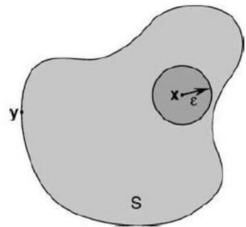

## 4.4 Neighborhoods (3/4)

A point x is said to be a boundary point of the set S if every neighborhood of x contains a point in S and a point not in S (see Figure 4.8). Note that a boundary point of S may or may not be an element of S. The set of all boundary points of S is called the boundary of S.

A set S is said to be open if it contains a neighborhood of each of its points; that is, if each of its points is an interior point, or equivalently, if S contains no boundary points.

A set S is said to be closed if it contains its boundary (see Figure 4.9). We can show that a set is closed if and only if its complement is open.

A set that is contained in a ball of finite radius is said to be bounded. A set is compact if it is both closed and bounded. Compact sets are important in optimization problems for the following reason.

## 4.4 Neighborhoods $( 4 / 4 )$

Theorem 4.2Theorem of Weierstrass. Let $f : \Omega \to \mathbb { R }$ be a continuous function, where $\Omega \subset \mathbb { R } ^ { n }$ is a compact set. Then, there exists a point $\pmb { x } _ { 0 } \in \Omega$ such that $f ( { \pmb x } _ { 0 } ) \leq f ( { \pmb x } )$ for all $\pmb { x } \in \Omega$ . In other words. f achieves its minimum on Ω. □

Proof. See [112, p. 89] or [2, p. 154].

## 4.5 Polytopes (多面体) and Polyhedra

A set that can be expressed as the intersection of a finite number of halfspaces is called a convex polytope (see Figure 4.10).

A nonempty bounded polytope is called a polyhedron (see Figure 4.11)

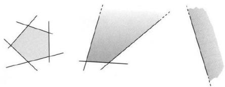

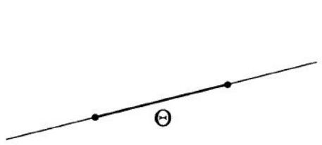

## 第四章内容总结

超平面是 n−1 维的, 因为 $x _ { 1 } , \cdots , x _ { n }$ 是 n 维的, 超平面给了一个限制条件, 所以有 n−1 个自由度.

超平面法线的理解: 法线先记作 n (normal 的意思), normal 应满足同超平面内任意向量垂直, 那如何表示超平面内任何向量呢? 超平面内找一个已知点 ${ \mathbf { } } ^ { a , }$ 再找任意点 $^ { * , }$ 则 ${ \mathbf { } } x - a$ 可代表超平面内任意向量, slide 中已证 $\langle { \pmb u } , { \pmb a } - { \pmb x } \rangle = 0$ , 所以 u 即所求的法线.

超平面的交的理解方法, 方程每一个都可写成 $a _ { 1 } x _ { 1 } + \ldots + a _ { n } x _ { n } = b _ { 1 }$ , 每一个都是超平面, 所以解是超平面的交. 那么有几个超平面呢? 并不是有几个方程就是几个超平面, 因为有重复的

凸集概念在后面带限制条件的优化问题要用到, 直观上说, 优化迭代时, $x _ { 1 }$ 跳到 $x _ { 2 } , x _ { 2 }$ 跳到$x _ { 3 }$ , 我至少要保证点都在规定的集合中. 跳的时候还有跳多远 (步长) 的事, 如果两点间所有的点都在集合中, 可以根据需要, 有时跳近点. 85 / 8

## 例：超平面作为线性分类边界

考虑二维线性分类器 $\pmb { w } ^ { \top } \pmb { x } + b = 0$ , 其中 $w = \left[ 1 \right] , \qquad b = - 4 .$

因此分类边界为 $x _ { 1 } + 2 x _ { 2 } = 4$

这是 $\mathbb { R } ^ { 2 }$ 中的一个超平面（hyperplane），也就是一条直线。

它将 $\mathbb { R } ^ { 2 }$ 分成两个半空间：

$$
H ^ {+} = \{x: x _ {1} + 2 x _ {2} > 4 \},\tag{3.1}
$$

$$
H ^ {-} = \{x: x _ {1} + 2 x _ {2} <   4 \}.\tag{3.2}
$$

向量 $\pmb { w } = ( 1 , 2 ) ^ { \top }$ 与该超平面垂直，因此是它的法向量。

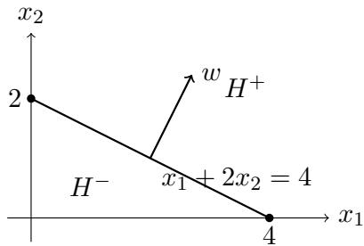

## 例：由半空间得到凸可行域

考虑约束条件 $x _ { 1 } \geq 0 , x _ { 2 } \geq 0 , x _ { 1 } + 2 x _ { 2 } \leq 4$ . 对应的可行域为$C = \{ x : x _ { 1 } \geq 0 , \ x _ { 2 } \geq 0 , \ x _ { 1 } + 2 x _ { 2 } \leq 4 \}$

每一个线性不等式都定义了一个半空间。因此，C 是三个半空间的交。

在 $\mathbb { R } ^ { 2 }$ 中，C 是由三个顶点 (0, 0), (4, 0),(0,2) 构成的三角形。

因此 C 既是 凸集（convex set） , 也是多面体（polytope）

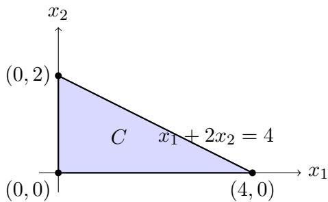

## 为什么这个可行域是凸集？

取可行域中的两个点 $x = { \bigg [ } 0 { \bigg ] } , \qquad y = { \bigg [ } { \frac { 4 } { 0 } } { \bigg ] }$ 对任意 $\alpha \in [ 0 , 1 ]$ ，考虑两点之间的点 $z = \alpha x + ( 1 - \alpha ) y$ , 则 $z = \left[ \begin{array} { c } { { \left[ 4 ( 1 - \alpha ) \right] } } \\ { { 2 \alpha } } \end{array} \right]$ 显然， $z _ { 1 } \ge 0 , \qquad z _ { 2 } \ge 0 ,$ , 并且 $z _ { 1 } + 2 z _ { 2 } = 4 ( 1 - \alpha ) + 4 \alpha = 4$ 因此 $z \in C , \qquad \forall \alpha \in [ 0 , 1 ]$

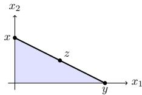

$$
\boxed {x, y \in C \quad \Longrightarrow \quad \alpha x + (1 - \alpha) y \in C}
$$

还需验证任意两点也有该性质。

## 凸集与优化的关系

凸集的一个重要性质是：

$$
x, y \in C \quad \Longrightarrow \quad \alpha x + (1 - \alpha) y \in C, \qquad 0 \leq \alpha \leq 1.
$$

也就是说，若两个点都在凸集中，则连接这两个点的整条线段都在凸集中。

这在带约束的优化问题中非常重要。

例如，若当前迭代点 $x ^ { ( k ) }$ 和下一候选点 $x ^ { ( k + 1 ) }$ 都在可行域 C 中，则对于

$$
0 \leq \alpha \leq 1,
$$

中间点

$$
x (\alpha) = \alpha x ^ {(k)} + (1 - \alpha) x ^ {(k + 1)}
$$

也仍然位于可行域中。

因此，可以通过调节 α，控制一次迭代“走多远”，同时保证不离开可行域。

凸性使得优化算法可以在可行域内安全地调整步长
