# 2026-10-06 · 微积分与优化导论

高级工程数学

**2026-10-06**

沈超敏

计算机科学与技术学院

cmshen@cs.ecnu.edu.cn

文附楼 105

**复习**

Ch. 3. Transformations   
3.1 Linear Transformations   
3.2 Eigenvalues and Eigenvectors   
3.3 Orthogonal Projections   
3.4 Quadratic Forms   
3.5 Matrix Norms
3.5 Exercises

**上次课例题**

习题3.5 对 $A = \begin{bmatrix} -1 & 0 & 0 & 0 \\ 1 & 1 & 0 & 0 \\ 2 & 5 & 2 & 1 \\ -1 & 1 & 0 & 3 \end{bmatrix}$ 给出的linear transform, 找一组基, 使在这组基下A对应的矩阵是对角阵.

解: 该题意思是: A 代表一个变换, 将 x 变成 y, 即 Ax = y (这里 A 就是变换对应的矩阵, A, x, y, 均在自然基下表示).

该题问，如果换了一组基，在新基下 A 对应的矩阵如记成 B，要使 B 是对角阵，基应如何取法.

Claim: 新基取 A 的一组特征向量 $\{v_1,\ldots,v_n\}$（若它们构成一组基），则新基下 A 的矩阵为 $\Lambda=\operatorname{diag}(\lambda_1,\ldots,\lambda_n)$。

理由: x 在 $\{e_{1},\cdots,e_{n}\}$ 下的坐标是 $\begin{bmatrix}x_{1}\\ \vdots\\ x_{n}\end{bmatrix}$ ，在 $\{v_{1},\cdots,v_{n}\}$ 下坐标 $\begin{bmatrix}a_{1}\\ \vdots\\ a_{n}\end{bmatrix}$ .
y 在 $\{e_{1},\cdots,e_{n}\}$ 下的坐标是 $\begin{bmatrix}y_{1}\\ \vdots\\ y_{n}\end{bmatrix}$ ，在 $\{v_{1},\cdots,v_{n}\}$ 下坐标 $\begin{bmatrix}b_{1}\\ \vdots\\ b_{n}\end{bmatrix}$ .
令 $V=[v_1\ \cdots\ v_n]$，则

$$x=Va,\qquad y=Vb.\tag{1–2}$$

对 (1) 两端左乘 $\vec{A}$ , 得

$$AVa=V\Lambda a,$$

而 $A\left[\begin{array}{c}x_{1}\\ \vdots\\ x_{n}\end{array}\right]=y=V\left[\begin{array}{c}b_{1}\\ \vdots\\ b_{n}\end{array}\right]$ (由（2）式可得).

所以，

$$V\Lambda a=Vb,\qquad b=\Lambda a. $$

因此，在基 $V$ 下，A 的矩阵表示为对角矩阵 $\Lambda$。

**上次补充例题**

$\overrightarrow{x}$ , 经正交变换 $(Q^T Q = I)$ , 变成 $\overrightarrow{y}$ ,

问 $\overrightarrow{y}$ 的长度和 $\overrightarrow{x}$ 的长度的关系。

答：由 $\overrightarrow{y}=Q\overrightarrow{x}$，其长度可通过内积计算：

$\langle Q\overrightarrow{x},Q\overrightarrow{x}\rangle=(Q\overrightarrow{x})^{T}Q\overrightarrow{x}=\overrightarrow{x}^{T}Q^{T}Q\overrightarrow{x}$

## 3.4 Quadratic Forms

A quadratic form $f:\mathbb{R}^{n}\to\mathbb{R}$ is a function

$$
f (\boldsymbol {x}) = \boldsymbol {x} ^ {\top} Q \boldsymbol {x},
$$

where Q is an $n \times n$ real matrix.

假设 Q 是对称的.

称 quadratic form $x^{\top}Qx$ 是 positive definite, if $x^{\top}Qx > 0$ for all nonzero x. Semidefinite if $x^{\top}Qx \geq 0$ for all nonzero x.

The analogous notions are negative definite and negative semidefinite.

## 3.5 Matrix Norms

Using arguments similar to the above, we can deduce the following important inequalities.

Rayleigh's Inequalities. If an $n \times n$ matrix $P$ is real symmetric positive definite, then

$$
\lambda_ {\min} (\boldsymbol {P}) \| \boldsymbol {x} \| ^ {2} \leq \boldsymbol {x} ^ {\top} \boldsymbol {P} \boldsymbol {x} \leq \lambda_ {\max} (\boldsymbol {P}) \| \boldsymbol {x} \| ^ {2},
$$

where $\lambda_{\min}(\boldsymbol{P})$ denotes the smallest eigenvalue of P, and $\lambda_{\max}(\boldsymbol{P})$ denotes the largest eigenvalue of P.

Concepts from Geometry
4.1 Line Segments
4.2 Hyperplanes and Linear Varieties
4.3 Convex Sets
4.4 Neighborhoods
4.5 Polytopes and Polyhedra

**第四章内容总结**

超平面是 n-1 维的, 因为 $x_{1}, \cdots, x_{n}$ 是 n 维的, 超平面给了一个限制条件, 所以有 n-1 个自由度.

超平面法线的理解：法线先记作 $n$ (normal 的意思), normal 应满足同超平面内任意向量垂直, 那如何表示超平面内任何向量呢？超平面内找一个已知点 $a$ , 再找任意点 $x$ , 则 $x - a$ 可代表超平面内任意向量, slide 中已证 $\langle u, a - x \rangle = 0$ , 所以 $u$ 即所求的法线.

超平面的交可以这样理解：每个方程都可写成 $a_1x_1 + \ldots + a_nx_n = b$，对应一个超平面，所以方程组的解是这些超平面的交。方程数不一定等于不同超平面的个数，因为方程可能重复。

凸集概念在后面带限制条件的优化问题要用到, 直观上说, 优化迭代时, $x_{1}$ 跳到 $x_{2}, x_{2}$ 跳到 $x_{3}$ , 我至少要保证点都在规定的集合中. 跳的时候还有跳多远 (步长) 的事, 如果两点间所有的点都在集合中, 可以根据需要, 有时跳近点.

今天: Elements of Calculus
5.1 Sequences and Limits
5.2 Differentiability
5.3 The Derivative Matrix
5.4 Differentiation Rules
5.5 Level Sets and Gradients
5.6 Taylor Series

## 5.1 Sequences and Limits

A sequence of real numbers is a function whose domain is the set of natural numbers $1,2,\ldots,k,\ldots$ and whose range is contained in R. Thus, a sequence of real numbers can be viewed as a set of numbers $\{x_{1},x_{2},\ldots,x_{k},\ldots\}$ , which is often also denoted as $\{x_{k}\}$ (or sometimes as $\{x_{k}\}_{k=1}^{\infty}$ , to indicate explicitly the range of values that k can take).

A sequence $\{x_{k}\}$ is increasing if $x_{1}<x_{2}<\cdots<x_{k}\cdots$ ; that is, $x_{k}<x_{k+1}$ for all k. If $x_{k}\leq x_{k+1}$ , then we say that the sequence is nondecreasing. Similarly, we can define decreasing and nonincreasing sequences. Nonincreasing or nondecreasing sequences are called monotone sequences.

A number $x^{*} \in R$ is called the limit of the sequence $\{x_{k}\}$ if for any positive $\varepsilon$ there is a number K (which may depend on $\varepsilon$ ) such that for all k &gt; K, $|x_{k} - x^{*}| < \varepsilon$ ; that is, $x_{k}$ lies between $x^{*} - \varepsilon$ and $x^{*} + \varepsilon$ for all k &gt; K. In this case we write

$$
x ^ {*} = \lim _ {k \rightarrow \infty} x _ {k}
$$

or

$$
x _ {k} \rightarrow x ^ {*}.
$$

**5.1 Sequences and Limits ( $R^{n}$ )**

The notion of a sequence can be extended to sequences with elements in $\mathbb{R}^n$ . Specifically, a sequence in $\mathbb{R}^n$ is a function whose domain is the set of natural numbers $1,2,\ldots,k,\ldots$ and whose range is contained in $\mathbb{R}^n$ . We use the notation $\{\pmb{x}^{(1)},\pmb{x}^{(2)},\dots\}$ or $\{\pmb{x}^{(k)}\}$ for sequences in $\mathbb{R}^n$ . For limits of sequences in $\mathbb{R}^n$ , we need to replace absolute values with vector norms. In other words, $\pmb{x}^*$ is the limit of $\{\pmb{x}^{(k)}\}$ if for any positive $\varepsilon$ there is a number $K$ (which may depend on $\varepsilon$ ) such that for all $k > K$ , $\| \pmb{x}^{(k)} - \pmb{x}^* \| < \varepsilon$ . As before, if a sequence $\{\pmb{x}^{(k)}\}$ is convergent, we write $\pmb{x}^* = \lim_{k\to \infty}\pmb{x}^{(k)}$ or $\pmb{x}^{(k)}\to \pmb{x}^*$ .

**5.1 Sequences and Limits (唯一性)**

Theorem 5.1 A convergent sequence has only one limit.

Proof. We prove this result by contradiction. Suppose that a sequence $\{\pmb{x}^{(k)}\}$ has two different limits, say $\pmb{x}_1$ and $\pmb{x}_2$ . Then, we have $\| \pmb{x}_1 - \pmb{x}_2 \| > 0$ . Let

$$
\varepsilon = \frac {1}{2} \| \boldsymbol {x} _ {1} - \boldsymbol {x} _ {2} \|.
$$

From the definition of a limit, there exist $K_{1}$ and $K_{2}$ such that for $k > K_{1}$ we have $\| \pmb{x}^{(k)} - \pmb{x}_1 \| < \varepsilon$ , and for $k > K_{2}$ we have $\| \pmb{x}^{(k)} - \pmb{x}_2 \| < \varepsilon$ . Let $K = \max \{K_1, K_2\}$ . Then, if $k > K$ , we have $\| \pmb{x}^{(k)} - \pmb{x}_1 \| < \varepsilon$ and $\| \pmb{x}^{(k)} - \pmb{x}_2 \| < \varepsilon$ . Adding $\| \pmb{x}^{(k)} - \pmb{x}_1 \| < \varepsilon$ and $\| \pmb{x}^{(k)} - \pmb{x}_2 \| < \varepsilon$ yields

$$
\left\| \boldsymbol {x} ^ {(k)} - \boldsymbol {x} _ {1} \right\| + \left\| \boldsymbol {x} ^ {(k)} - \boldsymbol {x} _ {2} \right\| <   2 \varepsilon .
$$

Applying the triangle inequality gives

$$
\begin{array}{r l} \| - \boldsymbol {x} _ {1} + \boldsymbol {x} _ {2} \| & = \| \boldsymbol {x} ^ {(k)} - \boldsymbol {x} _ {1} - \boldsymbol {x} ^ {(k)} + \boldsymbol {x} _ {2} \| \\ & = \| (\boldsymbol {x} ^ {(k)} - \boldsymbol {x} _ {1}) - (\boldsymbol {x} ^ {(k)} - \boldsymbol {x} _ {2}) \| \\ & \leq \| \boldsymbol {x} ^ {(k)} - \boldsymbol {x} _ {1} \| + \| \boldsymbol {x} ^ {(k)} - \boldsymbol {x} _ {2} \|. \end{array}
$$

Therefore,

$$
\| - \boldsymbol {x} _ {1} + \boldsymbol {x} _ {2} \| = \| \boldsymbol {x} _ {1} - \boldsymbol {x} _ {2} \| <   2 \varepsilon .
$$

However, this contradicts the assumption that $\|x_{1}-x_{2}\|=2\varepsilon$ , which completes the proof.

**5.1 Sequences and Limits (有界性)**

A sequence $\{\pmb{x}^{(k)}\}$ in $\mathbb{R}^n$ is bounded if there exists a number $B \geq 0$ such that $\| \pmb{x}^{(k)} \| \leq B$ for all $k = 1,2,\ldots$ .

Theorem 5.2 Every convergent sequence is bounded.

Proof. Let $\{\pmb{x}^{(k)}\}$ be a convergent sequence with limit $\pmb{x}^*$ . Choose $\varepsilon = 1$ . Then, by definition of the limit, there exists a natural number $K$ such that for all $k > K$ ,

$$
\left\| \boldsymbol {x} ^ {(k)} - \boldsymbol {x} ^ {*} \right\| <   1.
$$

By the result of Exercise 2.9, we get

$$
\| \boldsymbol {x} ^ {(k)} \| - \| \boldsymbol {x} ^ {*} \| \leq \| \boldsymbol {x} ^ {(k)} - \boldsymbol {x} ^ {*} \| <   1 \quad \text { for   all } k > K.
$$

Therefore,

$$
\| \boldsymbol {x} ^ {(k)} \| <   \| \boldsymbol {x} ^ {*} \| + 1 \quad \text { for   all } k > K.
$$

Letting

$$
B = \max \left\{\| \boldsymbol {x} ^ {(1)} \|, \| \boldsymbol {x} ^ {(2)} \|, \dots , \| \boldsymbol {x} ^ {(K)} \|, \| \boldsymbol {x} ^ {*} \| + 1 \right\},
$$

we have

$$
B \geq \| \boldsymbol {x} ^ {(k)} \| \quad \text { for   all } k,
$$

which means that the sequence $\{\pmb{x}^{(k)}\}$ is bounded.

**5.1 Sequences and Limits (上确界)**

For a sequence $\{x_{k}\}$ in R, a number B is called an upper bound if $x_{k} \leq B$ for all $k = 1, 2, \ldots$ . In this case, we say that $\{x_{k}\}$ is bounded above. Similarly, B is called a lower bound if $x_{k} \geq B$ for all $k = 1, 2, \ldots$ . In this case, we say that $\{x_{k}\}$ is bounded below. Clearly, a sequence is bounded if it is both bounded above and bounded below.

Any sequence $\{x_{k}\}$ in R that has an upper bound has a least upper bound (also called the supremum), which is the smallest number B that is an upper bound of $\{x_{k}\}$ . Similarly, any sequence $\{x_{k}\}$ in R that has a lower bound has a greatest lower bound (also called the infimum). If B is the least upper bound of the sequence $\{x_{k}\}$ , then $x_{k} \leq B$ for all k, and for any $\varepsilon > 0$ , there exists a number K such that $x_{K} > B - \varepsilon$ . An analogous statement applies to the greatest lower bound: If B is the greatest lower bound of $\{x_{k}\}$ , then $x_{k} \geq B$ for all k, and for any $\varepsilon > 0$ , there exists a number K such that $x_{K} < B + \varepsilon$ .

**5.1 Sequences and Limits （单调有界必收敛）**

**Theorem 5.3 Every monotone bounded sequence in $\mathbb{R}$ is convergent.**

Proof. We prove the theorem for nondecreasing sequences. The proof for nonincreasing sequences is analogous.

Let $\{x_{k}\}$ be a bounded nondecreasing sequence in $\mathbb{R}$ and $x^{*}$ the least upper bound. Fix a number $\varepsilon > 0$ . Then, there exists a number $K$ such that $x_{K} > x^{*} - \varepsilon$ . Because $\{x_{k}\}$ is nondecreasing, for any $k \geq K$ ,

$$
x _ {k} \geq x _ {K} > x ^ {*} - \varepsilon .
$$

Also, because $x^{*}$ is an upper bound of $\{x_{k}\}$ , we have

$$
x _ {k} \leq x ^ {*} <   x ^ {*} + \varepsilon .
$$

Therefore, for any $k \geq K$ ,

$$
\left| x _ {k} - x ^ {*} \right| <   \varepsilon ,
$$

which means that $x_{k} \rightarrow x^{*}$ .

**5.1 Sequences and Limits （收敛序列的子序列必收敛）**

Theorem 5.4 Consider a convergent sequence $\{\pmb{x}^{(k)}\}$ with limit $\pmb{x}^*$ . Then, any subsequence of $\{\pmb{x}^{(k)}\}$ also converges to $\pmb{x}^*$ .

Proof. Let $\{\pmb{x}^{(m_k)}\}$ be a subsequence of $\{\pmb{x}^{(k)}\}$ , where $\{m_k\}$ is an increasing sequence of natural numbers. Observe that $m_k \geq k$ for all $k = 1,2,\ldots$ . To show this, first note that $m_1 \geq 1$ because $m_1$ is a natural number. Next, we proceed by induction by assuming that $m_k \geq k$ . Then, we have $m_{k+1} > m_k \geq k$ , which implies that $m_{k+1} \geq k + 1$ . Therefore, we have shown that $m_k \geq k$ for all $k = 1,2,\ldots$ .

Let $\varepsilon > 0$ be given. Then, by definition of the limit, there exists $K$ such that $\| \pmb{x}^{(k)} - \pmb{x}^* \| < \varepsilon$ for any $k > K$ . Because $m_k \geq k$ , we also have $\| \pmb{x}^{(m_k)} - \pmb{x}^* \| < \varepsilon$ for any $k > K$ . This means that

$$
\lim _ {k \rightarrow \infty} \boldsymbol {x} ^ {(m _ {k})} = \boldsymbol {x} ^ {*}.
$$

It turns out that any bounded sequence contains a convergent subsequence. This result is called the Bolzano-Weierstrass theorem (see [2, p. 70]).

**5.1 Sequences and Limits (连续)**

Consider a function $\pmb{f}:\mathbb{R}^n\to \mathbb{R}^m$ and a point $\pmb{x}_0\in \mathbb{R}^n$ . Suppose that there exists $f^{*}$ such that for any convergent sequence $\{\pmb{x}^{(k)}\}$ with limit $\pmb{x}_0$ , we have

$$
\lim _ {k \rightarrow \infty} \boldsymbol {f} (\boldsymbol {x} ^ {(k)}) = \boldsymbol {f} ^ {*}.
$$

Then, we use the notation

$$
\lim _ {\boldsymbol {x} \rightarrow \boldsymbol {x} _ {0}} \boldsymbol {f} (\boldsymbol {x})
$$

to represent the limit $f^{*}$ .

It turns out that f is continuous at $x_{0}$ if and only if for any convergent sequence $\{\boldsymbol{x}^{(k)}\}$ with limit $x_{0}$ , we have

$$
\lim _ {k \rightarrow \infty} f (x ^ {(k)}) = f \left(\lim _ {k \rightarrow \infty} x ^ {(k)}\right) = f (x _ {0})
$$

(see [2, p. 137]). Therefore, using the notation introduced above, the function $\pmb{f}$ is continuous at $x_0$ if and only if

$$
\lim _ {\boldsymbol {x} \rightarrow \boldsymbol {x} _ {0}} \boldsymbol {f} (\boldsymbol {x}) = \boldsymbol {f} (\boldsymbol {x} _ {0}).
$$

**5.1 Sequences and Limits**

**矩阵的极限**

We say that a sequence $\{\pmb{A}_k\}$ of $m \times n$ matrices converges to the $m \times n$ matrix $\pmb{A}$ if

$$
\lim _ {k \rightarrow \infty} \| \boldsymbol {A} - \boldsymbol {A} _ {k} \| = 0.
$$

Lemma 5.1 Let $\mathbf{A} \in \mathbb{R}^{n \times n}$ . Then, $\lim_{k \to \infty} \mathbf{A}^k = \mathbf{O}$ if and only if the eigenvalues of $\mathbf{A}$ satisfy $|\lambda_i(\mathbf{A})| < 1$ , $i = 1, \ldots, n$ .

## 5.2 Differentiability

Differential calculus is based on the idea of approximating an arbitrary function by an affine function. A function $\mathcal{A}:\mathbb{R}^{n}\to\mathbb{R}^{m}$ is affine if there exists a linear function $\mathcal{L}:\mathbb{R}^{n}\to\mathbb{R}^{m}$ and a vector $y\in\mathbb{R}^{m}$ such that

$$
\mathcal {A} (\boldsymbol {x}) = \mathcal {L} (\boldsymbol {x}) + \boldsymbol {y}
$$

for every $x \in R^{n}$ . Consider a function $f : R^{n} \to R^{m}$ and a point $x_{0} \in R^{n}$ . We wish to find an affine function A that approximates f near the point $x_{0}$ . First, it is natural to impose the condition

$$
\mathcal {A} (\boldsymbol {x} _ {0}) = \boldsymbol {f} (\boldsymbol {x} _ {0}).
$$

Because $\mathcal{A}(\pmb{x}) = \mathcal{L}(\pmb{x}) + \pmb{y}$ , we obtain $\pmb{y} = \pmb{f}(\pmb{x}_0) - \mathcal{L}(\pmb{x}_0)$ . By the linearity of $\mathcal{L}$ ,

$$
\mathcal {L} (\boldsymbol {x}) + \boldsymbol {y} = \mathcal {L} (\boldsymbol {x}) - \mathcal {L} (\boldsymbol {x} _ {0}) + \boldsymbol {f} (\boldsymbol {x} _ {0}) = \mathcal {L} (\boldsymbol {x} - \boldsymbol {x} _ {0}) + \boldsymbol {f} (\boldsymbol {x} _ {0}).
$$

Hence, we may write

$$
\mathcal {A} (\boldsymbol {x}) = \mathcal {L} (\boldsymbol {x} - \boldsymbol {x} _ {0}) + \boldsymbol {f} (\boldsymbol {x} _ {0}).
$$

Next, we require that $\mathcal{A}(\pmb{x})$ approaches $\pmb{f}(\pmb{x})$ faster than $\pmb{x}$ approaches $\pmb{x}_0$ ; that is,

$$
\lim _ {\boldsymbol {x} \rightarrow \boldsymbol {x} _ {0}, \boldsymbol {x} \in \Omega} \frac {\| \boldsymbol {f} (\boldsymbol {x}) - \mathcal {A} (\boldsymbol {x}) \|}{\| \boldsymbol {x} - \boldsymbol {x} _ {0} \|} = 0.
$$

The conditions above on A ensure that A approximates f near $x_{0}$ in the sense that the error in the approximation at a given point is “small” compared with the distance of the point from $x_{0}$ .

## 5.3 The Derivative Matrix

Any linear transformation from $\mathbb{R}^n$ to $\mathbb{R}^m$ , and in particular the derivative $\mathcal{L}$ of $f: \mathbb{R}^n \to \mathbb{R}^m$ , can be represented by an $m \times n$ matrix. To find the matrix representation $L$ of the derivative $\mathcal{L}$ of a differentiable function $f: \mathbb{R}^n \to \mathbb{R}^m$ , we use the natural basis $\{e_1, \ldots, e_n\}$ for $\mathbb{R}^n$ . Consider the vectors

$$
\boldsymbol {x} _ {j} = \boldsymbol {x} _ {0} + t \boldsymbol {e} _ {j}, \quad j = 1, \dots , n.
$$

By the definition of the derivative, we have

$$
\lim _ {t \rightarrow 0} \frac {\boldsymbol {f} (\boldsymbol {x} _ {j}) - (t \boldsymbol {L e} _ {j} + \boldsymbol {f} (\boldsymbol {x} _ {0}))}{t} = \mathbf {0}
$$

for $j = 1, \ldots, n$ . This means that

$$
\lim _ {t \rightarrow 0} \frac {\boldsymbol {f} (\boldsymbol {x} _ {j}) - \boldsymbol {f} (\boldsymbol {x} _ {0})}{t} = \boldsymbol {L e} _ {j}
$$

for $j = 1, \ldots, n$ . But $Le_{j}$ is the jth column of the matrix L. On the other hand, the vector $x_{j}$ differs from $x_{0}$ only in the jth coordinate, and in that coordinate the difference is just the number t. Therefore, the left side of the preceding equation is the partial derivative

$$
\frac {\partial \boldsymbol {f}}{\partial x _ {j}} (\boldsymbol {x} _ {0}).
$$

Because vector limits are computed by taking the limit of each coordinate function, it follows that if

$$
\boldsymbol {f} (\boldsymbol {x}) = \left[ \begin{array}{c} f _ {1} (\boldsymbol {x}) \\ \vdots \\ f _ {m} (\boldsymbol {x}) \end{array} \right],
$$

then

$$
\frac {\partial \boldsymbol {f}}{\partial x _ {j}} (\boldsymbol {x} _ {0}) = \left[ \begin{array}{c} \frac {\partial f _ {1}}{\partial x _ {j}} (\boldsymbol {x} _ {0}) \\ \vdots \\ \frac {\partial f _ {m}}{\partial x _ {j}} (\boldsymbol {x} _ {0}) \end{array} \right],
$$

Theorem 5.5 If a function $\pmb{f} : \mathbb{R}^n \to \mathbb{R}^m$ is differentiable at $x_0$ , then the derivative of $\pmb{f}$ at $x_0$ is determined uniquely and is represented by the $m \times n$ derivative matrix $D\pmb{f}(x_0)$ . The best affine approximation to $\pmb{f}$ near $x_0$ is then given by

$$
\mathcal {A} (\boldsymbol {x}) = \boldsymbol {f} \left(\boldsymbol {x} _ {0}\right) + D \boldsymbol {f} \left(\boldsymbol {x} _ {0}\right) \left(\boldsymbol {x} - \boldsymbol {x} _ {0}\right),
$$

in the sense that

$$
\boldsymbol {f} (\boldsymbol {x}) = \mathcal {A} (\boldsymbol {x}) + \boldsymbol {r} (\boldsymbol {x})
$$

and $\lim_{x\to x_{0}}\|r(x)\|/\|x-x_{0}\|=0$ . The columns of the derivative matrix $Df(x_{0})$ are vector partial derivatives. The vector

$$
\frac {\partial \boldsymbol {f}}{\partial x _ {j}} (\boldsymbol {x} _ {0})
$$

is a tangent vector at $x_{0}$ to the curve f obtained by varying only the jth coordinate of x. □

If $f:\mathbb{R}^{n}\to \mathbb{R}$ is differentiable, then the function $\nabla f$ defined by

$$
\nabla f (\boldsymbol {x}) = \left[ \begin{array}{c} \frac {\partial f}{\partial x _ {1}} (\boldsymbol {x}) \\ \vdots \\ \frac {\partial f}{\partial x _ {n}} (\boldsymbol {x}) \end{array} \right] = D f (\boldsymbol {x}) ^ {\top}
$$

is called the gradient of $f$ . The gradient is a function from $\mathbb{R}^n$ to $\mathbb{R}^n$ , and can be pictured as a vector field, by drawing the arrow representing $\nabla f(\pmb{x})$ so that its tail starts at $\pmb{x}$ .

Given $f: \mathbb{R}^n \to \mathbb{R}$ , if $\nabla f$ is differentiable, we say that $f$ is twice differentiable, and we write the derivative of $\nabla f$ as

$$
D ^ {2} f = \left[ \begin{array}{c c c c} \frac {\partial^ {2} f}{\partial x _ {1} ^ {2}} & \frac {\partial^ {2} f}{\partial x _ {2} \partial x _ {1}} & \dots & \frac {\partial^ {2} f}{\partial x _ {n} \partial x _ {1}} \\ \frac {\partial^ {2} f}{\partial x _ {1} \partial x _ {2}} & \frac {\partial^ {2} f}{\partial x _ {2} ^ {2}} & \dots & \frac {\partial^ {2} f}{\partial x _ {n} \partial x _ {2}} \\ \vdots & \vdots & \ddots & \vdots \\ \frac {\partial^ {2} f}{\partial x _ {1} \partial x _ {n}} & \frac {\partial^ {2} f}{\partial x _ {2} \partial x _ {n}} & \dots & \frac {\partial^ {2} f}{\partial x _ {n} ^ {2}} \end{array} \right].
$$

(The notation $\frac{\partial^2f}{\partial x_i\partial x_j}$ represents taking the partial derivative of $f$ with respect to $x_{j}$ first, then with respect to $x_{i}$ .) The matrix $D^2 f(\pmb {x})$ is called the Hessian matrix of $f$ at $\pmb{x}$ , and is often also denoted $\pmb{F}(\pmb{x})$ .

Note that the Hessian matrix of a function $f: R^{n} \to R$ at x is symmetric if f is twice continuously differentiable at x. This is a well-known result from calculus called Clairaut's theorem or Schwarz's theorem. However, if the second partial derivatives of f are not continuous, then there is no guarantee that the Hessian is symmetric, as shown in the following well-known example.

Example 5.1 Consider the function

$$
f (\boldsymbol {x}) = \left\{ \begin{array}{l l} x _ {1} x _ {2} (x _ {1} ^ {2} - x _ {2} ^ {2}) / (x _ {1} ^ {2} + x _ {2} ^ {2}) & \text { if } \boldsymbol {x} \neq \boldsymbol {0} \\ 0 & \text { if } \boldsymbol {x} = \boldsymbol {0}. \end{array} \right.
$$

## 5.4 Differentiation Rules

We now introduce the chain rule for differentiating the composition $g(\boldsymbol{f}(t))$ , of a function $f: R \to R^{n}$ and a function $g: R^{n} \to R$ .

Theorem 5.6 Let $g: \mathcal{D} \to \mathbb{R}$ be differentiable on an open set $\mathcal{D} \subset \mathbb{R}^n$ , and let $f: (a, b) \to \mathcal{D}$ be differentiable on $(a, b)$ . Then, the composite function $h: (a, b) \to \mathbb{R}$ given by $h(t) = g(f(t))$ is differentiable on $(a, b)$ , and

$$
h ^ {\prime} (t) = D g (\boldsymbol {f} (t)) D \boldsymbol {f} (t) = \nabla g (\boldsymbol {f} (t)) ^ {\top} \left[ \begin{array}{c} f _ {1} ^ {\prime} (t) \\ \vdots \\ f _ {n} ^ {\prime} (t) \end{array} \right].
$$

Proof. By definition,

$$
h ^ {\prime} (t) = \lim _ {s \rightarrow t} \frac {h (s) - h (t)}{s - t} = \lim _ {s \rightarrow t} \frac {g (\boldsymbol {f} (s)) - g (\boldsymbol {f} (t))}{s - t}
$$

if the limit exists. By Theorem 5.5 we write

$$
g (\boldsymbol {f} (s)) - g (\boldsymbol {f} (t)) = D g (\boldsymbol {f} (t)) (\boldsymbol {f} (s) - \boldsymbol {f} (t)) + r (s),
$$

where $\lim_{s\to t}r(s)/(s-t)=0$ . Therefore,

$$
\frac {h (s) - h (t)}{s - t} = D g (\boldsymbol {f} (t)) \frac {\boldsymbol {f} (s) - \boldsymbol {f} (t)}{s - t} + \frac {r (s)}{s - t}.
$$

Letting $s\to t$ yields

$$
h ^ {\prime} (t) = \lim _ {s \rightarrow t} D g (\boldsymbol {f} (t)) \frac {\boldsymbol {f} (s) - \boldsymbol {f} (t)}{s - t} + \frac {r (s)}{s - t} = D g (\boldsymbol {f} (t)) D \boldsymbol {f} (t).
$$

Next, we present the product rule. Let $\pmb{f}:\mathbb{R}^n\to \mathbb{R}^m$ and $\pmb {g}:\mathbb{R}^n\to \mathbb{R}^m$ be two differentiable functions. Define the function $h:\mathbb{R}^n\to \mathbb{R}$ by $h(\pmb {x}) = \pmb {f}(\pmb {x})^{\top}\pmb {g}(\pmb {x})$ . Then, $h$ is also differentiable and

$$
D h (\boldsymbol {x}) = \boldsymbol {f} (\boldsymbol {x}) ^ {\top} D \boldsymbol {g} (\boldsymbol {x}) + \boldsymbol {g} (\boldsymbol {x}) ^ {\top} D \boldsymbol {f} (\boldsymbol {x}).
$$

We end this section with a list of some useful formulas from multivariable calculus. In each case, we compute the derivative with respect to x. Let $A \in R^{m \times n}$ be a given matrix and $y \in R^{m}$ a given vector. Then,

$$
\begin{array}{l} D (\boldsymbol {y} ^ {\top} \boldsymbol {A} \boldsymbol {x}) = \boldsymbol {y} ^ {\top} \boldsymbol {A} \\ D (\boldsymbol {x} ^ {\top} \boldsymbol {A} \boldsymbol {x}) = \boldsymbol {x} ^ {\top} (\boldsymbol {A} + \boldsymbol {A} ^ {\top}) \quad \text { if } m = n. \end{array}
$$

It follows from the first formula above that if $y \in R^{n}$ , then

$$
D (\boldsymbol {y} ^ {\top} \boldsymbol {x}) = \boldsymbol {y} ^ {\top}.
$$

It follows from the second formula above that if Q is a symmetric matrix, then

$$
D (\boldsymbol {x} ^ {\top} \boldsymbol {Q} \boldsymbol {x}) = 2 \boldsymbol {x} ^ {\top} \boldsymbol {Q}.
$$

In particular,

$$
D (\boldsymbol {x} ^ {\top} \boldsymbol {x}) = 2 \boldsymbol {x} ^ {\top}.
$$

## 5.5 Level Sets and Gradients

The level set of a function $f : R^{n} \to R$ at level c is the set of points

$$
S = \{\boldsymbol {x}: f (\boldsymbol {x}) = c \}.
$$

For $f: \mathbb{R}^2 \to \mathbb{R}$ , we are usually interested in $S$ when it is a curve. For $f: \mathbb{R}^3 \to \mathbb{R}$ , the sets $S$ most often considered are surfaces.

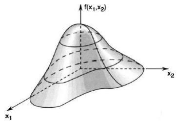

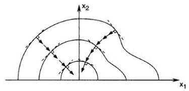

Example 5.2 Consider the following real-valued function on $\mathbb{R}^2$ :

$$
f (\boldsymbol {x}) = 100(x _ {2} - x _ {1} ^ {2}) ^ {2} + (1 - x _ {1}) ^ {2}, \quad \boldsymbol {x} = [ x _ {1}, x _ {2} ] ^ {\top}.
$$

The function above is called Rosenbrock's function. A plot of the function f is shown in Figure 5.2. The level sets of f at levels 0.7, 7, 70, 200, and 700 are depicted in Figure 5.3. The figures below show the surface and its curved level sets.

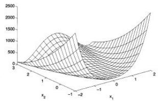

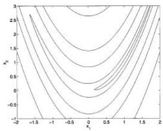

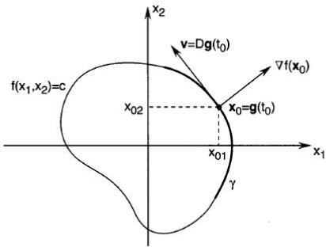

To say that a point $x_{0}$ is on the level set S at level c means that $f(\boldsymbol{x}_{0}) = c$ . Now suppose that there is a curve $\gamma$ lying in S and parameterized by a continuously differentiable function $g : R \to R^{n}$ . Suppose also that $g(t_{0}) = x_{0}$ and $D\boldsymbol{g}(t_{0}) = \boldsymbol{v} \neq \boldsymbol{0}$ , so that v is a tangent vector to $\gamma$ at $x_{0}$ (see Figure 5.4). Applying the chain rule to the function $h(t) = f(\boldsymbol{g}(t))$ at $t_{0}$ gives

$$
h ^ {\prime} (t _ {0}) = D f (\boldsymbol {g} (t _ {0})) D \boldsymbol {g} (t _ {0}) = D f (\boldsymbol {x} _ {0}) \boldsymbol {v}.
$$

## 5.6 Taylor Series

演示：https://www.geogebra.org/m/rfdkjwpx

Theorem 5.8 Taylor's Theorem. Assume that a function $f: \mathbb{R} \to \mathbb{R}$ is $m$ times continuously differentiable (i.e., $f \in C^m$ ) on an interval $[a, b]$ . Denote $h = b - a$ . Then,

$$
f (b) = f (a) + \frac {h}{1 !} f ^ {(1)} (a) + \frac {h ^ {2}}{2 !} f ^ {(2)} (a) + \dots + \frac {h ^ {m - 1}}{(m - 1) !} f ^ {(m - 1)} (a) + R _ {m},
$$

(called Taylor's formula) where $f^{(i)}$ is the $i$ th derivative of $f$ , and

$$
R _ {m} = \frac {h ^ {m} (1 - \theta) ^ {m - 1}}{(m - 1) !} f ^ {(m)} (a + \theta h) = \frac {h ^ {m}}{m !} f ^ {(m)} (a + \theta^ {\prime} h),
$$

with $\theta, \theta' \in (0,1)$ .

Theorem 5.9 If a function $\pmb{f} : \mathbb{R}^n \to \mathbb{R}^m$ is differentiable on an open set $\Omega \subset \mathbb{R}^n$ , then for any pair of points $\pmb{x}, \pmb{y} \in \Omega$ , there exists a matrix $M$ such that

$$
\boldsymbol {f} (\boldsymbol {x}) - \boldsymbol {f} (\boldsymbol {y}) = M (\boldsymbol {x} - \boldsymbol {y}).
$$

The mean value theorem follows from Taylor's theorem (for the case where m = 1) applied to each component of f. It is easy to see that M is a matrix whose rows are the rows of Df evaluated at points that lie on the line segment joining x and y (these points may differ from row to row).

## 优化：Topic 1: Introduction

★ Problem

$\min_{\boldsymbol{x}\in\Omega}f(\boldsymbol{x})$

\- $f$ : objective function

\- $\Omega \subset \mathbb{R}^{n}$ : feasible set / constraint set

$\max f(\boldsymbol{x})$ can be changed to $\min -f(\boldsymbol{x})$

1. Modeling: Practical problems → Optimization problems

2. Algorithms: Methods to solve

3. Software: Implement

**Topic 1: Introduction**

★ Types of Optimization Problems

\- Constrained vs. Non-Constrained $x \in \Omega$ $x \in \mathbb{R}^{n}$ , i.e., $x$ is free

\- Convex vs. Non-convex both $f$ and $\Omega$ are convex

\- Smooth vs. Non-Smooth $\nabla f$ $\partial f$ - 1-d $R^{1}$ vs. n-d $R^{n}$

\- illustration
- motivation    Harder due to infinite directions
- understanding

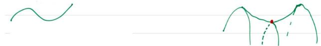

**★ Examples**

1. $\min_{x\in[0,5]}f(x)$ , $f(x)=x^{3}-6x^{2}+9x+1$

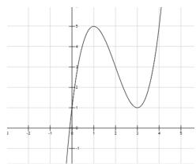

This is a 1-d smooth, non-convex, and constrained optimization sol. (only outline, not detailed solution)

critical pts: $f'(x) = 0$ , x = 1 or x = 3

min or max ? $f''(1) < 0$ local max, $f''(3) > 0$ local min

Topic 1: Introduction
★ Examples
Question: how about the case $f''(x) = 0$?
Can we conclude the answer is $x = 3$?
No! This is a constrained opt. problem. Check
1. $x = 3 \in \Omega = [0,5]$,
2. compare with values on boundary: $f(0), f(5)$
The final answer is $\min_{x \in [0,5]} f(x) = 1$, and is achieved at $x = 0, 3$.
Question: Change the constraint $\min_x f(x)$ s.t. $x \in [-1,1]$

**Topic 1: Introduction**

★ Examples

2.

Critical pts:

$$
\begin{array}{c} f (x, y) = (x - 1) ^ {2} + (y - 1) ^ {2} \\ \min _ {(x, y) \in \mathbb {R} ^ {2}} f (x, y) \end{array}
$$

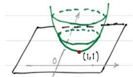

$$
\left\{ \begin{array}{l l} \frac {\partial f}{\partial x} (x, y) = 0, & 2 (x - 1) = 0 \quad \Rightarrow \quad x = 1 \\ \frac {\partial f}{\partial y} (x, y) = 0, & 2 (y - 1) = 0 \quad \Rightarrow \quad y = 1 \end{array} \right.
$$

**★ Examples**

Second order conditions.

▶ 1-d: $f''(x) > 0$

▶ 2-d: Hessian matrix

$$
\nabla^ {2} f = \left( \begin{array}{c c} \frac {\partial^ {2} f}{\partial x ^ {2}} & \frac {\partial^ {2} f}{\partial y \partial x} \\ \frac {\partial^ {2} f}{\partial x \partial y} & \frac {\partial^ {2} f}{\partial y ^ {2}} \end{array} \right), \text { formally } \nabla^ {2} f \succ 0
$$

For a symmetric matrix $A = \begin{pmatrix} a_{11} & a_{12} \\ a_{21} & a_{22} \end{pmatrix}$ ,

$$
A \succ 0 \text {   if   } (u, v) A \binom{u}{v} > 0 \forall (u, v) \in \mathbb {R} ^ {2},
$$

i.e., $\alpha_{11}u^{2} + 2a_{12}uv + a_{22}v^{2} > 0,\quad \forall u,v$

特殊值: Set v = 0, u = 1 → $a_{11} > 0$

$$
\text { Set   } u = 0, v = 1 \quad \rightarrow \quad a _ {2 2} > 0
$$

$$
\det (A) = a _ {1 1} a _ {2 2} - a _ {1 2} ^ {2} > 0
$$

**Topic 1: Introduction**

$2 \times 2$ symmetric $A \succ 0$ if $a_{11}$ and $\det(A) > 0$

A can be better viewed as $A=Q^{\top}\Lambda Q$ , where $\Lambda = \begin{pmatrix} \lambda_{1} & 0 \\ 0 & \lambda_{2} \end{pmatrix}$ and Q consists of corresponding eigenvectors, and $Q^{T}Q = I$

$$
A \succ 0 \Leftrightarrow \lambda_ {1} > 0, \lambda_ {2} > 0
$$

$$
A \not\succ 0 \left\{ \begin{array}{l} \lambda_ {1} \leq 0, \lambda_ {2} \leq 0 \\ \lambda_ {1} \lambda_ {2} \leq 0 (+, -) \quad \text {   saddle   pt   } \end{array} \right.
$$

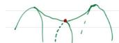

Notation. $f:\mathbb{R}^n\to \mathbb{R}\quad \pmb {x}\in \mathbb{R}^n,\quad \pmb {x} = (x_1,x_2,\dots,x_n)$

$$
D f \triangleq (\frac {\partial f}{\partial x _ {1}}, \frac {\partial f}{\partial x _ {2}},..., \frac {\partial f}{\partial x _ {n}}), \quad \nabla f = (D f) ^ {T} = \left( \begin{array}{c} \frac {\partial f}{\partial x _ {1}} \\ ... \\ \frac {\partial f}{\partial x _ {n}} \end{array} \right)
$$

特例: 1-d, $f'(x)$ is the slope of the tangent line $\frac{\partial f}{\partial x_{n}}$ at x

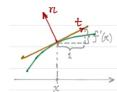

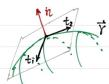

$$
\vec {n} = (- f ^ {\prime} (x), 1)
$$

$$
(x, y) \rightarrow (x, y, f (x, y))
$$

a parametrigation

$$
\vec {t} = (1, f ^ {\prime} (x))
$$

$$
\vec {t} _ {1} = \frac {\partial \vec {Y}}{\partial x} = (1, 0, \partial_ {x} f)
$$

$$
\vec {t} _ {2} = \frac {\partial \vec {r}}{\partial y} = (0, 1, \partial_ {y} f)
$$

$$
\vec {n} = \vec {t} _ {1} \times \vec {t} _ {2} = (- \partial_ {x} f, - \partial_ {y} f, 1)
$$

$H = \nabla^{2}f = (\frac{\partial^{2}f}{\partial x_{i}\partial x_{j}})$ . As $\frac{\partial^2f}{\partial x_i\partial x_j} = \frac{\partial^2f}{\partial x_j\partial x_i}$ , $\nabla^2$ is symmetric

★ Examples

3. $\min_{x,y} f(x,y)$ s.t. $x + y = 3$

$$
f (x, y) = (x - 1) ^ {2} + (y - 1) ^ {2}, \quad \Omega = \{(x, y) \in \mathbb {R} ^ {2} | x + y = 3 \}
$$

This is a 2-d smooth, convex and constrained optimization.

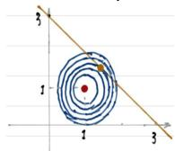

Level set $S_{c} = \{\pmb {x}:f(\pmb {x}) = c\}$

Level set $S_{c}$ is a curve in $R^{2}$

Graph of $f$ $(\pmb {x},f(\pmb {x}))\in \mathbb{R}^3$ is a surface in $\mathbb{R}^3$

Non-constrained minimum is at $(1,1)$ red pt $\nabla f(1,1)=0$

With an equality constraint, the minimum is changed to brown where $\nabla f \neq 0$

**★ Examples**

For this problem, we can eliminate y to get a 1-d non-constraint smooth and convex opt problem.

$$
y = 3 - x \quad \tilde {f} (x) \triangleq f (x, 3 - x) = (x - 1) ^ {2} + (x - 2) ^ {2}
$$

$$
\tilde {f} ^ {\prime} (x) = 0, \mathrm{so} x = \frac {3}{2}, y = \frac {3}{2} \tilde {f} ^ {\prime \prime} (x) = 4 > 0 \forall x
$$

$x = \frac{3}{2}$ is a local minimum, and as $\tilde{f}$ is convex, it is a global min. So $\min f(x,y)$ s.t. $x+y=3$ is $\frac{1}{2}$ , and the minimum pt $(\frac{3}{2},\frac{3}{2})$

Fact: for a convex function, a local minimum is also a global one (to be proved soon)

**Topic 1: Introduction**

level sets and gradient
$S_c = \{x | f(x) = c\}$. This is a smooth curve for most $c$.
How to represent/describe a curve $f(x) = c$? Parametrization.
$g: \mathbb{R} \to \mathbb{R}^n g(t) = (x(t), y(t))$ in $\mathbb{R}^2$ $h: \mathbb{R} \to \mathbb{R} h(t) \triangleq f(g(t))$ $h(t) = c$ by definition. So $h'(t) = 0$
By chain rule, $h'(t) = \nabla f(g(t)) \cdot g'(t)$. So for a pt $x_0 \in S_c$, we have $\nabla f(x_0) \cdot v = 0$ where $v$ is a tangent vector of $S_c$ at $x_0$.
Theorem. $\nabla f(x_0) \perp v$, $\forall v$ tangent vector at $x_0$ of the level set $S_c$ for $c = f(x_0)$ $\nabla f(x)$ is the direction of maximum rate of increase of $f$ at $x$
-$\nabla f(x)$ is the direction of maximum rate of decrease of $f$ at $x$
-$\nabla f(x)$: steepest descent direction

level sets and gradient
$S_c = \{x | f(x) = c\}$. This is a smooth curve for most $c$.
How to represent/describe a curve $f(x) = c$? Parametrization.
$g: \mathbb{R} \to \mathbb{R}^n g(t) = (x(t), y(t))$ in $\mathbb{R}^2$ $h: \mathbb{R} \to \mathbb{R} h(t) \triangleq f(g(t))$ $h(t) = c$ by definition. So $h'(t) = 0$
By chain rule, $h'(t) = \nabla f(g(t)) \cdot g'(t)$. So for a pt $x_0 \in S_c$, we have $\nabla f(x_0) \cdot v = 0$ where $v$ is a tangent vector of $S_c$ at $x_0$.
Theorem. $\nabla f(x_0) \perp v$, $\forall v$ tangent vector at $x_0$ of the level set $S_c$ for $c = f(x_0)$ $\nabla f(x)$ is the direction of maximum rate of increase of $f$ at $x$ $-\nabla f(x)$ is the direction of maximum rate of decrease of $f$ at $x$ $-\nabla f(x)$: steepest descent direction

**★ Examples**

4. Rosenbrock function $f(x_{1},x_{2}) = 100(x_{2} - x_{1}^{2})^{2} + (1 - x_{1})^{2}$

$$
\min _ {\boldsymbol {x} \in \mathbb {R} ^ {2}} f
$$

non-constrained, smooth, but non-convex

$\nabla f(\boldsymbol {x}) = \binom{-400x_{1}(x_{2} - x_{1}^{2}) - 2(1 - x_{1})}{200(x_{2} - x_{1}^{2})}$ , critical point (1,1)

$$
H(\boldsymbol{x})=\nabla^2 f(\boldsymbol{x})=\begin{pmatrix}1200x_1^2-400x_2+2 & -400x_1 \\ -400x_1 & 200\end{pmatrix}
$$

$H(1,1) = \left( \begin{array}{cc}802 & -400\\ -400 & 200 \end{array} \right),$ so $(1,1)$ is a local minimum.

(1, 1) is also a global minimum. It is inside a long, narrow, parabolic shaped flab valley.

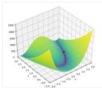

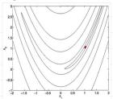

**6.1 习题**

$$
\begin{array}{l l} \text { minimize } & f (\boldsymbol {x}) \\ \text { subject   to } & \boldsymbol {x} \in \Omega , \end{array}
$$

where $f \in C^{2}$ . For each of the following specifications for $\Omega$ , $x^{*}$ , and f, determine if the given point $x^{*}$ is: (i) definitely a local minimizer; (ii) definitely not a local minimizer; or (iii) possibly a local minimizer.

b. $f: \mathbb{R}^2 \to \mathbb{R}$ , $\Omega = \{\pmb{x} = [x_1, x_2]^{\top}: x_1 \geq 1, x_2 \geq 2\}$ , $\pmb{x}^* = [1, 2]^{\top}$ , and gradient $\nabla f(\pmb{x}^*) = [1, 0]^{\top}$ .

**习题**

**6.1 Consider the problem**

$$
\begin{array}{l l} \text { minimize } & f (\boldsymbol {x}) \\ \text { subject   to } & \boldsymbol {x} \in \Omega , \end{array}
$$

where $f \in C^{2}$ . For each of the following specifications for $\Omega$ , $x^{*}$ , and f, determine if the given point $x^{*}$ is: (i) definitely a local minimizer; (ii) definitely not a local minimizer; or (iii) possibly a local minimizer.

c. $f: \mathbb{R}^2 \to \mathbb{R}$ , $\Omega = \{\pmb{x} = [x_1, x_2]^{\top}: x_1 \geq 0, x_2 \geq 0\}$ , $\pmb{x}^* = [1, 2]^{\top}$ , gradient $\nabla f(\pmb{x}^*) = [0, 0]^{\top}$ , and Hessian $\pmb{F}(\pmb{x}^*) = \pmb{I}$ (identity matrix).

d. $f:\mathbb{R}^2\to \mathbb{R},\Omega = \{\pmb {x} = [x_1,x_2]^{\top}:x_1\geq 1,x_2\geq 2\} ,\pmb{x}^{*} = [1,2]^{\top}$ gradient $\nabla f(\pmb{x}^{*}) = [1,0]^{\top}$ ,and Hessian

$$
\boldsymbol {F} (\boldsymbol {x} ^ {*}) = \left[ \begin{array}{c c} 1 & 0 \\ 0 & - 1 \end{array} \right].
$$

**知识点、重点、难点**

**知识点**

\- 优化问题的一般形式：

$$
\min _ {\boldsymbol {x} \in \Omega} f (\boldsymbol {x})
$$

其中 $f(x)$ 为目标函数， $\Omega$ 为约束集合。

\- 优化问题的主要分类：有约束 / 无约束、凸 / 非凸、光滑 / 非光滑。

\- 局部最小点与全局最小点的概念。

\- 梯度（Gradient）与 Hessian 矩阵在多维函数中的几何意义。

**知识点、重点、难点**

**重点**

优化问题的核心在于通过一阶条件 $\nabla f(x)=0$ 寻找候选极值点，并利用二阶条件（Hessian 的正定性）判断其为极小点；凸函数中局部最小即为全局最小，而含约束问题则常可通过变量消元化为无约束形式。

**难点**

\- 区分局部最小点、鞍点与约束最小点。

\- 约束优化中如何判断最优解是否在边界上。

**一句话总结：**

本节核心在于理解优化问题的建模、分类与基本求解原则，掌握梯度和 Hessian 在判断极值中的作用，为后续最优条件的学习奠定基础。
