# 2026-10-11 · 最优性条件与搜索方法

高级工程数学

**2026-10-11**

沈超敏

计算机科学与技术学院

cmshen@cs.ecnu.edu.cn

文附楼 105

**今天内容**

1. 上次内容（Ch. 5、Ch. 6 (Topic 1. Introduction)）的复习拓展
2. Topic 2: Optimality Conditions
3. Ch. 7
4. Gradient Methods
5. Newton’s Methods

上次: Elements of Calculus
5.1 Sequences and Limits
5.2 Differentiability
5.3 The Derivative Matrix
5.4 Differentiation Rules
5.5 Level Sets and Gradients
5.6 Taylor Series

## Topic 1 回顾

### 知识点

优化问题的一般形式：

$$
\min _ {\boldsymbol {x} \in \Omega} f (\boldsymbol {x})
$$

其中 f(x) 为目标函数，Ω 为约束集合。

优化问题的主要分类：有约束 / 无约束、凸 / 非凸、光滑 / 非光滑。

局部最小点与全局最小点的概念。

梯度（Gradient）与 Hessian 矩阵在多维函数中的几何意义。

**Topic 1 的知识点、重点、难点**

### 重点

优化问题的核心在于通过一阶条件 ∇f(x) = 0 寻找候选极值点，并利用二阶条件（Hessian 的正定性）判断其为极小点；凸函数中局部最小即为全局最小，而含约束问题则常可通过变量消元化为无约束形式。

### Topic 1 的难点

区分局部最小点、鞍点与约束最小点。

约束优化中如何判断最优解是否在边界上。

**一句话总结：**

本节核心在于理解优化问题的建模、分类与基本求解原则，掌握梯度和 Hessian 在判断极值中的作用，为后续最优条件的学习奠定基础。

**上次：习题**

**6.1 习题**

$$
\begin{array}{l l} \text { minimize } & f (\boldsymbol {x}) \\ \text { subject   to } & \boldsymbol {x} \in \Omega , \end{array}
$$

where $f \in { \mathcal { C } } ^ { 2 }$ . For each of the following specifications for $\Omega , { \pmb x } ^ { * }$ , and $f ,$ , determine if the given point ${ \pmb x } ^ { * }$ is: (i) definitely a local minimizer; (ii) definitely not a local minimizer; or (iii) possibly a local minimizer.

b. $\begin{array} { r l } & { f : \mathbb { R } ^ { 2 } \to \mathbb { R } , \Omega = \{ { \pmb x } = [ { \pmb x } _ { 1 } , { \pmb x } _ { 2 } ] ^ { \top } : x _ { 1 } \geq 1 , { \pmb x } _ { 2 } \geq 2 \} , { \pmb x } ^ { * } = [ 1 , 2 ] ^ { \top } } \\ & { \nabla f ( { \pmb x } ^ { * } ) = [ 1 , 0 ] ^ { \top } . } \end{array}$.

答案：Possibly a local minimizer

c. $f : \mathbb { R } ^ { 2 } \to \mathbb { R } , \Omega = \lbrace x = [ x _ { 1 } , x _ { 2 } ] ^ { \top } : x _ { 1 } \geq 0 , x _ { 2 } \geq 0 \rbrace , x ^ { * } = [ 1 , 2 ] ^ { \top }$ , gradient $\nabla f ( \pmb { x } ^ { * } ) = [ 0 , 0 ] ^ { \top }$ , and Hessian $\pmb { F } ( \pmb { x } ^ { * } ) = \pmb { I }$ (identity matrix).

d. $f : \mathbb{R}^{2}\to\mathbb{R}$, $\Omega=\{\pmb{x}=[x_1,x_2]^\top:x_1\geq1,x_2\geq2\}$, $\pmb{x}^*=[1,2]^\top$, gradient $\nabla f ( { \pmb x } ^ { * } ) = [ 1 , 0 ] ^ { \top }$ , and Hessian

$$
\boldsymbol {F} (\boldsymbol {x} ^ {*}) = \left[ \begin{array}{c c} 1 & 0 \\ 0 & - 1 \end{array} \right].
$$

C 是, D 不是

## Topic 2: Optimality Conditions

Three acronyms:

FONC (First Order Necessary Condition)

SONC (Second Order Necessary Condition)

SOSC (Second Order Sufficient Condition)

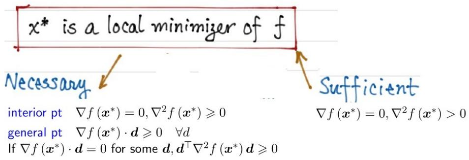

interior pt ∇f (x\*) = 0, ∇2 f (x\*) ≥ 0

general pt ∇f (x\*) · d ≥0 ∀d

**Topic 2: Condition**

### ⋆ Conditions for Local Minimizers

Global minimizer $\pmb { x } ^ { \ast } : f ( \pmb { x } ) \geqslant f \left( \pmb { x } ^ { \ast } \right) \quad \forall \pmb { x } \in \Omega \backslash \left\{ \pmb { x } ^ { \ast } \right\}$

Strict global minimizer $\pmb { x } ^ { \ast } : f ( \pmb { x } ) > f \left( \pmb { x } ^ { \ast } \right) \quad \forall \pmb { x } \in \Omega \backslash \left\{ \pmb { x } ^ { \ast } \right\}$

Mathematically, “near” can be characterized as $\| { \pmb x } - { \pmb x } ^ { * } \| < \varepsilon$

● $\scriptstyle { \pmb { x } } ^ { * }$ is a local minimizer if ∃ε &gt; 0, s.t.

$$
f (\boldsymbol {x}) \geqslant f \left(\boldsymbol {x} ^ {*}\right) \quad \forall \boldsymbol {x} \in \Omega \backslash \left\{\boldsymbol {x} ^ {*} \right\} \& \| \boldsymbol {x} - \boldsymbol {x} ^ {*} \| <   \varepsilon
$$

**Topic 2: Condition**

### ⋆ First Order Necessary Condition

Theorem. $\mathbf { \boldsymbol { x } } ^ { * }$ is a local minimizer of f over Ω. Then for any feasible direction d at $\mathbf { \boldsymbol { x } } ^ { * }$ , we have

$$
\nabla f \left(\boldsymbol {x} ^ {*}\right) \cdot \boldsymbol {d} \geqslant 0
$$

Explanation. 1 feasible direction d at a point $\pmb { x } \in \Omega$ is a direction so that: starting from x and moving towards d remains in Ω.

Math language: ∃α &gt; 0 s.t. $\pmb { x } + \alpha \pmb { d } \in \Omega , \forall \alpha \in [ 0 , \alpha _ { 0 } ]$

2 $\nabla f \left( \mathbf { x } ^ { * } \right) \cdot d$ : inner product of two vectors.

Also write as $\begin{array} { r l r l } { d ^ { \top } \nabla f \left( { \pmb x } ^ { * } \right) } & { { } \mathrm { o r } } & { \left( \nabla f \left( { \pmb x } ^ { * } \right) , { \pmb d } \right) , } & { \left. \nabla f \left( { \pmb x } ^ { * } \right) , { \pmb d } \right. } \end{array}$

${ \frac { \partial f } { \partial d } } \triangleq \nabla f$ · d is the directional derivative when $\| \pmb { d } \| = 1$

3 Define $\phi ( \alpha ) = f \left( \boldsymbol { x } ^ { * } + \alpha d \right)$ for $\alpha \in [ 0 , \alpha _ { 0 } ]$ , then

$$
\phi^ {\prime} (0) = \left\{ \begin{array}{l l} \lim _ {\alpha \to 0 ^ {+}} \frac {\phi (\alpha) - \phi (0)}{\alpha} = \lim _ {\alpha \to 0 ^ {+}} \frac {f (\boldsymbol {x} ^ {*} + \alpha \boldsymbol {d}) - f (\boldsymbol {x} ^ {*})}{\alpha} & \text {Def} \\ \nabla f \left(\boldsymbol {x} ^ {*}\right) \cdot \boldsymbol {d} & \text {Chain rule} \end{array} \right.
$$

**Topic 2: Condition**

Proof. Let d be any feasible direction at $\scriptstyle { \pmb { x } } ^ { * }$

Define $\phi ( \alpha ) = f \left( \boldsymbol { x } ^ { * } + \alpha \boldsymbol { d } \right)$ ，then

$$
\begin{array}{r c l} f \left(\boldsymbol {x} ^ {*} + \alpha \boldsymbol {d}\right) - f \left(\boldsymbol {x} ^ {*}\right) & = & \phi (\alpha) - \phi (0) = \phi^ {\prime} (0) \alpha + o (\alpha) \\ & = & \langle \nabla f \left(\boldsymbol {x} ^ {*}\right) \cdot \boldsymbol {d} \rangle \alpha + o (\alpha) \end{array}
$$

If $\scriptstyle { \pmb { x } } ^ { * }$ is a local minimizer,

$$
\left(\text { i.e., } \exists \varepsilon , \text { s.t. } f (\boldsymbol {x}) \geqslant f \left(\boldsymbol {x} ^ {*}\right), \forall \boldsymbol {x} \in \Omega \backslash \left\{\boldsymbol {x} ^ {*} \right\} \& \| \boldsymbol {x} - \boldsymbol {x} ^ {*} \| <   \varepsilon\right)
$$

for sufficiently small $\alpha$ (e.g., when $\|\alpha\pmb{d}\|<\varepsilon$), we have $f(\pmb{x}^*+\alpha\pmb{d})-f(\pmb{x}^*)\geq0$. Then

$$
\phi^ {\prime} (0) = \nabla f \left(\boldsymbol {x} ^ {*}\right) \cdot \boldsymbol {d} \geqslant 0
$$

FONC Two possibilities for a given feasible direction d.

$\nabla f(x^*)\cdot d>0$: $f(x^*+\alpha d)>f(x^*)$ for all sufficiently small $\alpha>0$.

$\nabla f(x^*)\cdot d=0$: check the second-order derivative.

### ⋆ Second Order Necessary Condition

Theorem If $\mathbf { \boldsymbol { x } } ^ { * }$ is a local minimizer of $f$ over $\Omega ,$ and there exists a feasible direction d at $\scriptstyle { \pmb { x } } ^ { * }$ s.t. $\nabla f \left( \pmb { x } ^ { * } \right) \cdot \pmb { d } = 0$ , then

$$
\boldsymbol {d} ^ {\top} \nabla^ {2} f (\boldsymbol {x} ^ {*}) \boldsymbol {d} \geqslant 0
$$

Proof Consider $\phi ( \alpha ) = f \left( \boldsymbol { x } ^ { * } + \alpha d \right)$ and its Taylor series at $\alpha = 0$

$$
\phi (\alpha) = \phi (0) + \phi^ {\prime} (0) \alpha + \frac {1}{2} \phi^ {\prime \prime} (0) \alpha^ {2} + o \left(\alpha^ {2}\right).
$$

$$
\text { as } \phi^ {\prime} (0) = \nabla f (\boldsymbol {x} ^ {*}) \cdot \boldsymbol {d} = 0
$$

So we have $\begin{array} { r } { \phi ( \alpha ) - \phi ( 0 ) = \frac { 1 } { 2 } \phi ^ { \prime \prime } ( 0 ) \alpha ^ { 2 } + o \left( \alpha ^ { 2 } \right) } \end{array}$ . Written in terms f is $f \left( \pmb { x } ^ { * } + \alpha \pmb { d } \right) - f \left( \pmb { x } ^ { * } \right) =$ $\begin{array} { r } { \frac { \alpha ^ { 2 } } { 2 } \pmb { d } ^ { \top } \nabla ^ { 2 } f \left( x ^ { * } \right) \pmb { d } + o \left( \alpha ^ { 2 } \right) } \end{array}$

If $\pmb { d } ^ { \top } \nabla ^ { 2 } f \left( \pmb { x } ^ { * } \right) \pmb { d } < 0$ , then for sufficiently small $\alpha$ (how small?)

which contradicts that $x ^ { * }$ is a local minimizer.

so, $\pmb { d } ^ { \top } \nabla ^ { 2 } f \left( \pmb { x } ^ { * } \right) \pmb { d } \geq 0 .$

**Topic 2: Condition**

Corollary $\mathbf { x } ^ { \ast }$ is an interior local minimizer of f. Then

FONC $\nabla f \left( \pmb { x } ^ { * } \right) = 0$

SONC: $d^{\top}\nabla^{2}f(\pmb{x}^{*})d\geq 0$ for all $d\in\mathbb{R}^{n}$.

Examples. 6.3 (p.86), 6.5 (p.89)

Necessary conditions are not sufficient

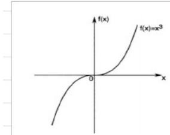

$$
f (x) = x ^ {3}, f ^ {\prime} (x) = 3 x ^ {2}, f ^ {\prime \prime} (x) = 6 x
$$

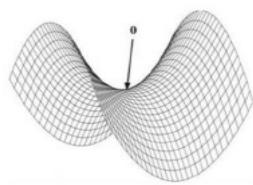

$$
f (\pmb {x}) = x _ {1} ^ {2} - x _ {2} ^ {2}
$$

0 is a saddle point $\nabla f ( \mathbf { 0 } ) = \mathbf { 0 }$ but neither a local minimizer nor maximizer By SONC, 0 is not a local minimizer!

### ⋆ Second Order Sufficient Condition

Th 6.3 (SOSC) $f \in C ^ { 2 } ( \Omega ) , x ^ { * } \in \Omega$ is an interior point.

Suppose that (1) $\nabla f \left( { { \pmb x } ^ { * } } \right) = { \bf 0 } ; \left( 2 \right) \nabla ^ { 2 } f \left( { { \pmb x } ^ { * } } \right) \succ 0 .$

Then $\mathbf { \boldsymbol { x } } ^ { * }$ is a strict local minimizer of $f .$

Pf. $\nabla ^ { 2 } f \left( x ^ { * } \right) \succ 0 \Leftrightarrow \lambda _ { \operatorname* { m i n } } \left( \nabla ^ { 2 } f \left( x ^ { * } \right) \right) > 0$

(Diagonalize $\nabla^2f(\mathbf{x}^*)=Q^\top\Lambda Q$.)

For a feasible direction $d\neq 0$, define $\phi(\alpha)=f(\boldsymbol{x}^*+\alpha\boldsymbol{d})$.

$$
\begin{array}{r l} & f (\boldsymbol {x} ^ {*} + \alpha \boldsymbol {d}) - f (\boldsymbol {x} ^ {*}) = \phi (\alpha) - \phi (0) = \frac {1}{2} \phi^ {\prime \prime} (0) \alpha^ {2} + o (\alpha^ {2}) \\ & \qquad = \frac {1}{2} \boldsymbol {d} ^ {\top} \nabla^ {2} f (\boldsymbol {x} ^ {*}) \boldsymbol {d} \alpha^ {2} + o (\alpha^ {2}) \\ & \qquad \geqslant \frac {1}{2} \lambda_ {\min} \| d \| ^ {2} \alpha^ {2} + o (\alpha^ {2}) > 0 \end{array}
$$

if α is sufficiently small.

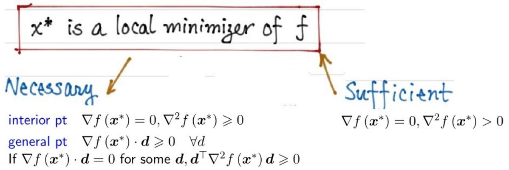

**习题**

**6.1 Consider the problem**

$$
\begin{array}{l l} \text { minimize } & f (\boldsymbol {x}) \\ \text { subject   to } & \boldsymbol {x} \in \Omega , \end{array}
$$

where $f \in { \mathcal { C } } ^ { 2 }$ . For each of the following specifications for $\Omega , { \pmb x } ^ { * }$ , and $f ,$ , determine if the given point ${ \pmb x } ^ { * }$ is: (i) definitely a local minimizer; (ii) definitely not a local minimizer; or (iii) possibly a local minimizer.

a. $\begin{array} { r l } & { f : \mathbb { R } ^ { 2 } \to \mathbb { R } , \Omega = \{ \mathbf { x } = [ x _ { 1 } , x _ { 2 } ] ^ { \top } : x _ { 1 } \geq 1 \} , \mathbf{x} ^ { * } = [ 1 , 2 ] ^ { \top } } \\ & { \nabla f ( \mathbf { x } ^ { * } ) = [ 1 , 1 ] ^ { \top } . } \end{array}$ , and gradient

**一定不是**

**3. 几何直观**

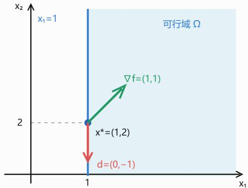

• 绿色箭头：梯度方向，函数值上升最快

• 红色箭头：可行的下降方向，函数值减小。

• 蓝色直线：约束边界 $x _ { 1 } = 1 ,$

## Ch 7. One-Dimensional Search Methods

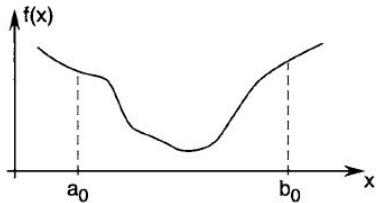

7.1 Introduction

7.2 Golden Section Search

7.3 Fibonacci Method

7.4 Bisection Method

7.5 Newton’s Method

7.6 Secant Method

7.7 Bracketing

7.8 Line Search in Multidimensional Optimization

**§2 单因素**

我们知道，钢要用某种化学元素来加强其强度，太少不好，太多也不好，例如，碳太多了成为生铁，碳太少了成为熟铁，都不成钢材，每吨要加多少碳才能达到强度最高？假定从理论上算出)每吨在1000克到2000克之间，普通的方法是加1001克，1002克，……，做下去，做了一千次以后，才能发现最好的选择，这种方法称为均分法，做一千次实验既浪费时又浪费原材料，为了迅速找出最优方案，我们建议以下的“折迭纸条法”

请牢记一个数0.618

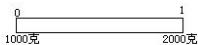

用一个有刻度的纸条表达1000\~2000克，在这纸条长度的0.618的地方划一条线，在这条线所指示的刻度做一次实验，也就是按1618克做一次实验

然后把纸条对中迭起，前一线落在另一层上的地方，再划一条线，这条线在1382克处，再按1382克做一次实验

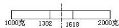

两次实验进行比较，如果1382克的好一些，我们在1618处把纸条的右边一段剪掉，得

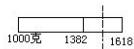

**Ch 7. One-Dimensional Search Methods**

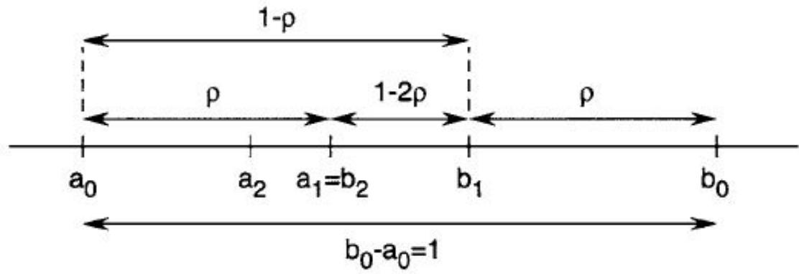

7.3 Fibonacci Method

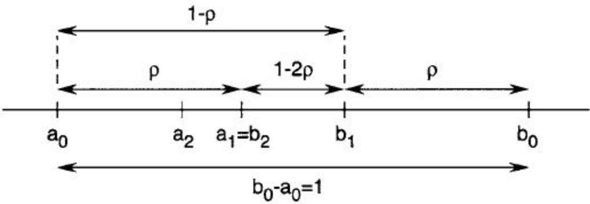

## Topic 3: Ch 8. Gradient Methods

$\nabla f ( x )$ is the direction of maximum rate of increase of f at x.

$- \nabla f ( x )$ is the direction of maximum rate of decrease of f at x.

Lemma (Cauchy–Schwarz inequality). For $\boldsymbol{a},\boldsymbol{b}\in\mathbb{R}^n$,

$$
\boldsymbol {a} \cdot \boldsymbol {b} = (\boldsymbol {a}, \boldsymbol {b}) = \sum_ {i = 1} ^ {n} a _ {i} b _ {i} \leqslant \left(\sum_ {i = 1} ^ {n} a _ {i} ^ {2}\right) ^ {\frac {1}{2}} \left(\sum_ {i = 1} ^ {n} b _ {i} ^ {2}\right) ^ {\frac {1}{2}} = \| \boldsymbol {a} \| \cdot \| \boldsymbol {b} \|
$$

Pf: Consider

$$
\begin{array}{r l} & y (t) = \left(\sum a _ {i} ^ {2}\right) t ^ {2} + \left(2 \sum a _ {i} b _ {i}\right) t + \sum b _ {i} ^ {2} \\ & \quad = \sum_ {i = 1} ^ {n} \left(a _ {i} ^ {2} t ^ {2} + 2 a _ {i} b _ {i} t + b _ {i} ^ {2}\right) \\ & \quad = \sum (a _ {i} t + b _ {i}) ^ {2} \geqslant 0 \end{array}
$$

$y ( t ) = 0$ if $a _ { i } t + b _ { i } = 0 ,$ , ∀i

$$
\mathrm{So} \Delta = (2 \Sigma a _ {i} b _ {i}) ^ {2} - 4 (\Sigma a _ {i} ^ {2}) (\Sigma b _ {i} ^ {2}) \leqslant 0
$$

Topic 3: Gradient Methods

Apply to $( \nabla f , d ) \leqslant \| \nabla f \| \cdot \| d \| = \| \nabla f \| { \mathrm { ~ i f ~ } } \| d \| = 1$

Equality holds $\begin{array} { r } { \Leftrightarrow d = \frac { \nabla f } { \| \nabla f \| } } \end{array}$

Therefore $- \nabla f ( { \pmb x } )$ is the max-rate descending direction. When $\nabla f ( { \pmb x } ) \neq { \bf 0 }$ , for α sufficiently small, $f ( { \pmb x } - \alpha \nabla f ( { \pmb x } ) ) < f ( { \pmb x } )$

**Topic 3: Gradient Methods**

Gradient Descent Algorithm:

Start from $\mathbf { x } ^ { 0 }$ for $k = 0 , 1 , 2 , \cdots$ till converge

$$
\boldsymbol {x} ^ {k + 1} = \boldsymbol {x} ^ {k} - \alpha_ {k} \nabla f (\boldsymbol {x} ^ {k})
$$

Ideal condition: $\left\| \nabla f \left( { \boldsymbol { x } } ^ { k } \right) \right\| = 0$

Practical conditions:

gradient condition $\left\| \nabla f \left( \mathbf { x } ^ { k } \right) \right\| < \varepsilon$

success objective condition $\frac { \left| f \big ( x ^ { k + 1 } \big ) - f \big ( x ^ { k } \big ) \right| } { \left| f \big ( x ^ { k } \big ) \right| } < \varepsilon$

successive point difference $\frac { \left\| \mathbf { { x } } ^ { k + 1 } - \mathbf { { x } } ^ { k } \right\| } { \left\| \mathbf { { x } } ^ { k } \right\| } < \varepsilon$

Replace denominator by max $\left\{ 1 , \left| f \left( \pmb { x } ^ { k } \right) \right| \right\}$ or max $\{ 1 , \| \pmb { x } ^ { k } \| \}$ to avoid division by tiny numbers

Topic 3: Gradient Methods Step size:

1. Exact line search. Expensive and not worth

2. Fixed estimate value.

3. Line search (Ch. 7).

具体地

1. Exact or “best” for $\phi _ { k } ( \alpha ) = f \left( x _ { k } - \alpha \nabla f \left( x _ { k } \right) \right)$

$$
\alpha_ {k} = \underset {\alpha \geqslant 0} {\arg \min} \phi_ {k} (\alpha)
$$

This is called Steepest Descent method.

**梯度下降法的性质：相邻方向垂直**

$$
\alpha_ {k} = \arg \min _ {\alpha \geq 0} f (x _ {k} - \alpha \nabla f (x _ {k})).
$$

令

$$
\phi (\alpha) = f (x _ {k} - \alpha \nabla f (x _ {k})).
$$

由于 $\alpha _ { k }$ 是内部极小点，所以

利用链式法则

$$
\phi^ {\prime} (\alpha_ {k}) = 0.
$$

$$
\phi^ {\prime} (\alpha) = - \nabla f (x _ {k} - \alpha \nabla f (x _ {k})) ^ {T} \nabla f (x _ {k}).
$$

代入 $\alpha _ { k }$ ，得到

$$
- \nabla f (x _ {k + 1}) ^ {T} \nabla f (x _ {k}) = 0.
$$

因此

$$
\boxed {\nabla f (x _ {k + 1}) ^ {T} \nabla f (x _ {k}) = 0}
$$

**Topic 3: Gradient Methods**

2. Based on properties of f, choose a fixed value

small: converges slow

large: may diverge faster

convergence eficiency

3. Several practical line search algorithms

• Golden section • Newton’s method

• Fibonacci • Secant method

**梯度下降法缺点**

作业

编写一个完整的最速下降算法，

1. 定义 f(x)

2. 给出 $\scriptstyle { \pmb { x } } ^ { * }$ 的算法

运行时，输入 f(x) 和 $\scriptstyle { \mathbf { { \mathit { x } } } } _ { 0 }$

输出 $\mathbf { \boldsymbol { x } } ^ { * }$

Consider  $\min_{x\in\mathbb{R}^{n}}f(x)$ $\cdot n=1$ $x_{k+1}=x_{k}-\left(f''(x_{k})\right)^{-1}f'(x_{k})$ $\cdot n>1$ $x_{k+1}=x_{k}-\left(\nabla^{2}f(x_{k})\right)^{-1}\nabla f(x_{k})$

Another form ① solve  $\nabla^{2}f(x_{k})d_{k}=-\nabla f(x_{k})$
② update  $x_{k+1}=x_{k}+d_{k}$

Remark. Do not require  $\nabla^{2}f(x_{k})>0$  only needs non-singular (invertible).
Namely, Newton's method also works for non-convex optimization problems.
but may not find local min.

Topic 4: Newton’s method

Pro. 1. Converges super-fast (quadratic rate).

2. Affine invariant.

Cons. 1. Local convergence; requires $\|x_0-x^*\|$ to be sufficiently small.

2. Computational cost: forming the Hessian costs $O(n^2)$, and computing $(\nabla^2f)^{-1}$ costs $O(n^3)$.

Topic 4: Newton’s method

Derivation, Given current approximate xk, approximates f by its quadratic Taylor series

$$
f (x) \approx f _ {g} (x; x _ {k}) := f (x _ {k}) + (\nabla f (x _ {k}), x - x _ {k}) + \frac {1}{2} (\nabla^ {2} f (x _ {k}) (x - x _ {k}), x - x _ {k})
$$

$$
\begin{array}{l l} {\underset {x \in \mathbb {R} ^ {n}} {\min} f (x)} & {\longrightarrow \underset {x \in \mathbb {R} ^ {n}} {\min} f _ {\mathfrak {g}} (x; x _ {k}) \longrightarrow \nabla f _ {\mathfrak {g}} (x _ {k + 1}; x _ {k}) = 0.} \\ & {\quad \downarrow} \\ {\nabla f _ {\mathfrak {g}} (x; x _ {k}) = \nabla f (x _ {k}) + \nabla^ {2} f (x _ {k}) (x - x _ {k})} & {\mathrm {Newton^ {\prime} s method}} \end{array}
$$

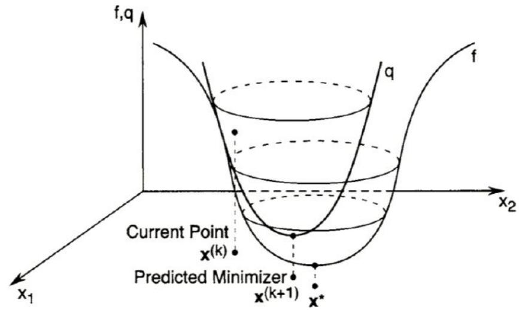

Topic 4: Newton’s method

**Convergence Analysis.**

Theorem. Suppose $f\in C^3$, $x^*$ is a critical point, i.e., $\nabla f(x^*)=0$, and $\nabla^2f(x^*)$ is invertible. Then for all $x_0$ sufficiently close to $x^*$, Newton’s method is well defined for all $k$ and satisfies $\|x_{k+1}-x^*\|\leq C\|x_k-x^*\|^2$ for $k=0,1,2,\ldots$. Proof. Denote $F(x)=\nabla^2f(x)$. Then $\det F(x)\in C^1$. Since $\det F(x^*)\ne0$, for sufficiently small $\varepsilon>0$, $\det F(x)\ne0$ whenever $\|x-x^*\|<\varepsilon$. Thus $F(x)$ is invertible.

Furthermore $\| F^{-1}(x) \| \leqslant c$, $\forall \| x - x^* \| < \varepsilon$.

Assume $x_k$ satisfies $\| x_k - x^* \| < \varepsilon$, then $F^{-1}(x_k)$ exists and $\| F^{-1}(x_k) \| \leqslant c$.

Then $x_{k+1} - x^* = x_k - x^* - (\nabla^2 f(x_k))^{-1} \nabla f(x_k)$ $= (\nabla^2 f(x_k))^{-1} [\nabla^2 f(x_k)(x_k - x^*) - \nabla f(x_k)]$.

We apply first order Taylor expansion to $\nabla f(x^*)$ at $x_k$ to get

$\nabla f(x^*) = \nabla f(x_k) + \nabla^2 f(x_k)(x^* - x_k) + O(\| x_k - x^* \|^2)$

Note that $\nabla f(x^*) = 0$ and the sign change, we have

$\nabla^2 f(x_k)(x_k - x^*) - \nabla f(x_k) = O(\| x_k - x^* \|^2)$.

Therefore $\| x_{k+1} - x^* \| \leqslant C\|\left(\nabla^2 f(x_k)\right)^{-1} \| \| x_k - x^* \|^2$ $\leqslant C_1 \| x_k - x^* \|^2$

## Topic 4: Newton’s method

Topic 4: Newton’s method

Choosing $\varepsilon$ smaller if necessary so that $C_1\varepsilon^2<\varepsilon$, we conclude that $\|x_{k+1}-x^*\|<\varepsilon$ and $F(x_{k+1})^{-1}$ exists with $\|F(x_{k+1})^{-1}\|\leq C$. Thus, if $\|x_0-x^*\|<\varepsilon$, then $\|x_k-x^*\|<\varepsilon$ and $\|x_{k+1}-x^*\|\leq C_1\|x_k-x^*\|^2$ for all $k=0,1,2,\ldots$, which implies local quadratic convergence.

**Modification of Newton's method.**

Newton's method may not be a descent method, i.e. $f(x_{k+1}) > f(x_k)$ is possible (e.g. $x^*$ is a local maximum). Have to restrict to strictly convex functions.

Lemma. Assume $\nabla^2 f(x) > 0, \forall x$. If $\nabla f(x_k) \neq 0$, then Newton's direction $d_k = -(\nabla^2 f(x_k))^{-1} \nabla f(x_k)$ is a descent direction in the sense that $f(x_k+\alpha d_k)<f(x_k)$ for all sufficiently small $\alpha>0$.

Proof. Let $\phi(\alpha)=f(x_k+\alpha d_k)$. Then

$$\phi'(0)=\nabla f(x_k)^\top d_k=-\nabla f(x_k)^\top(\nabla^2f(x_k))^{-1}\nabla f(x_k)<0,$$

because $\nabla^2f(x_k)$ is positive definite.

**Topic 4: Newton’s method**

For convex functions, use the following modification:

1. Compute $d_k$ by solving $\nabla^2f(x_k)d_k=-\nabla f(x_k)$.
2. Find $\alpha_k=\arg\min_{\alpha\geq0}f(x_k+\alpha d_k)$ by line search.
3. Update $x_{k+1}=x_k+\alpha_kd_k$.

What if  $\nabla^{2}f$  is not SPD? Note that for non-convex functions, the gradient method  $x_{k+1}=x_{k}-\alpha_{k}I\nabla f(x_{k})$  is always a descent method. This motivates the Levenberg-Marquardt modification

$$
x _ {k + 1} = x _ {k} - \alpha_ {k} (\nabla^ {2} f (x _ {k}) + \mu_ {k} I) ^ {- 1} \nabla f (x _ {k}),
$$

where $\mu_k>0$ is chosen so that $\nabla^2f(x_k)+\mu_k I$ is positive definite, and $\alpha_k>0$ is a step size.

It is a mixture of Newton and gradient methods:

μk=0. Newton's method.

$\mu_k\to+\infty$. Gradient method.
