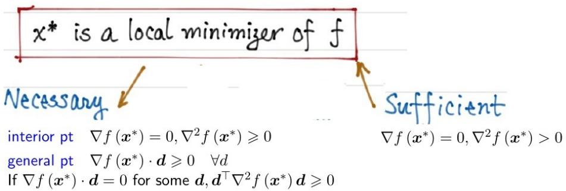
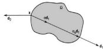
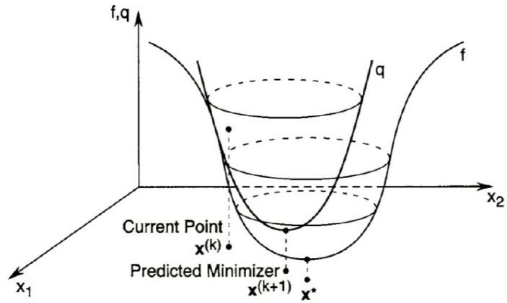
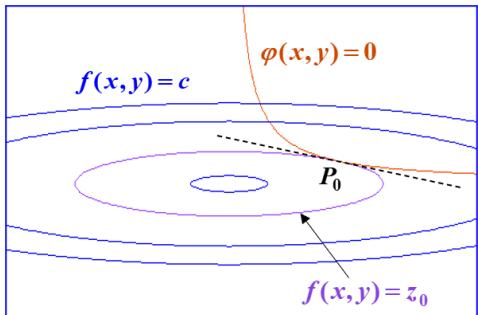
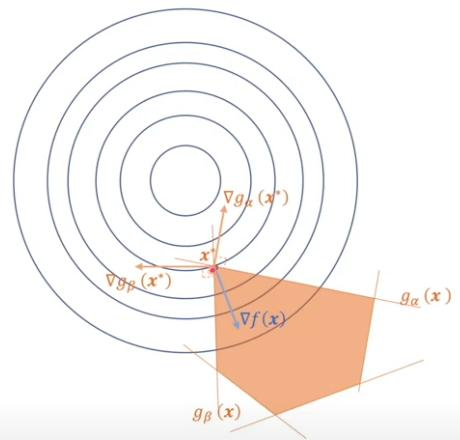

# 2026-10-18 课程讲义

高级工程数学

## 2026-10-18

沈超敏

计算机科学与技术学院

cmshen@cs.ecnu.edu.cn

文附楼 105

## 今天内容

\- 复习、拓展

Topic 2 Conditions

Ch. 7 (一维搜索方法)

Gradient Methods

Newton's Methods

\- Lagrange 乘子法

• The Karush–Kuhn–Tucker (KKT) Conditions

## 上次内容回顾: Topic 2: Optimality Conditions

Three acronyms:

• FONC (First Order Necessary Condition)

• SONC (Second Order Necessary Condition)

• SOSC (Second Order Sufficient Condition)



interior pt $\nabla f(x^{*}) = 0, \nabla^{2}f(x^{*}) \geqslant 0$

general pt $\nabla f(x^{*})\cdot d\geqslant 0\quad \forall d$

## Topic 2: Conditions

## ★ First Order Necessary Condition

Theorem. $x^{*}$ is a local minimizer of f over $\Omega$ . Then for any feasible direction d at $x^{*}$ , we have

$$
\nabla f \left(\boldsymbol {x} ^ {*}\right) \cdot \boldsymbol {d} \geqslant 0
$$

Explanation. ① feasible direction d at a point $x \in \Omega$ is a direction so that: starting from x and moving towards d remains in $\Omega$ .

Math language: $\exists\alpha_{0}&gt;0$ s.t. $x+\alpha d\in\Omega,\forall\alpha\in[0,\alpha_{0}]$



② $\nabla f(x^{*}) \cdot d$ : inner product of two vectors.

Also write as $\boldsymbol{d}^{\top}\nabla f(\boldsymbol{x}^{*})$ or $(\nabla f(\boldsymbol{x}^{*}),\boldsymbol{d})$ , $\langle\nabla f(\boldsymbol{x}^{*}),\boldsymbol{d}\rangle$

$\frac{\partial f}{\partial d} \triangleq \nabla f \cdot d$ is the directional derivative when $\| d \| = 1$

• ③ Define $\phi(\alpha) = f(x^{*} + \alpha d)$ for $\alpha \in [0, \alpha_{0}]$ , then

$$
\phi^ {\prime} (0) = \left\{ \begin{array}{l l} \lim _ {\alpha \to 0 ^ {+}} \frac {\phi (\alpha) - \phi (0)}{\alpha} = \lim _ {\alpha \to 0 ^ {+}} \frac {f (\boldsymbol {x} ^ {*} + \alpha \boldsymbol {d}) - f (\boldsymbol {x} ^ {*})}{\alpha} & \text {Def} \\ \nabla f \left(\boldsymbol {x} ^ {*}\right) \cdot \boldsymbol {d} & \text {Chain rule} \end{array} \right.
$$

## Ch 7. One-Dimensional Search Methods


7.1 Introduction

7.2 Golden Section Search

7.3 Fibonacci Method

7.4 Bisection Method

7.5 Newton's Method

7.6 Secant Method

7.7 Bracketing

7.8 Line Search in Multidimensional Optimization

Topic 3: Gradient Methods

## 梯度方向是函数值增大最快的方向

$$
\text { Apply   to } (\nabla f, \boldsymbol {d}) \leqslant \| \nabla f \| \cdot \| \boldsymbol {d} \| = \| \nabla f \| \text { if } \| \boldsymbol {d} \| = 1
$$

Equality holds $\Leftrightarrow \pmb{d} = \frac{\nabla f}{\|\nabla f\|}$

Therefore $-\nabla f(\boldsymbol{x})$ is the max-rate descending direction. When $\nabla f(\boldsymbol{x}) \neq \mathbf{0}$ , for $\alpha$ sufficiently small, $f(\boldsymbol{x} - \alpha \nabla f(\boldsymbol{x})) &lt; f(\boldsymbol{x})$ .

## Topic 3: Gradient Methods

Gradient Descent Algorithm:

Start from $x^{0}$ for $k = 0, 1, 2, \cdots$ till converge

$$
\boldsymbol {x} ^ {k + 1} = \boldsymbol {x} ^ {k} - \alpha_ {k} \nabla f (\boldsymbol {x} ^ {k})
$$

Ideal condition: $\left\| \nabla f(x^k)\right\| = 0$

Practical conditions:

gradient condition $\left\| \nabla f\left(\boldsymbol{x}^k\right)\right\| &lt;  \varepsilon$

success objective condition $\frac{|f(x^{k+1}) - f(x^k)|}{|f(x^k)|} &lt; \varepsilon$

successive point difference $\frac{\left\|\boldsymbol{x}^{k+1}-\boldsymbol{x}^{k}\right\|}{\left\|\boldsymbol{x}^{k}\right\|}&lt;\varepsilon$

Replace denominator by $\max\left\{1,|f\left(\boldsymbol{x}^{k}\right)|\right\}$ or $\max\{1,\|\boldsymbol{x}^{k}\|\}$ to avoid division by tiny numbers.

## 梯度下降法的性质：相邻方向垂直

$$
\alpha_ {k} = \arg \min _ {\alpha \geq 0} f (x _ {k} - \alpha \nabla f (x _ {k})).
$$

令

$$
\phi (\alpha) = f (x _ {k} - \alpha \nabla f (x _ {k})).
$$

由于 $\alpha_{k}$ 是内部极小点，所以

利用链式法则，

$$
\phi^ {\prime} (\alpha_ {k}) = 0.
$$

$$
\phi^ {\prime} (\alpha) = - \nabla f (x _ {k} - \alpha \nabla f (x _ {k})) ^ {T} \nabla f (x _ {k}).
$$

代入 $\alpha_{k}$ ，得到

$$
- \nabla f (x _ {k + 1}) ^ {T} \nabla f (x _ {k}) = 0.
$$

因此

$$
\boxed {\nabla f (x _ {k + 1}) ^ {T} \nabla f (x _ {k}) = 0}
$$

上次作业

编写一个完整的最速下降算法，

1. 定义 $f(\pmb{x})$

2. 给出 $x^{*}$ 的算法

运行时，输入 $f(x)$ 和 $x_{0}$

输出 $x^{*}$

```
<div class="mineru-algorithm" style="white-space: pre-wrap; font-family:monospace;">
Consider  $\min_{x\in\mathbb{R}^{n}}f(x)$ $\cdot n=1$ $x_{k+1}=x_{k}-\left(f''(x_{k})\right)^{-1}f'(x_{k})$ $\cdot n&gt;1$ $x_{k+1}=x_{k}-\left(\nabla^{2}f(x_{k})\right)^{-1}\nabla f(x_{k})$ 

Another form ① solve  $\nabla^{2}f(x_{k})d_{k}=-\nabla f(x_{k})$ 

② update  $x_{k+1}=x_{k}+d_{k}$ 

Remark. Do not require  $\nabla^{2}f(x_{k})&gt;0$  only needs non-singular (invertible).

Namely, Newton's method also works for non-convex optimization problems.

but may not find local min.
</div>
```



## 今天：Lagrange 乘子法

A series of steps by which you could get the answer if you didn't understand what you were trying to do.

Feynman

即使你不明白自己在做什么，也能通过一系列步骤得到答案。

## Video: Lagrange 乘子法 (Constrained Optimization)

1. Constrained optimization introduction

https://www.youtube.com/watch?v=vwUV2IDLP8Q

2. Lagrange multipliers, using tangency to solve constrained optimization

https://www.youtube.com/watch?v=yuqB-d5MjZA

3. Finishing the introduction to Lagrange multiplier example

https://www.youtube.com/watch?v=aep6lwPqm6I

4. Meaning of Lagrange multiplier

https://www.youtube.com/watch?v=m-G3K2GPmEQ

5. Proof for the meaning of Lagrange multipliers

https://www.youtube.com/watch?v=b9B2FZ5cqbM

约 30min

## 问题引入

```
<div class="mineru-algorithm" style="white-space: pre-wrap; font-family:monospace;">
很多极值问题, 目标函数的自变量不能在其定义域上自由变化, 而是要受到某些条件的约束.
例 (1)
要设计一个容积为 V 的长方形无盖水箱, 试问长、宽、高各等于多少时, 可使得表面积最小?
若设长、宽、高各等于 x, y, z, 则
目标函数:  $S = 2z(x + y) + xy$ ;
约束条件: xyz = V.
</div>
```

定义（极值（最值））

设目标函数为

$$
y = f \left(x _ {1}, x _ {2}, \dots , x _ {n}\right), \quad \left(x _ {1}, x _ {2}, \dots , x _ {n}\right) \in D \subset \mathbb {R} ^ {n};
$$

约束条件为如下一组方程:

$$
\Phi : \varphi_ {k} (x _ {1}, x _ {2}, \dots , x _ {n}) = 0, \quad k = 1, 2, \dots , m \quad (m <   n).
$$

为简便起见, 记 $P = (x_{1}, x_{2}, \cdots, x_{n})$ , 并设

$$
\Omega = \left\{P \mid P \in D, \varphi_ {k} (P) = 0, k = 1, 2, \dots , m \right\}.
$$

若存在 $P_0 \in \Omega, \delta &gt; 0$ , 使得

$$
f \left(P _ {0}\right) \leq f (P), \quad \forall P \in \Omega \cap U \left(P _ {0}; \delta\right) (\text {或} \forall P \in \Omega),
$$

则称 $f(P_0)$ 是 $f(P)$ 在约束条件 $\Phi$ 之下的极小值 (或最小值), 称 $P_0$ 是相应的极小值点 (或最小值点).

类似地, 可定义条件极大 (或最大) 值.

## 拉格朗日乘数法

拉格朗日乘数法探源 先从 $n = 2, m = 1$ 的最简情形说起，即设目标函数与约束条件分别为

$$
z = f (x, y) \quad {\text {与}} \quad \varphi (x, y) = 0.\tag{1}
$$

若由 $\varphi(x, y) = 0$ 确定了隐函数 $y = y(x)$ ，则使得目标函数成为一元函数 $z = f(x, y(x))$ 。再由

$$
\frac {\mathrm{d} z}{\mathrm{d} x} = f _ {x} + f _ {y} \cdot \frac {\mathrm{d} y}{\mathrm{d} x} = f _ {x} - f _ {y} \cdot \frac {\varphi_ {x}}{\varphi_ {y}} = 0
$$

求出稳定点 $P_{0}(x_{0},y_{0})=(x_{0},y(x_{0}))$ ，在此点处满足

$$
\left. (f _ {x} \varphi_ {y} - f _ {y} \varphi_ {x}) \right| _ {P _ {0}} = 0
$$

$$
\left. \left(f _ {x} \varphi_ {y} - f _ {y} \varphi_ {x}\right) \right| _ {P _ {0}} = 0, \quad \text { i   .   e   .   , } \quad \frac {f _ {x}}{f _ {y}} = \frac {\varphi_ {x}}{\varphi_ {y}}
$$

而 f 的梯度为 $(f_{x}, f_{y})$ ， $\varphi$ 的梯度为 $(\varphi_{x}, \varphi_{y})$ ，所以 $(f_{x}, f_{y})$ 与 $(\varphi_{x}, \varphi_{y})$ 成比例。

或者说，表示 $f$ 的等值线

$$
f (x, y) = z _ {0}
$$

与曲线 $\varphi(x,y)=0$ 在点 $P_{0}$ 有公共切线，见图.



由此推知: 存在比例常数 $\lambda_{0}$ ，满足 $(f_{x}(P_{0}), f_{y}(P_{0})) + \lambda_{0}(\varphi_{x}(P_{0}), \varphi_{y}(P_{0})) = (0, 0)$ .

这又表示: 对于函数

$$
L (x, y, \lambda) = f (x, y) + \lambda \varphi (x, y),
$$

在点 $(x_{0},y_{0},\lambda_{0})$ 处恰好满足:

$$
\left. \left(f _ {x} \varphi_ {y} - f _ {y} \varphi_ {x}\right) \right| _ {P _ {0}} = 0
$$

即

$$
\left\{ \begin{array}{l} L _ {x} = f _ {x} (x, y) + \lambda \varphi_ {x} (x, y) = 0, \\ L _ {y} = f _ {y} (x, y) + \lambda \varphi_ {y} (x, y) = 0, \\ L _ {\lambda} = \varphi (x, y) = 0. \end{array} \right.\tag{2}
$$

也就是说, (2) 式是函数 $L(x, y, \lambda)$ 在其极值点处所满足的必要条件.

由此产生了一个重要思想:

拉格朗日乘数法 对于前面定义中所设的一般目标函数和约束条件组，应引入辅助函数

$$
\begin{array}{l} L \left(x _ {1}, x _ {2}, \dots , x _ {n}, \lambda_ {1}, \lambda_ {2}, \dots , \lambda_ {m}\right) \\ = f \left(x _ {1}, x _ {2}, \dots , x _ {n}\right) + \sum_ {k = 1} ^ {m} \lambda_ {k} \varphi_ {k} \left(x _ {1}, x _ {2}, \dots , x _ {n}\right). \end{array}
$$

称此函数为拉格朗日函数, 其中 $\lambda_{1}, \lambda_{2}, \cdots, \lambda_{m}$ 称为拉格朗日乘数.

## 拉格朗日乘数法应用举例

例 (1)

求 $S = 2(xz + yz) + xy$ 在约束条件 $V = xyz$ 下的极值.

解 此例 以往的解法是从条件式解出显函数, 例如 $z = \frac{V}{xy}$ , 代入目标函数后, 转而求解

$$
S = \frac {2 V}{x y} (x + y) + x y
$$

的普通极值问题.

无法将条件式作显化处理时，此法就无法进行了.

现在作拉格朗日函数

并求解以下方程组:

$$
L = 2 (x z + y z) + x y + \lambda (x y z - V),
$$

$$
\left\{ \begin{array}{l} L _ {x} = 2 z + y + \lambda y z = 0 \\ L _ {y} = 2 z + x + \lambda x z = 0 \\ L _ {z} = 2 (x + y) + \lambda x y = 0, \\ L _ {\lambda} = x y z - V = 0. \end{array} \right.
$$

为消去 $\lambda$ ，将前三式分别乘以 $x,y,z$ ，则得

$$
\left\{ \begin{array}{l} 2 x z + x y = - \lambda x y z \\ 2 y z + x y = - \lambda x y z \\ 2 z (x + y) = - \lambda x y z \end{array} \right.
$$

两两相减后立即得出 x = y = 2z，再代入第四式，得

$$
x = \sqrt [ 3 ]{2 V} = y, z = \sqrt [ 3 ]{2 V} / 2.
$$

注 由以上结果还可以得到一个不等式 (这是获得不等式的一种好方法). 那就是具体算出目标函数 (表面积) 的最小值:

$$
S _ {\mathrm{min}} = 2 \cdot \frac {\sqrt [ 3 ]{2 V}}{2} (\sqrt [ 3 ]{2 V} + \sqrt [ 3 ]{2 V}) + (\sqrt [ 3 ]{2 V}) ^ {2} = 3 \sqrt [ 3 ]{4 V ^ {2}}
$$

于是有 $2z(x + y) + xy \geq 3\sqrt[3]{4V^2}$ , 其中 $V = xyz$ . 消去 $V$ 后便得不等式

例 (2)

抛物面 $z = x^{2} + y^{2}$ 被平面 $x + y + z = 1$ 截成一个椭圆．求该椭圆到原点的最长和最短距离.

解 这个问题的目标函数是 $f(x, y, z) = \sqrt{x^2 + y^2 + z^2}$ 在条件 $z = x^2 + y^2$ 及 $x + y + z = 1$ 下的最值问题.

为了计算方便, 把目标函数改取距离的平方 (这是等价的), 即设

$$
L = x ^ {2} + y ^ {2} + z ^ {2} + \lambda (x ^ {2} + y ^ {2} - z) + \mu (x + y + z - 1).
$$

求解以下方程组:

$$
\left. \begin{array}{l} L _ {x} = 2 x + 2 \lambda x + \mu = 0, \\ L _ {y} = 2 y + 2 \lambda y + \mu = 0, \\ L _ {z} = 2 z - \lambda + \mu = 0, \\ L _ {\lambda} = x ^ {2} + y ^ {2} - z = 0, \\ L _ {\mu} = x + y + z - 1 = 0. \end{array} \right\} \Rightarrow \left\{ \begin{array}{r l} & 2 (x + \lambda x) \\ & = 2 (y + \lambda y) \\ & = 2 z - \lambda . \end{array} \right.
$$

由此又得 $(1 + \lambda)(x - y) = 0 \Rightarrow x = y$ . 再代入条件式, 继而得到: (这里 $\lambda \neq -1$ , 否则将无解)

$$
\begin{array}{c} {2 x ^ {2} + 2 x - 1 = 0} \\ {x = y = \frac {- 1 \pm \sqrt {3}}{2}, z = 1 - (- 1 \pm \sqrt {3}) = 2 \mp \sqrt {3}} \end{array}
$$

这是拉格朗日函数的稳定点. 由于所求问题存在最大值和最小值, 所以

$$
\begin{array}{l} x ^ {2} + y ^ {2} + z ^ {2} = \frac {2 (- 1 \pm \sqrt {3}) ^ {2}}{4} + (2 \mp \sqrt {3}) ^ {2} \\ = \left\{ \begin{array}{l l} \frac {1}{2} (1 - 2 \sqrt {3} + 3) + 4 - 4 \sqrt {3} + 3 = 9 - 5 \sqrt {3}, \\ \frac {1}{2} (1 + 2 \sqrt {3} + 3) + 4 + 4 \sqrt {3} + 3 = 9 + 5 \sqrt {3}. \end{array} \right. \end{array}
$$

故原点至已知曲线上点的最小距离与最大距离分别为

$$
d _ {\mathrm{min}} = \sqrt {9 - 5 \sqrt {3}}, d _ {\mathrm{max}} = \sqrt {9 + 5 \sqrt {3}}
$$

例 (3)

已知圆柱面

$$
x ^ {2} + y ^ {2} + z ^ {2} - x y - y z - z x - 1 = 0,\tag{4}
$$

它与平面 $x + y - z = 0$ 相交得一椭圆，试求此椭圆的面积.

分析

(i) 如果能求得该椭圆的长、短半轴 a 与 b，则椭圆面积为 $\pi ab$ ;

(ii) 由方程 (4)，此圆柱面关于坐标原点是对称的，故此圆柱面的中心轴是通过坐标原点的某一直线；

(iii) 因为所给平面也是通过坐标原点的，所以此平面上的椭圆截线必以坐标原点为其中心点.

解 由以上分析, 自原点至椭圆上任意点 $(x, y, z)$ 的距离 $d = \sqrt{x^2 + y^2 + z^2}$ 之最大、小值, 就是该椭圆的长、短半轴.

(说明: 本例的题型与例 2 相类似, 但在具体计算策略上将有较大差异.)

设拉格朗日函数为

$$
\begin{array}{c} L = x ^ {2} + y ^ {2} + z ^ {2} + \lambda (x + y - z) \\ - \mu \left(x ^ {2} + y ^ {2} + z ^ {2} - x y - y z - z x - 1\right) \end{array}
$$

并令

$$
\left[ L _ {x} = 2 x + \lambda - \mu (2 x - y - z) = 0, \right.\tag{5}
$$

$$
L _ {y} = 2 y + \lambda - \mu (2 y - z - x) = 0,\tag{6}
$$

$$
L _ {z} = 2 z - \lambda - \mu (2 z - x - y) = 0,\tag{7}
$$

$$
L _ {\lambda} = x + y - z = 0,\tag{8}
$$

$$
\left\lfloor L _ {\mu} = - \left(x ^ {2} + y ^ {2} + z ^ {2} - x y - y z - z x - 1\right) = 0. \right.\tag{9}
$$

对 (5), (6), (7) 三式分别乘以 $x, y, z$ 后相加, 得到

$$
\begin{array}{l} 2 \left(x ^ {2} + y ^ {2} + z ^ {2}\right) + \lambda (x + y - z) \\ - 2 \mu \left(x ^ {2} + y ^ {2} + z ^ {2} - x y - y z - z x\right) = 0, \end{array}
$$

借助 (8), (9) 两式进行化简, 又得

$$
d ^ {2} = x ^ {2} + y ^ {2} + z ^ {2} = \mu .
$$

这说明 $d^{2}$ 的极值就是这里的 $\mu$ (即 d 的极值就是 $\sqrt{\mu}$ ). 问题便转而去计算 $\mu$ .

为此先从 (5) - (8) 式消去 $\lambda$ , 得到一个线性方程组:

$$
\left\{ \begin{array}{l l} (2 - \mu) x + 2 \mu y + (2 - \mu) z = 0 \\ 2 \mu x + (2 - \mu) y + (2 - \mu) z = 0 \\ x + y - z = 0 \end{array} \right.
$$

它有非零解 $(x, y, z)$ 的充要条件是

$$
\left| \begin{array}{c c c} 2 - \mu & 2 \mu & 2 - \mu \\ 2 \mu & 2 - \mu & 2 - \mu \\ 1 & 1 & - 1 \end{array} \right| = - 3 \mu^ {2} + 2 0 \mu - 1 2 = 0
$$

即

$$
\mu^ {2} - \frac {2 0}{3} \mu + 4 = 0.\tag{10}
$$

由前面讨论知道, 方程 (10) 的两个根 $\mu_{1}, \mu_{2}$ 就是 $d^{2}$ 的最大、小值, 即 $a^{2}$ 与 $b^{2}$ ; 而 $\mu_{1} \mu_{2} = 4$ , 于是

$$
S = \pi a b = \pi \sqrt {\mu_ {1} \mu_ {2}} = 2 \pi .\tag{0.1}
$$

## 说明

(i) 一旦由方程 (5)-(9) 能直接求得椭圆的长、短半轴, 那就不必再去计算椭圆的顶点坐标 $(x, y, z)$ 了, 这使解题过程简单了许多.

(ii) 若用解析几何方法来处理本例的问题, 则需要先求出圆柱面的中心轴所在直线 $l: x = y = z$ , 再求出纬圆半径 $r = \sqrt{\frac{2}{3}}$ 和纬圆面积 $A = \frac{2\pi}{3}$ ; 还有平面 $x + y - z = 0$ 的法线与 $l$ 夹角的余弦

$$
\cos \theta = \frac {(1 , 1 , 1) \cdot (1 , 1 , - 1)}{\sqrt {3} \cdot \sqrt {3}} = \frac {1}{3}.
$$

然后根据面积投影关系 $A = S \cos \theta$ ，最后求得椭圆面积为 $S = \frac{A}{\cos \theta} = \frac{2\pi}{3} / \frac{1}{3} = 2\pi$ .

$$
\Gamma : F (x, y) = 0.
$$

证明: $\Gamma$ 上任意两个相距最远点处的切线互相平行, 且垂直于这两点间的连线.

证 由于 $\Gamma$ 是光滑封闭曲线, 所以满足:

(i) F 在一个包含 $\Gamma$ 的开域内有连续的一阶偏导数, 且 $F_{x}^{2} + F_{y}^{2} \neq 0$ ;

(ii) 在 $\Gamma$ 上必有相距最远的点.

设 $P_{0}(x_{0},y_{0})$ , $Q_{0}(u_{0},v_{0})$ 为 $\Gamma$ 上相距最远的两点. 题目转化为:

求目标函数

$$
f (x, y, u, v) = (x - u) ^ {2} + (y - v) ^ {2}
$$

在约束条件

$$
F (x, y) = 0, F (u, v) = 0
$$

之下的极大值 $f(x_{0}, y_{0}, u_{0}, v_{0})$ .

于是由拉格朗日乘数法, 存在 $\lambda_{0}, \mu_{0}$ , 使点 $M_{0}$ 成为拉格朗日函数

$$
L = (x - u) ^ {2} + (y - v) ^ {2} + \lambda F (x, y) + \mu F (u, v)
$$

的稳定点. 从而满足

$$
\left\{ \begin{array}{r l} 2 (x _ {0} - u _ {0}) + \lambda_ {0} F _ {x} (x _ {0}, y _ {0}) & = 0 \\ 2 (y _ {0} - v _ {0}) + \lambda_ {0} F _ {y} (x _ {0}, y _ {0}) & = 0 \\ - 2 (x _ {0} - u _ {0}) + \mu_ {0} F _ {u} (u _ {0}, v _ {0}) & = 0 \\ - 2 (y _ {0} - v _ {0}) + \mu_ {0} F _ {v} (u _ {0}, v _ {0}) & = 0 \end{array} \right.
$$

由前两式与后两式分别得到

$$
\begin{array}{l} (x _ {0} - u _ {0}, y _ {0} - v _ {0}) / / (F _ {x}, F _ {y}) | _ {P _ {0}}, \\ (x _ {0} - u _ {0}, y _ {0} - v _ {0}) / / (F _ {u}, F _ {v}) | _ {Q _ {0}} \end{array}
$$

前者表示 $\overline{P_0Q_0}$ 与 $\Gamma$ 在 $P_0$ 的切线垂直, 后者表示 $\overline{P_0Q_0}$ 与 $\Gamma$ 在 $Q_0$ 的切线垂直. 所以 $\Gamma$ 在 $P_0, Q_0$ 两点处的切线互相平行, 且垂直于 $\overline{P_0Q_0}$ .

## 今天：含有不等式的 Constrained Optimization

The Karush-Kuhn-Tucker (KKT) Conditions

https://www.youtube.com/watch?v=uh1Dk68cfWs&t=606s (2'30"开始)

\- 引入 $\max_{u\geq 0}ux$ - Dual  
- KKT

## 性质: Primal ≥ Dual

原问题: $\min_{x}\max_{\lambda,\nu}L(x,\lambda,\nu)$ s.t. $\lambda \geq 0$

对偶问题： $\max_{\pmb{\lambda},\pmb{\nu}}g(\pmb {\lambda},\pmb {\nu}) = \max_{\pmb {\lambda},\pmb {\nu}}\min_{x}L(\pmb {x},\pmb {\lambda},\pmb {\nu})$ s.t. $\pmb {\lambda}\geq \mathbf{0}$

$$
L (\boldsymbol {x}, \boldsymbol {\lambda}, \boldsymbol {v}) = f _ {0} (\boldsymbol {x}) + \sum \lambda_ {i} f _ {i} (\boldsymbol {x}) + \sum v _ {i} h _ {i} (\boldsymbol {x})
$$

$$
\max _ {\boldsymbol {\lambda}, \boldsymbol {v}} L (\boldsymbol {x}, \boldsymbol {\lambda}, \boldsymbol {v}) \geq L (\boldsymbol {x}, \boldsymbol {\lambda}, \boldsymbol {v}) \geq \min _ {\boldsymbol {x}} L (\boldsymbol {x}, \boldsymbol {\lambda}, \boldsymbol {v})
$$

$$
A (\boldsymbol {x}) = \max _ {\boldsymbol {\lambda}, \boldsymbol {v}} L (\boldsymbol {x}, \boldsymbol {\lambda}, \boldsymbol {v}) \geq L (\boldsymbol {x}, \boldsymbol {\lambda}, \boldsymbol {v}) \geq \min _ {\boldsymbol {x}} L (\boldsymbol {x}, \boldsymbol {\lambda}, \boldsymbol {v}) = I (\boldsymbol {\lambda}, \boldsymbol {v})
$$

$$
A (\boldsymbol {x}) \geq \min _ {\boldsymbol {x}} A (\boldsymbol {x}) \geq \max _ {\boldsymbol {\lambda}, \boldsymbol {v}} I (\boldsymbol {\lambda}, \boldsymbol {v}) \geq I (\boldsymbol {\lambda}, \boldsymbol {v})
$$

$$
P ^ {*} = \min _ {\boldsymbol {x}} A (\boldsymbol {x}) \geq \max _ {\boldsymbol {\lambda}, \boldsymbol {v}} I (\boldsymbol {\lambda}, \boldsymbol {v}) = D ^ {*}
$$

## KKT Conditions

Given general problem

$$
\begin{array}{c} \min _ {x \in \mathbb {R} ^ {n}} f (x) \\ \text { subject   to } h _ {i} (x) \leq 0, i = 1, \ldots m \\ \ell_ {j} (x) = 0, j = 1, \ldots r \end{array}
$$

The Karush-Kuhn-Tucker conditions or KKT conditions are:

$$
0 \in \partial f (x) + \sum_ {i = 1} ^ {m} u _ {i} \partial h _ {i} (x) + \sum_ {j = 1} ^ {r} v _ {j} \partial \ell_ {j} (x)
$$

(stationarity)

\- $u_{i} \cdot h_{i}(x) = 0$ for all $i$ (complementary slackness)

\- $h_i(x) \leq 0$ , $\ell_j(x) = 0$ for all $i, j$ (primal feasibility)

\- $u_{i} \geq 0$ for all $i$

(dual feasibility)

例子 1

解：化成标准形式

求解

i.e.,

交换，得

$$
\{\min _ {x} x ^ {2} \mid 1 \leq x \leq 2 \}
$$

$$
\left\{\min _ {x} x ^ {2} \mid - x + 1 \leq 0 \text { and } x - 2 \leq 0 \right\}
$$

$$
\min _ {x} x ^ {2} + \max _ {\lambda_ {1} \geq 0, \lambda_ {2} \geq 0} \lambda_ {1} (- x + 1) + \lambda_ {2} (x - 2)
$$

$$
\min _ {x} \max _ {\lambda_ {1} \geq 0, \lambda_ {2} \geq 0} x ^ {2} + \lambda_ {1} (- x + 1) + \lambda_ {2} (x - 2)
$$

$$
\max _ {\lambda_ {1} \geq 0, \lambda_ {2} \geq 0} \min _ {x} x ^ {2} + \lambda_ {1} (- x + 1) + \lambda_ {2} (x - 2)
$$

## KKT Conditions

由 KKT, 则

1. $\nabla_{x}L = 0$ ，即 $2x - \lambda_{1} + \lambda_{2} = 0\Rightarrow x^{*} = \frac{\lambda_{1} - \lambda_{2}}{2}$

2. $\lambda_1(-x + 1) = 0$ ，且 $\lambda_2(x - 2) = 0$

3. $\lambda_1\geq 0,\lambda_2\geq 0$

4. $-x + 1 \leq 0, x - 2 \leq 0$

#2 为

$$
\left\{ \begin{array}{l l} {\lambda_ {1} = 0} \\ {\lambda_ {2} = 0} \end{array} \right. \quad \text {或} \left\{ \begin{array}{l l} {x = 1} \\ {x = 2} \end{array} \right. \quad \Rightarrow \left\{ \begin{array}{l l} {\lambda_ {1} = 0   \mathrm{or}   x = 1} \\ {\lambda_ {2} = 0   \mathrm{or}   x = 2} \end{array} \right.
$$

因此，由

$$
\left\{ \begin{array}{l l} x = 1 & \\ \lambda_ {2} = 0 & \end{array} \right. \Rightarrow x ^ {*} = 1.
$$

例子 2

$$
\min f (x _ {1}, x _ {2}) = x _ {1} ^ {2} + 2 x _ {2} ^ {2} - 4 x _ {1} - 4 x _ {2}
$$

$$
\mathrm{s.t.} \quad g _ {1} (x _ {1}, x _ {2}) = x _ {1} + x _ {2} - 3 \leq 0
$$

$$
g _ {2} \left(x _ {1}, x _ {2}\right) = 5 - x _ {1} - 2 x _ {2} \leq 0
$$

解；拉格朗日函数为：

$$
L \left(x _ {1}, x _ {2}, \lambda_ {1}, \lambda_ {2}\right) = x _ {1} ^ {2} + 2 x _ {2} ^ {2} - 4 x _ {1} - 4 x _ {2} + \lambda_ {1} \left(x _ {1} + x _ {2} - 3\right) + \lambda_ {2} \left(5 - x _ {1} - 2 x _ {2}\right)
$$

对 $x_{1}$ 和 $x_{2}$ 求偏导得到的等式为：

$$
\frac {\partial L}{\partial x _ {1}} = 2 x _ {1} - 4 + \lambda_ {1} - \lambda_ {2} = 0\tag{0.2}
$$

$$
\frac {\partial L}{\partial x _ {2}} = 4 x _ {2} - 4 + \lambda_ {1} - 2 \lambda_ {2} = 0\tag{0.3}
$$

## 例子 2 (续 1)

$$
\text { i.e., } \nabla f + \lambda_ {1} \nabla g _ {1} + \lambda_ {2} \nabla g _ {2} = \binom{2 x _ {1} - 4}{4 x _ {2} - 4} + \lambda_ {1} \binom{1}{1} + \lambda_ {2} \binom{- 1}{- 2} = 0
$$

另外， $\lambda_{i}g_{i}=0 (i=1,2)$ . 所以，4个未知数，4个方程，

注： $\lambda_{i}g_{i}=0+KKT$ 条件中的不等式，具体含义为：

1. 若 $\lambda_1 = \lambda_2 = 0$ ，则 $g_1 &lt; 0, g_2 &lt; 0$ ;

2. 若 $\lambda_1 = 0, \lambda_2 &gt; 0$ ，则 $g_1 &lt; 0, g_2 = 0$ ;

3. 若 $\lambda_1 &gt; 0, \lambda_2 = 0$ ，则 $g_1 = 0, g_2 &lt; 0$ ;

4. 若 $\lambda_{1}&gt;0,\lambda_{2}&gt;0$ ，则 $g_{1}=0,g_{2}=0$

## 例子 2 (续 2)

无论哪种情形，主要是求解上面写的求导后的梯度方程，即：

$$
\frac {\partial L}{\partial x _ {1}} = 2 x _ {1} - 4 + \lambda_ {1} - \lambda_ {2} = 0,
$$

$$
\frac {\partial L}{\partial x _ {2}} = 4 x _ {2} - 4 + \lambda_ {1} - 2 \lambda_ {2} = 0.
$$

(i) 若 $\lambda_1 = \lambda_2 = 0$ ，则 $g_1 &lt; 0, g_2 &lt; 0$

若 $\lambda_1 = \lambda_2 = 0$ ，则只需要求解 $x_{1}, x_{2}$ 即可：

$$
\frac {\partial L}{\partial x _ {1}} = 2 x _ {1} - 4 = 0 \Rightarrow x _ {1} = 2
$$

$$
\frac {\partial L}{\partial x _ {2}} = 4 x _ {2} - 4 = 0 \Rightarrow x _ {2} = 1
$$

## 例子 2 (续 3)

那么 $x_{1} = 2, x_{2} = 1$ 就是其中的一个解了吗？

还得验证下该解是否满足不等式 $g_{1}&lt;0$ 和 $g_{2}&lt;0$ 。

将 $x_{1}=2, x_{2}=1$ 带入 $g_{1}$ 和 $g_{2}$ ，有：

$$
g _ {1} (x _ {1}, x _ {2}) = x _ {1} + x _ {2} - 3 = 2 + 1 - 3 = 0
$$

$$
g _ {2} (x _ {1}, x _ {2}) = 5 - x _ {1} - 2 x _ {2} = 5 - 2 - 2 = 1 > 0
$$

很遗憾，两个式子都无法使得 $g_{1} &lt; 0$ 和 $g_{2} &lt; 0$ ，故只能舍弃该解。

## 例子 2 (续 4)

(ii)、(iii) 类似，我们以（iii）为例

(iii) 的情形为: $\lambda_{1} &gt; 0$ , $\lambda_{2} = 0$ , 则 $g_{1} = 0$ , $g_{2} &lt; 0$

$$
\left\{ \begin{array}{l} \frac {\partial L}{\partial x _ {1}} = 2 x _ {1} - 4 + \lambda_ {1} - \lambda_ {2} = 0 \\ \frac {\partial L}{\partial x _ {2}} = 4 x _ {2} - 4 + \lambda_ {1} - 2 \lambda_ {2} = 0 \\ g _ {1} (x _ {1}, x _ {2}) = x _ {1} + x _ {2} - 3 = 0 \\ \lambda_ {2} = 0 \end{array} \right. \Rightarrow \left\{ \begin{array}{l} x _ {1} = 2 \\ x _ {2} = 1 \\ \lambda_ {1} = 0 \\ \lambda_ {2} = 0 \end{array} \right.
$$

发现此解与情形1的解一样（仅是这个例子一样，一般不会一样），但带入 $g_{2}$ 函数时，有：

$$
g _ {2} (x _ {1}, x _ {2}) = 5 - x _ {1} - 2 x _ {2} = 5 - 2 - 2 = 1 > 0
$$

很可惜，依然不能使得 $g_{2} &lt; 0$ ，故该解还是需要舍弃。

## 例子 2 (续 5)

(iv) 若 $\lambda_1 &gt; 0, \lambda_2 &gt; 0$ ，则 $g_1 = 0, g_2 = 0$

此时，最优解在 $g_{1}$ 和 $g_{2}$ 函数的边界上，联立的四个方程为：

$$
\left\{ \begin{array}{l} \frac {\partial L}{\partial x _ {1}} = 2 x _ {1} - 4 + \lambda_ {1} - \lambda_ {2} = 0 \\ \frac {\partial L}{\partial x _ {2}} = 4 x _ {2} - 4 + \lambda_ {1} - 2 \lambda_ {2} = 0 \\ g _ {1} (x _ {1}, x _ {2}) = x _ {1} + x _ {2} - 3 = 0 \\ g _ {2} (x _ {1}, x _ {2}) = 5 - x _ {1} - 2 x _ {2} = 0 \end{array} \right. \Rightarrow \left\{ \begin{array}{l} x _ {1} = 1 \\ x _ {2} = 2 \\ \lambda_ {1} = 8 \\ \lambda_ {2} = 6 \end{array} \right.
$$



$\min f(x), x \in \mathbb{R}^{n}$

s.t. $g_{i}(\pmb {x}) = \pmb{a}_{i}^{T}\cdot \pmb {x} + b_{i}\leq 0$ 其中 $\mathrm{i} = 1,2,3\dots \mathrm{m},\pmb {a}_i\in \mathbb{R}^n,b_i\in \mathbb{R}$

$$
\begin{array}{c} L (\boldsymbol {x}, \boldsymbol {\lambda}) = f (\boldsymbol {x}) + \sum \lambda_ {i}   g _ {i} \left(\boldsymbol {x}\right) \\ \Downarrow \\ \nabla L (\boldsymbol {x}, \boldsymbol {\lambda}) = 0 \\ \Downarrow \\ - \nabla f (\boldsymbol {x}) = \sum \lambda_ {i} \cdot \nabla g _ {i} \left(\boldsymbol {x}\right) \end{array}
$$

## KKT Conditions 的局限性

## 1. 必要，非充分

## 2. 方程可能不容易求解

## KKT 的程序（ChatGPT 生成）

```python
import sympy as sp

def kkt_solver_symbolic(objective_func, variables, constraints):
    """
    使用 KKT 条件求解非线性优化问题，通过符号求解方程。

参数：
- objective_func：目标函数，用户定义的符号表达式。
- variables：决策变量的符号列表。
- constraints：一个包含等式和不等式约束的字典：
    - 'eq'：等式约束的列表，每个约束是一个符号表达式。
    - 'ineq'：不等式约束的列表，每个约束是一个符号表达式。

返回：
- 解的结果，包括最优解和拉格朗日乘子。
"""

# 计算目标函数的梯度
objective_grad = [sp.diff(objective_func, var) for var in variables]

# 创建拉格朗日乘子
lambdas = sp.symbols(f'lambda:{len(constraints["eq"])}')
mus = sp.symbols(f'mu:{len(constraints["ineq"]})')
```

```python
# 测试使用
if __name__ == "__main__":
    # 定义符号变量
    x1, x2 = sp.symbols('x1 x2')

    # 目标函数 f(x) = 0.5 * x1^2 + 0.5 * x2^2
    objective_func = 0.5 * x1**2 + 0.5 * x2**2

    # 等式约束 x1 + x2 - 1 = 0
    eq_constraint = x1 + x2 - 1

    # 不等式约束 x1 >= 0, x2 >= 0
    ineq_constraint1 = x1
    ineq_constraint2 = x2

    constraints = {
    'eq': [eq_constraint],
    'ineq': [ineq_constraint1, ineq_constraint2]
    }

    # 调用 KKT 求解器
```

## KKT 的程序（更一般的解法）

## 1. 定义拉格朗日函数

构造拉格朗日函数：

$$
L (x, \lambda , \mu) = f (x) + \sum_ {i} \lambda_ {i} g _ {i} (x) + \sum_ {j} \mu_ {j} h _ {j} (x)
$$

其中， $\lambda$ 是等式约束的拉格朗日乘子， $\mu$ 是不等式约束的拉格朗日乘子，且 $\mu_j \geq 0$ 。

## 2. 初始化

选择一个初始猜测值 $x_0$ ，并初始化拉格朗日乘子 $\lambda$ 和 $\mu$ （通常设置为零或较小的正数）。

## 3.迭代步骤

1. 梯度步：在每一步，更新 $x$ 使得它沿着负梯度的方向前进，尽量减少拉格朗日函数值：

$$
x _ {k + 1} = x _ {k} - \alpha \nabla_ {x} L (x _ {k}, \lambda_ {k}, \mu_ {k})
$$

其中 $\alpha$ 是步长，通常可以通过线搜索确定。

## 2. 拉格朗日乘子更新：

\- 对于等式约束，更新拉格朗日乘子 $\lambda$

$$
\lambda_ {k + 1} = \lambda_ {k} + \beta g (x _ {k + 1})
$$

\- 对于不等式约束，更新拉格朗日乘子 $\mu$

$$
\mu_ {j, k + 1} = \max (0, \mu_ {j, k} + \beta h _ {j} (x _ {k + 1}))
$$

这里 $\beta$ 是拉格朗日乘子的步长。

## 3. 检查 KKT 条件的收敛性：

\- 检查以下条件是否满足：

\- 梯度条件： $\nabla_{x}L(x,\lambda ,\mu)\approx 0$

\- 可行性条件：约束 $g_{i}(x) = 0$ 和 $h_j(x)\leq 0$

\- 互补松弛条件： $\mu_{j}h_{j}(x) = 0$

\- 如果满足这些条件，则停止迭代；否，↓继续迭代。

作业: 利用 KKT conditions 求解 Optimization 问题

$$
\begin{array}{c} \min _ {x} x ^ {3} + 2 x ^ {2} - x + 1 \\ \mathsf {s . t .} x ^ {2} \leq 1 \end{array}
$$
