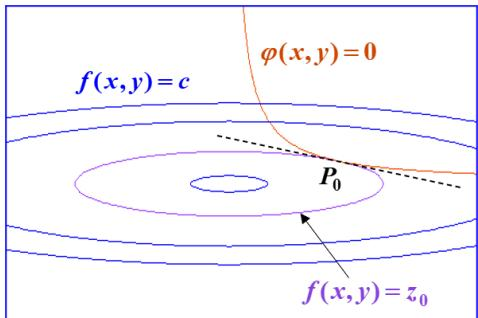
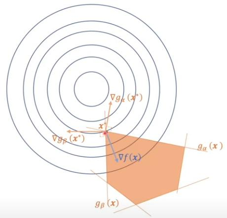
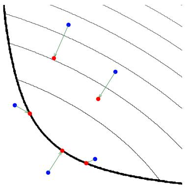
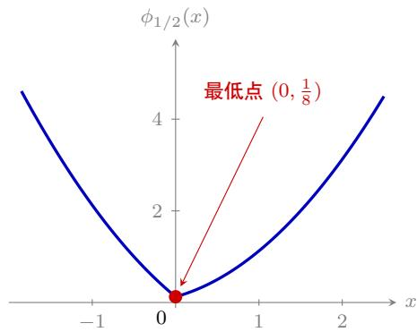
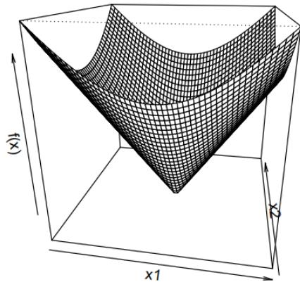
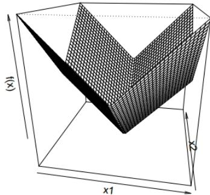
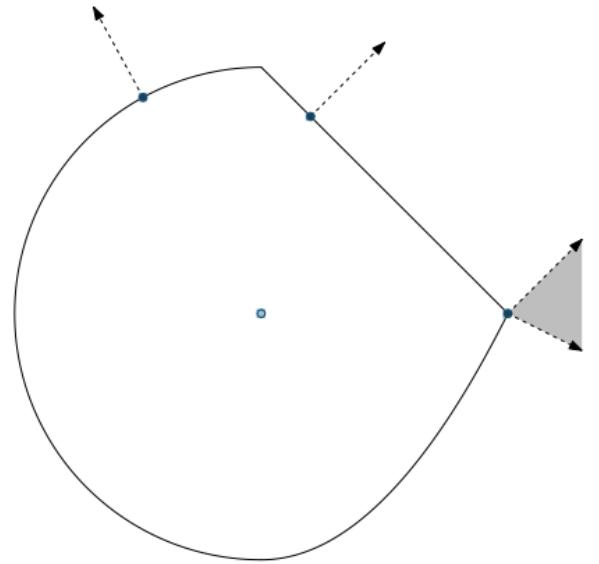

# 2026-10-25 · KKT 与近端方法

高级工程数学

**2026-10-25**

沈超敏

计算机科学与技术学院

cmshen@cs.ecnu.edu.cn

文附楼 105

**今天内容**

复习、拓展

Lagrange 乘子法

The Karush–Kuhn–Tucker (KKT) Conditions

Proximal Gradient 方法

Subgradient 方法

**上次：Lagrange 乘子法**

A series of steps by which you could get the answer if you didn’t understand what you were trying to do.

Feynman

即使你不明白自己在做什么，也能通过一系列步骤得到答案。

**Video： Lagrange 乘子法 (Constrained Optimization)**

1. Constrained optimization introduction

https://www.youtube.com/watch?v=vwUV2IDLP8Q

2. Lagrange multipliers, using tangency to solve constrained optimization

https://www.youtube.com/watch?v=yuqB-d5MjZA

3. Finishing the introduction to Lagrange multiplier example

https://www.youtube.com/watch?v=aep6lwPqm6I

4. Meaning of Lagrange multiplier

https://www.youtube.com/watch?v=m-G3K2GPmEQ

5. Proof for the meaning of Lagrange multipliers

https://www.youtube.com/watch?v=b9B2FZ5cqbM

约 30min

## 拉格朗日乘数法

拉格朗日乘数法探源 先从 $n = 2 , m = 1$ 的最简情形说起，即设目标函数与约束条件分别为

$$
z = f (x, y) \quad {\text {与}} \quad \varphi (x, y) = 0.\tag{1}
$$

若由 $\varphi ( x , y ) = 0$ 确定了隐函数 $y = y ( x )$ , 则使得目标函数成为一元函数 $z=f(x,y(x))$。再由

$$
\frac {\mathrm{d} z}{\mathrm{d} x} = f _ {x} + f _ {y} \cdot \frac {\mathrm{d} y}{\mathrm{d} x} = f _ {x} - f _ {y} \cdot \frac {\varphi_ {x}}{\varphi_ {y}} = 0
$$

求出稳定点 $P _ { 0 } \left( x _ { 0 } , y _ { 0 } \right) = \left( x _ { 0 } , y \left( x _ { 0 } \right) \right)$ , 在此点处满足

$$
\left. (f _ {x} \varphi_ {y} - f _ {y} \varphi_ {x}) \right| _ {P _ {0}} = 0
$$

$$
\left. \left(f _ {x} \varphi_ {y} - f _ {y} \varphi_ {x}\right) \right| _ {P _ {0}} = 0, \quad \text { i   .   e   .   , } \quad \frac {f _ {x}}{f _ {y}} = \frac {\varphi_ {x}}{\varphi_ {y}}
$$

而 f 的梯度为 $( f _ { x } , f _ { y } ) , \varphi$ 的梯度为 $( \varphi _ { x } , \varphi _ { y } )$ , 所以 $( f _ { x } , f _ { y } )$ 与 $( \varphi _ { x } , \varphi _ { y } )$ 成比例。

或者说，表示 f 的等值线

$$
f (x, y) = z _ {0}
$$

与曲线 $\varphi ( x , y ) = 0$ 在点 $P _ { 0 }$ 有公共切线, 见图.

由此推知: 存在比例常数 $\lambda_0$，满足 $\left( f _ { x } \left( P _ { 0 } \right) , f _ { y } \left( P _ { 0 } \right) \right) + \lambda _ { 0 } \left( \varphi _ { x } \left( P _ { 0 } \right) , \varphi _ { y } \left( P _ { 0 } \right) \right) = \left( 0 , 0 \right)$

这又表示: 对于函数

$$
L (x, y, \lambda) = f (x, y) + \lambda \varphi (x, y),
$$

在点 $( x _ { 0 } , y _ { 0 } , \lambda _ { 0 } )$ 处恰好满足:

$$
\left. \left(f _ {x} \varphi_ {y} - f _ {y} \varphi_ {x}\right) \right| _ {P _ {0}} = 0
$$

即

$$
\left\{ \begin{array}{l} L _ {x} = f _ {x} (x, y) + \lambda \varphi_ {x} (x, y) = 0, \\ L _ {y} = f _ {y} (x, y) + \lambda \varphi_ {y} (x, y) = 0, \\ L _ {\lambda} = \varphi (x, y) = 0. \end{array} \right.\tag{2}
$$

也就是说, (2) 式是函数 $L ( x , y , \lambda )$ 在其极值点处所满足的必要条件.

由此产生了一个重要思想:

拉格朗日乘数法 对于前面定义中所设的一般目标函数和约束条件组, 应引入辅助函数

$$
\begin{array}{l} L \left(x _ {1}, x _ {2}, \dots , x _ {n}, \lambda_ {1}, \lambda_ {2}, \dots , \lambda_ {m}\right) \\ = f \left(x _ {1}, x _ {2}, \dots , x _ {n}\right) + \sum_ {k = 1} ^ {m} \lambda_ {k} \varphi_ {k} \left(x _ {1}, x _ {2}, \dots , x _ {n}\right). \end{array}
$$

称此函数为拉格朗日函数, 其中 $\lambda _ { 1 } , \lambda _ { 2 } , \cdots , \lambda _ { m }$ 称为拉格朗日乘数.

**上次：含有不等式的 Constrained Optimization**

The Karush–Kuhn–Tucker (KKT) Conditions

https://www.youtube.com/watch?v=uh1Dk68cfWs&t=606s （2′30″ 开始）

引入对偶变量 $u\geq 0$，考察 $\max_{u\geq 0}ux$，由此引出 Dual 与 KKT。

**性质：Primal $\geq \text{Dual}$**

原问题: $\min _ { \boldsymbol { x } } \max _ { \lambda , \nu } L ( \boldsymbol { x } , \lambda , \nu )$ s.t. $\lambda \geq \mathbf { 0 }$

对偶问题: $\begin{array} { l } { \displaystyle \max _ { \lambda , \nu } g ( \lambda , \nu ) = \max _ { \lambda , \nu } \min _ { x } L ( x , \lambda , \nu ) } \\ { \displaystyle s . t . ~ \lambda \geq 0 } \end{array}$

$$
L (\boldsymbol {x}, \boldsymbol {\lambda}, \boldsymbol {v}) = f _ {0} (\boldsymbol {x}) + \sum \lambda_ {i} f _ {i} (\boldsymbol {x}) + \sum v _ {i} h _ {i} (\boldsymbol {x})
$$

$$
\max _ {\boldsymbol {\lambda}, \boldsymbol {v}} L (\boldsymbol {x}, \boldsymbol {\lambda}, \boldsymbol {v}) \geq L (\boldsymbol {x}, \boldsymbol {\lambda}, \boldsymbol {v}) \geq \min _ {\boldsymbol {x}} L (\boldsymbol {x}, \boldsymbol {\lambda}, \boldsymbol {v})
$$

$$
A (\boldsymbol {x}) = \max _ {\boldsymbol {\lambda}, \boldsymbol {v}} L (\boldsymbol {x}, \boldsymbol {\lambda}, \boldsymbol {v}) \geq L (\boldsymbol {x}, \boldsymbol {\lambda}, \boldsymbol {v}) \geq \min _ {\boldsymbol {x}} L (\boldsymbol {x}, \boldsymbol {\lambda}, \boldsymbol {v}) = I (\boldsymbol {\lambda}, \boldsymbol {v})
$$

$$
A (\boldsymbol {x}) \geq \min _ {\boldsymbol {x}} A (\boldsymbol {x}) \geq \max _ {\boldsymbol {\lambda}, \boldsymbol {v}} I (\boldsymbol {\lambda}, \boldsymbol {v}) \geq I (\boldsymbol {\lambda}, \boldsymbol {v})
$$

$$
P ^ {*} = \min _ {\boldsymbol {x}} A (\boldsymbol {x}) \geq \max _ {\boldsymbol {\lambda}, \boldsymbol {v}} I (\boldsymbol {\lambda}, \boldsymbol {v}) = D ^ {*}
$$

## KKT Conditions

Given general problem

$$
\begin{array}{c} \min _ {x \in \mathbb {R} ^ {n}} f (x) \\ \text { subject   to } h _ {i} (x) \leq 0, i = 1, \ldots m \\ \ell_ {j} (x) = 0, j = 1, \ldots r \end{array}
$$

The Karush–Kuhn–Tucker (KKT) conditions are:

$$
0 \in \partial f (x) + \sum_ {i = 1} ^ {m} u _ {i} \partial h _ {i} (x) + \sum_ {j = 1} ^ {r} v _ {j} \partial \ell_ {j} (x)
$$

(stationarity)

• ui · hi(x) = 0 for all i (complementary slackness)

$h_i(x)\leq 0,\quad \ell_j(x)=0\quad\text{for all }i,j$ (primal feasibility)

$u _ { i } \geq 0$ for all i

(dual feasibility)

例子 1

解：化成标准形式

求解

i.e.,

交换, 得

$$
\{\min _ {x} x ^ {2} \mid 1 \leq x \leq 2 \}
$$

$$
\left\{\min _ {x} x ^ {2} \mid - x + 1 \leq 0 \text { and } x - 2 \leq 0 \right\}
$$

$$
\min _ {x} x ^ {2} + \max _ {\lambda_ {1} \geq 0, \lambda_ {2} \geq 0} \lambda_ {1} (- x + 1) + \lambda_ {2} (x - 2)
$$

$$
\min _ {x} \max _ {\lambda_ {1} \geq 0, \lambda_ {2} \geq 0} x ^ {2} + \lambda_ {1} (- x + 1) + \lambda_ {2} (x - 2)
$$

$$
\max _ {\lambda_ {1} \geq 0, \lambda_ {2} \geq 0} \min _ {x} x ^ {2} + \lambda_ {1} (- x + 1) + \lambda_ {2} (x - 2)
$$

由 KKT, 则

1. $\nabla _ { x } L = 0$ ，即 $\begin{array} { r } { 2 x - \lambda _ { 1 } + \lambda _ { 2 } = 0 \Rightarrow x ^ { \ast } = \frac { \lambda _ { 1 } - \lambda _ { 2 } } { 2 } } \end{array}$

2. $\lambda _ { 1 } ( - x + 1 ) = 0 \qquad $ , 且 $\lambda _ { 2 } ( x - 2 ) = 0$

3. $\lambda _ { 1 } \geq 0 , \lambda _ { 2 } \geq 0$

4. $- x + 1 \leq 0 , x - 2 \leq 0$

由互补松弛条件（条件 2）可分为 4 种情形。因此，依题意取

$$
\left\{ \begin{array}{l l} x = 1 \\ \lambda_ {2} = 0 \end{array} \right. \Rightarrow x ^ {*} = 1.
$$

例子 2

$$
\min f (x _ {1}, x _ {2}) = x _ {1} ^ {2} + 2 x _ {2} ^ {2} - 4 x _ {1} - 4 x _ {2}
$$

$$
\mathsf {s . t .} \quad g _ {1} (x _ {1}, x _ {2}) = x _ {1} + x _ {2} - 3 \leq 0
$$

$$
g _ {2} \left(x _ {1}, x _ {2}\right) = 5 - x _ {1} - 2 x _ {2} \leq 0
$$

解；拉格朗日函数为：

$$
L \left(x _ {1}, x _ {2}, \lambda_ {1}, \lambda_ {2}\right) = x _ {1} ^ {2} + 2 x _ {2} ^ {2} - 4 x _ {1} - 4 x _ {2} + \lambda_ {1} \left(x _ {1} + x _ {2} - 3\right) + \lambda_ {2} \left(5 - x _ {1} - 2 x _ {2}\right)
$$

对 $x _ { 1 }$ 和 $x _ { 2 }$ 求偏导得到的等式为：

$$
\frac {\partial L}{\partial x _ {1}} = 2 x _ {1} - 4 + \lambda_ {1} - \lambda_ {2} = 0
$$

$$
\frac {\partial L}{\partial x _ {2}} = 4 x _ {2} - 4 + \lambda_ {1} - 2 \lambda_ {2} = 0
$$

$$
\text { i.e., } \nabla f + \lambda_ {1} \nabla g _ {1} + \lambda_ {2} \nabla g _ {2} = \binom{2 x _ {1} - 4}{4 x _ {2} - 4} + \lambda_ {1} \binom{1}{1} + \lambda_ {2} \binom{- 1}{- 2} = 0
$$

另外， $\lambda _ { i } g _ { i } = 0 ~ ( i = 1 , 2 )$ . 所以，4 个未知数，4 个方程，

注： 结合互补松弛条件 $\lambda_i g_i=0$ 与 KKT 条件中的不等式约束，可分为以下情形：

1. 若 $\lambda _ { 1 } = \lambda _ { 2 } = 0$ ，则 $g _ { 1 } < 0 , g _ { 2 } < 0 ;$

2. 若 $\lambda _ { 1 } = 0 , \lambda _ { 2 } > 0$ ，则 $g _ { 1 } < 0 , g _ { 2 } = 0$

3. 若 $\lambda _ { 1 } > 0 , \lambda _ { 2 } = 0$ ，则 $g _ { 1 } = 0 , g _ { 2 } < 0 \colon$

4. 若 $\lambda _ { 1 } > 0 , \lambda _ { 2 } > 0$ ，则 $g _ { 1 } = 0 , g _ { 2 } = 0$

无论哪种情形，主要是求解上面写的求导后的梯度方程，即：

$$
\frac {\partial L}{\partial x _ {1}} = 2 x _ {1} - 4 + \lambda_ {1} - \lambda_ {2} = 0,
$$

$$
\frac {\partial L}{\partial x _ {2}} = 4 x _ {2} - 4 + \lambda_ {1} - 2 \lambda_ {2} = 0.
$$

(i) 若 $\lambda _ { 1 } = \lambda _ { 2 } = 0$ ，则 $g _ { 1 } < 0 , g _ { 2 } < 0$

若 $\lambda _ { 1 } = \lambda _ { 2 } = 0$ ，则只需要求解 $x _ { 1 } , x _ { 2 }$ 即可：

$$
\frac {\partial L}{\partial x _ {1}} = 2 x _ {1} - 4 = 0 \Rightarrow x _ {1} = 2
$$

$$
\frac {\partial L}{\partial x _ {2}} = 4 x _ {2} - 4 = 0 \Rightarrow x _ {2} = 1
$$

那么 $x _ { 1 } = 2 , x _ { 2 } = 1$ 就是其中的一个解了吗？

还得验证下该解是否满足不等式 $g _ { 1 } < 0$ 和 $g _ { 2 } < 0$

将 $x _ { 1 } = 2 , x _ { 2 } = 1$ 带入 $g _ { 1 }$ 和 $g _ { 2 }$ ，有：

$$
g _ {1} (x _ {1}, x _ {2}) = x _ {1} + x _ {2} - 3 = 2 + 1 - 3 = 0
$$

$$
g _ {2} (x _ {1}, x _ {2}) = 5 - x _ {1} - 2 x _ {2} = 5 - 2 - 2 = 1 > 0
$$

很遗憾，两个式子都无法使得 $g _ { 1 } < 0$ 和 $g _ { 2 } < 0$ ，故只能舍弃该解。

(ii)、(iii) 类似，我们以（iii）为例

（iii）的情形为： $\lambda _ { 1 } > 0 , \lambda _ { 2 } = 0$ ，则 $g _ { 1 } = 0 , g _ { 2 } < 0$

$$
\left\{ \begin{array}{l} \frac {\partial L}{\partial x _ {1}} = 2 x _ {1} - 4 + \lambda_ {1} - \lambda_ {2} = 0 \\ \frac {\partial L}{\partial x _ {2}} = 4 x _ {2} - 4 + \lambda_ {1} - 2 \lambda_ {2} = 0 \\ g _ {1} (x _ {1}, x _ {2}) = x _ {1} + x _ {2} - 3 = 0 \\ \lambda_ {2} = 0 \end{array} \right. \Rightarrow \left\{ \begin{array}{l} x _ {1} = 2 \\ x _ {2} = 1 \\ \lambda_ {1} = 0 \\ \lambda_ {2} = 0 \end{array} \right.
$$

发现此解与情形 1 的解一样（仅是这个例子一样，一般不会一样），但带入 $g _ { 2 }$ 函数时，有：

$$
g _ {2} (x _ {1}, x _ {2}) = 5 - x _ {1} - 2 x _ {2} = 5 - 2 - 2 = 1 > 0
$$

很可惜，依然不能使得 $g _ { 2 } < 0$ ，故该解还是需要舍弃。

(iv) 若 $\lambda _ { 1 } > 0 , \lambda _ { 2 } > 0$ ，则 $g _ { 1 } = 0 , g _ { 2 } = 0$

此时，最优解在 $g _ { 1 }$ 和 $g _ { 2 }$ 函数的边界上，联立的四个方程为：

$$
\left\{ \begin{array}{l} \frac {\partial L}{\partial x _ {1}} = 2 x _ {1} - 4 + \lambda_ {1} - \lambda_ {2} = 0 \\ \frac {\partial L}{\partial x _ {2}} = 4 x _ {2} - 4 + \lambda_ {1} - 2 \lambda_ {2} = 0 \\ g _ {1} (x _ {1}, x _ {2}) = x _ {1} + x _ {2} - 3 = 0 \\ g _ {2} (x _ {1}, x _ {2}) = 5 - x _ {1} - 2 x _ {2} = 0 \end{array} \right. \Rightarrow \left\{ \begin{array}{l} x _ {1} = 1 \\ x _ {2} = 2 \\ \lambda_ {1} = 8 \\ \lambda_ {2} = 6 \end{array} \right.
$$

min f(x),x ∈ Rn

$g _ { i } \left( { \pmb x } \right) = { \pmb a } _ { i } ^ { T } \cdot { \pmb x } + b _ { i } \leq 0$ 其中 $\mathrm { i } = 1 , 2 , 3 \dots \mathrm { m } ,  { \pmb { a } } _ { i } \in \mathbb { R } ^ { n } , b _ { i } \in \mathbb { R }$

$$
\begin{array}{c} L (\boldsymbol {x}, \boldsymbol {\lambda}) = f (\boldsymbol {x}) + \sum \lambda_ {i}   g _ {i} \left(\boldsymbol {x}\right) \\ \Downarrow \\ \nabla L (\boldsymbol {x}, \boldsymbol {\lambda}) = 0 \\ \Downarrow \\ - \nabla f (\boldsymbol {x}) = \sum \lambda_ {i} \cdot \nabla g _ {i} \left(\boldsymbol {x}\right) \end{array}
$$

### KKT Conditions 的局限性

**1. 必要，非充分**

**2. 方程可能不容易求解**

上次作业: 利用 KKT conditions 求解 Optimization 问题

$$
\begin{array}{c} \min _ {x} x ^ {3} + 2 x ^ {2} - x + 1 \\ \text {s.t.} x ^ {2} \leq 1 \end{array}
$$

**作业解答：KKT 条件**

令 $f ( x ) = x ^ { 3 } + 2 x ^ { 2 } - x + 1 , \ g ( x ) = x ^ { 2 } - 1 \le 0$ ，可行域为 [−1,1]。拉格朗日函数为

$$
L (x, \lambda) = x ^ {3} + 2 x ^ {2} - x + 1 + \lambda (x ^ {2} - 1).
$$

KKT 条件为

$$
\left\{ \begin{array}{l l} {3 x ^ {2} + 4 x - 1 + 2 \lambda x = 0,} & {\text {(驻点条件)}} \\ {x ^ {2} - 1 \leq 0,} & {\text {(原始可行性)}} \\ {\lambda \geq 0,} & {\text {(对偶可行性)}} \\ {\lambda (x ^ {2} - 1) = 0.} & {\text {(互补松弛)}} \end{array} \right.
$$

**作业解答：分类求解**

情形一： $| x | < 1$ （约束不活跃）。 由互补松弛得 λ = 0，因此

$$
3 x ^ {2} + 4 x - 1 = 0 \quad \Longrightarrow \quad x = \frac {- 2 \pm \sqrt {7}}{3}.
$$

其中 $( - 2 - { \sqrt { 7 } } ) / 3 < - 1$ ，舍去；保留 $x ^ { * } = ( - 2 + { \sqrt { 7 } } ) / 3$

情形二： $| x | = 1$ （约束活跃）。

| $x$ | 驻点条件 | 结论 |
| ---: | --- | --- |
| $1$ | $6+2\lambda=0\Rightarrow\lambda=-3$ | 不满足 $\lambda\geq0$ |
| $-1$ | $-2-2\lambda=0\Rightarrow\lambda=-1$ | 不满足 $\lambda\geq0$ |

故唯一的 KKT 点为

$$
\boxed{(x^*,\lambda^*)=\left(\frac{\sqrt7-2}{3},0\right)}.
$$

**作业解答：全局最优性与最优值**

f 在紧集 [−1,1] 上连续，故全局最小值必存在。所有全局极小点均满足 KKT 条件，而 KKT 点唯一，因此

$$
\boxed {x ^ {*} = \frac {\sqrt {7} - 2}{3} \approx 0.21525,}
$$

$$
\boxed {f (x ^ {*}) = \frac{61-14\sqrt7}{27} \approx 0.88739}
$$

也可直接验证：令 $r = ( - 2 - { \sqrt { 7 } } ) / 3 < - 1$ ，则

$$
f ^ {\prime} (x) = 3 (x - r) \left(x - x ^ {*}\right).
$$

在 $[ - 1 , x ^ { * } )$ 上 $f ^ { \prime } ( x ) < 0$ ，在 $( x ^ { * } , 1 ]$ 上 $f ^ { \prime } ( x ) > 0$ ，故 f 先严格递减后严格递增， $x ^ { * }$ 是唯一全局最优解。

注意： $: f ^ { \prime \prime } ( x ) = 6 x + 4 \quad$ 在可行域内变号，本题不是凸优化问题；不能仅凭满足 KKT 条件就直接断言全局最优。

**今天内容**

## Proximal Gradient 方法

Subgradient 方法

$$
\mathrm{prox} _ {\lambda f} (\pmb {v}) = \arg \min _ {\pmb {x}} (f (\pmb {x}) + \frac {1}{2 \lambda} \| \pmb {x} - \pmb {v} \| ^ {2})
$$

例

$$
\text { If } f = I _ {C} (\boldsymbol {x}) = \left\{ \begin{array}{l l} 0 & \boldsymbol {x} \in C \\ + \infty & \boldsymbol {x} \notin C \end{array} \right. \text { then }
$$

v 在 C 上的投影

$$
\operatorname{prox} _ {f} (\boldsymbol {v}) = \arg \min _ {\boldsymbol {x} \in C} | | \boldsymbol {x} - \boldsymbol {v} | | _ {2}.
$$

**何时可以用 Proximal Gradient 方法？**

一般的情形:

$$
\min _ {x} f (x) + g (x)
$$

其中 $f(x)$ 光滑，且 $\operatorname{prox}_g(x)$ 易于计算时，就可采用近端梯度法。

The proximal gradient method is

$$
x ^ {k + 1} := \operatorname{prox} _ {\lambda^ {k} g} (x ^ {k} - \lambda^ {k} \nabla f (x ^ {k})),\tag{4.6}
$$

where $\lambda ^ { k } > 0$ is a step size.

什么叫 $\operatorname{prox}_g(x)$ 容易求？

例：$\operatorname{prox}_{\lambda f}(b)=\arg\min_x\left\{\frac{1}{2\lambda}\|x-b\|_2^2+\|x\|_1\right\}$，其中 $f(x)=\|x\|_1$，且 $x,b$ 均为标量。

解: (i) $b \geq 0 ,$ , 显然 $x ^ { * } \geq 0$

$$
\text { 原式 } = \arg \min _ {x > 0} {\frac {1}{2 \lambda}} (x - b) ^ {2} + x
$$

此抛物线顶点为 $\tilde { x } = b - \lambda$

若 $\tilde { x } \geq 0 ,$ , 则 $x ^ { * } = \tilde { x } = b - \lambda$ , 这时隐含着 $b \geq \lambda$

若 $\tilde { x } < 0 ,$ , 则 $x ^ { * } = 0$ , 这时 $b < \lambda$

所以, $x ^ { * } = { \left\{ \begin{array} { l l } { b - \lambda } & { b \geq \lambda } \\ { 0 } & { b < \lambda } \end{array} \right. }$

(ii) 同理, $b < 0 ,$ 则 $x ^ { * } = { \left\{ \begin{array} { l l } { b + \lambda } & { | b | \geq \lambda } \\ { 0 } & { | b | < \lambda } \end{array} \right. }$

$\phi _ { b } ( x ) = \frac { ( x - b ) ^ { 2 } } { 2 \lambda } + | x | ;$ ；取 λ = 1，横轴为 x，纵轴为函数值。

$b = 2 > \lambda$ ：最低点在 x = 1

$$
\phi_ {2} (x) = \frac {1}{2} (x - 2) ^ {2} + | x | 。
$$

$x \geq 0$ 时 $\begin{array} { r } { \phi _ { 2 } ( x ) = \frac { 1 } { 2 } ( x - 1 ) ^ { 2 } + \frac { 3 } { 2 } } \end{array}$ ，故

$$
\boxed {x ^ {*} = 1, \quad \min \phi_ {2} = \frac {3}{2}} 。
$$

$b = { \textstyle { \frac { 1 } { 2 } } } < \lambda$ ：最低点在 $x = 0$

$$
\phi_ {1 / 2} (x) = \frac {1}{2} (x - \frac {1}{2}) ^ {2} + | x | 。
$$

零点左导数为 $- \frac { 3 } { 2 }$ ，右导数为 $\frac { 1 } { 2 }$ ，故

$$
\boxed {x ^ {*} = 0, \quad \min \phi_ {1 / 2} = \frac {1}{8}}.
$$

**目标函数的最低点与最小值：一般结论**

$$
\phi_ {b} (x) = \frac {(x - b) ^ {2}}{2 \lambda} + | x |, \quad \lambda > 0.
$$

在零点两侧求导：

$$
\phi_ {b} ^ {\prime} (x) = \left\{ \begin{array}{l l} (x - b) / \lambda - 1, & x <   0, \\ (x - b) / \lambda + 1, & x > 0. \end{array} \right.
$$

若 $b > \lambda$ ，右侧驻点 $x = b - \lambda > 0$ 是最低点；若 $b < - \lambda$ ，左侧驻点 $x = b + \lambda < 0$ 是最低点。 若 $| b | \leq \lambda$ ，零点的左导数 $- b / \lambda - 1 \leq 0$ ，右导数 $- b / \lambda + 1 \ge 0$ ，最低点就在折点 $x = 0$

$$
\boxed {x ^ {*} = \operatorname{sign} (b) \max \{| b | - \lambda , 0 \},}
$$

$$
\boxed {\min _ {x} \phi_ {b} (x) = \left\{ \begin{array}{l l} \frac {b ^ {2}}{2 \lambda}, & | b | \leq \lambda , \\ | b | - \frac {\lambda}{2}, & | b | > \lambda . \end{array} \right.}
$$

$\phi _ { b }$ 严格凸，因此上述最低点唯一； $b < 0$ 的图像可由对应 $| b |$ 的图像左右翻转得到。

$x ^ { * } = { \left\{ \begin{array} { l l } { b - \lambda } & { b \geq \lambda } \\ { 0 } & { b < \lambda } \end{array} \right. }$ for $b \geq 0$ 和 $x ^ { \ast } = \left\{ { \begin{array} { l l } { b + \lambda } & { | b | \geq \lambda } \\ { 0 } & { | b | < \lambda } \end{array} } \right.$ for $b < 0$ 可合并成

$$
x ^ {*} = \left\{ \begin{array}{l l} \operatorname{sgn} (b) (| b | - \lambda) & | b | > \lambda \\ 0 & \text { else } \end{array} \right. \tag * {\square}
$$

对向量情形，若 $f(\mathbf{x})=\|\mathbf{x}\|_1$，则 $\operatorname{prox}_{\lambda f}(\mathbf{b})=\arg\min_{\mathbf{x}}\left\{\frac{1}{2\lambda}\|\mathbf{x}-\mathbf{b}\|_2^2+\|\mathbf{x}\|_1\right\}$。

$$
x _ {i} ^ {*} = \left\{ \begin{array}{l l} \operatorname{sgn} (b _ {i}) (| b _ {i} | - \lambda) & | b _ {i} | > \lambda \\ 0 & \text { else } \end{array} \right. \tag * {\square}
$$

$$
\min _ {\pmb {x}} \frac {1}{2} \| A \pmb {x} - \pmb {b} \| _ {2} ^ {2} + \lambda \| \pmb {x} \| _ {1}\tag{LASSO:}
$$

**Subgradients**

Ryan Tibshirani

Convex Optimization 10-725/36-725

**回忆：gradient descent**

Consider the problem

$$
\min _ {\boldsymbol {x}} f (\boldsymbol {x})
$$

for $f$ convex and differentiable, dom $( f ) = \mathbb { R } ^ { n }$

Gradient descent:

choose initial $\pmb { x } ^ { ( 0 ) } \in \mathbb { R } ^ { n }$ , repeat

$$
\boldsymbol {x} ^ {(k)} = \boldsymbol {x} ^ {(k - 1)} - t _ {k} \cdot \nabla f (\boldsymbol {x} ^ {(k - 1)}), k = 1, 2, 3, \dots
$$

Step sizes $t _ { k }$ chosen to be fixed and small, or by backtracking line search.

If ∇f Lipschitz (即 ∇f 变化不剧烈), gradient descent has convergence rate $O ( 1 / \epsilon )$

缺点:

Requires f differentiable

Can be slow to converge

**Outline**

**Today: crucial mathematical underpinnings!**

Subgradients

Examples

Subgradient rules

Optimality characterizations

## Subgradients

Remember that for convex and differentiable $f ,$

$$
f (\boldsymbol {y}) \geq f (\boldsymbol {x}) + \nabla f (\boldsymbol {x}) ^ {\mathrm{T}} (\boldsymbol {y} - \boldsymbol {x}) \text {   for   all   } \boldsymbol {x}, \boldsymbol {y}
$$

i.e., linear approximation always underestimates $f$

A subgradient of a convex function $f$ at $\pmb{x}$ is any $\pmb { g } \in \mathbb { R } ^ { n }$ such that

$$
f (\boldsymbol {y}) \geq f (\boldsymbol {x}) + \boldsymbol {g} ^ {\mathrm{T}} (\boldsymbol {y} - \boldsymbol {x}) \text {   for   all   } \boldsymbol {y}
$$

Always exists

If $f$ is differentiable at $x$, then $\pmb { g } = \nabla f ( \pmb { x } )$ uniquely

Actually, same definition works for nonconvex $f$ (however, subgradients need not exist)

**Examples of subgradients**

例 1. $f : \mathbb { R } \to \mathbb { R } , f ( x ) = | x |$

For $x \neq 0$ , unique subgradient $g = \operatorname{sign} \left( x \right)$

For $x = 0$, a subgradient $g$ is any element of $[ - 1 , 1 ]$

例 2. $f : \mathbb{R}^{n} \to \mathbb{R} , f ( \pmb { x } ) = \| \pmb { x } \| _ { 2 }$

For $\mathbf { \boldsymbol { x } } \neq \mathbf { \boldsymbol { 0 } }$ , unique subgradient ${ \pmb g } = { \pmb x } / \| { \pmb x } \| _ { 2 }$

For ${ \pmb x } = 0$ , subgradient g is any element of $\{ z : \| z \| _ { 2 } \leq 1 \}$

理由：

At $x = 0$ , the function $f ( x ) = \| x \| _ { 2 }$ is not differentiable because the Euclidean norm has a "sharp" point at the origin (like a cone vertex). In this case, the subgradient is defined as any vector $g$ that satisfies the subgradient inequality:

$$
f (y) \geq f (0) + g ^ {\top} (y - 0), \quad \forall y \in \mathbb {R} ^ {n}.
$$

Since $f ( 0 ) = 0 ,$ , this simplifies to:

$$
\| y \| _ {2} \geq g ^ {\top} y, \quad \forall y \in \mathbb {R} ^ {n}.
$$

The inequality $g ^ { \top } y \leq \| y \| _ { 2 }$ holds if and only if g satisfies $\| g \| _ { 2 } \leq 1$ . Therefore, the subgradient set at $x=0$ is

$$
\{z \in \mathbb {R} ^ {n}: \| z \| _ {2} \leq 1 \}.
$$

This includes all vectors within or on the surface of the unit ball in $\mathbb { R } ^ { n }$

例 3. $f : \mathbb{R}^{n} \to \mathbb{R} , f ( \pmb { x } ) = \| \pmb { x } \| _ { 1 }$

For $x _ { i } \neq 0$ , unique ith component $g _ { i } = \operatorname{sign} ( x _ { i } )$

For $x_i=0$, the $i$th component $g _ { i }$ is any element of $[ - 1 , 1 ]$

例 4. Let $f _ { 1 } , f _ { 2 } : \mathbb{R}^{n} \to \mathbb{R}$ be convex and differentiable, and $f ( \pmb { x } ) = \max \{ f _ { 1 } ( \pmb { x } ) , f _ { 2 } ( \pmb { x } ) \}$

For $f _ { 1 } ( { \pmb x } ) > f _ { 2 } ( { \pmb x } )$ , unique subgradient $\pmb { g } = \nabla f _ { 1 } ( \pmb { x } )$

For $f _ { 2 } ( { \pmb x } ) > f _ { 1 } ( { \pmb x } )$ , unique subgradient ${ \pmb g } = \nabla f _ { 2 } ( { \pmb x } )$

For $f _ { 1 } ( { \pmb x } ) = f _ { 2 } ( { \pmb x } )$ , subgradient g is any point on the line segment between $\nabla f _ { 1 } ( { \pmb x } )$ and $\nabla f _ { 2 } ( { \pmb x } )$

**Subdifferential**

Set of all subgradients of convex $f$ is called the subdifferential:

$\partial f(\pmb{x})=\{\pmb{g}\in\mathbb{R}^{n}: g \text{ is a subgradient of }f\text{ at }\pmb{x}\}$

$\partial f ( { \pmb x } )$ is closed and convex (even for nonconvex $f )$

Nonempty (can be empty for nonconvex $f )$

If $f$ is differentiable at x, then $\partial f ( { \pmb x } ) = \{ \nabla f ( { \pmb x } ) \}$

If $\partial f ( { \pmb x } ) = \{ { \pmb g } \}$ , then $f$ is differentiable at x and $\nabla f ( { \pmb x } ) = { \pmb g }$

**Connection to convex geometry**

Convex set $C \subseteq \mathbb { R } ^ { n }$ , consider the indicator function $I_C:\mathbb{R}^n\to\mathbb{R}\cup\{+\infty\}$

$$
I _ {C} (\boldsymbol {x}) = I \{\boldsymbol {x} \in C \} = \left\{ \begin{array}{l l} 0 & i f \boldsymbol {x} \in C \\ \infty & i f \boldsymbol {x} \notin C \end{array} \right.
$$

For $\pmb{x}\in C$, $\partial I_C(\pmb{x})=\mathcal{N}_C(\pmb{x})$, the normal cone of $C$ at $\pmb{x}$. Recall

$$
\mathcal {N} _ {C} (\boldsymbol {x}) = \left\{\boldsymbol {g} \in \mathbb {R} ^ {n}: \boldsymbol {g} ^ {\mathrm{T}} \boldsymbol {x} \geq \boldsymbol {g} ^ {\mathrm{T}} \boldsymbol {y} \text {   for   any   } \boldsymbol {y} \in C \right\}
$$

Why? By definition of a subgradient $\pmb{g}$,

$$
I _ {C} (\boldsymbol {y}) \geq I _ {C} (\boldsymbol {x}) + \boldsymbol {g} ^ {T} (\boldsymbol {y} - \boldsymbol {x}) \text {   for   all   } \boldsymbol {y}
$$

For $\pmb { y } \notin C , I _ { C } ( \pmb { y } ) = \infty$

For $\pmb { y } \in C$ , this means $0 \geq \pmb { g } ^ { T } ( \pmb { y } - \pmb { x } )$

**Subgradient calculus**

Basic rules for convex functions:

Scaling: $\partial ( a f ) = a \cdot \partial f$ provided $a > 0$

Addition: $\partial ( f _ { 1 } + f _ { 2 } ) = \partial f _ { 1 } + \partial f _ { 2 }$

Affine composition: if $g ( { \pmb x } ) = f ( A { \pmb x } + { \pmb b } )$ , then

$$
\partial g (\boldsymbol {x}) = A ^ {\mathrm{T}} \partial f (A \boldsymbol {x} + \boldsymbol {b})
$$

Finite pointwise maximum: if $f ( \pmb { x } ) = \max _ { i = 1 , \dots m } f _ { i } ( \pmb { x } )$ , then

$$
\partial f (\boldsymbol {x}) = \operatorname{conv} \left(\bigcup_ {i: f _ {i} (\boldsymbol {x}) = f (\boldsymbol {x})} \partial f _ {i} (\boldsymbol {x})\right)
$$

the convex hull of union of subdifferentials of all active functions at x

General pointwise maximum: if $f ( \pmb { x } ) = \max _ { s \in S } f _ { s } ( \pmb { x } )$ , then

$$
\partial f (\boldsymbol {x}) \supseteq \operatorname{cl} \left\{\operatorname{conv} \left(\bigcup_ {s: f _ {s} (\boldsymbol {x}) = f (\boldsymbol {x})} \partial f _ {s} (\boldsymbol {x})\right) \right\}
$$

and under some regularity conditions (on $S , f _ { s } )$ , we get an equality above

Norms: important special case, $f ( \pmb { x } ) = \| \pmb { x } \| _ { p }$ . Let $q$ be such that $1 / p + 1 / q = 1$ , then

$$
\| \boldsymbol {x} \| _ {p} = \max _ {\| \boldsymbol {z} \| _ {q} \leq 1} \boldsymbol {z} ^ {\mathrm{T}} \boldsymbol {x}
$$

Hence

$$
\partial f (\boldsymbol {x}) = \operatorname{argmax} _ {\| \boldsymbol {z} \| _ {q} \leq 1} z ^ {\mathrm{T}} \boldsymbol {x}
$$

**Why subgradients?**

Subgradients are important for two reasons:

Convex analysis: optimality characterization via subgradients, monotonicity, relationship to duality

Convex optimization: if you can compute subgradients, then you can minimize (almost) any convex function

**Optimality condition**

For any f (convex or not),

$$
f (\boldsymbol {x} ^ {\star}) = \min _ {\boldsymbol {x}} f (\boldsymbol {x}) \Longleftrightarrow \mathbf {0} \in \partial f (\boldsymbol {x} ^ {\star})
$$

i.e., ${ \pmb x } ^ { \star }$ is a minimizer if and only if 0 is a subgradient of $f$ at ${ \pmb x } ^ { \star }$ .

This is called the subgradient optimality condition

Why? Easy: $\mathbf { \nabla } _ { \mathbf { \pmb { g } } } = \mathbf { 0 }$ being a subgradient means that for all $\textbf {  { y } }$

$$
f (\boldsymbol {y}) \geq f (\boldsymbol {x} ^ {\star}) + \mathbf {0} ^ {\mathrm{T}} (\boldsymbol {y} - \boldsymbol {x} ^ {\star}) = f (\boldsymbol {x} ^ {\star})
$$

Note the implication for a convex and differentiable function $f ,$ , with $\partial f ( { \pmb x } ) = \{ \nabla f ( { \pmb x } ) \}$

**Derivation of first-order optimality**

Example of the power of subgradients: we can use what we have learned so far to derive the first-order optimality condition.

Recall that for $f$ convex and differentiable, the problem

$$
\min _ {\boldsymbol {x}} f (\boldsymbol {x}) \text { subject   to } \boldsymbol {x} \in C
$$

is solved at x if and only if

$$
\nabla f (\boldsymbol {x}) ^ {\mathrm{T}} (\boldsymbol {y} - \boldsymbol {x}) \geq 0 \text {   for   all   } \boldsymbol {y} \in C
$$

Intuitively, this says that the gradient points toward increasing function values as we move away from $x$. How to see this? First recast problem as min f(x) + I_C(x)

$$
\min _ {\boldsymbol {x}} f (\boldsymbol {x}) + I _ {C} (\boldsymbol {x})
$$

Now apply subgradient optimality: ${ \bf 0 } \in \partial ( f ( { \pmb x } ) + I _ { C } ( { \pmb x } ) )$

But

$$
\begin{array}{l} \mathbf {0} \in \partial (f (\boldsymbol {x}) + I _ {C} (\boldsymbol {x})) \\ \Longleftrightarrow \mathbf {0} \in \{\nabla f (\boldsymbol {x}) \} + \mathcal {N} _ {C} (\boldsymbol {x}) \\ \Longleftrightarrow - \nabla f (\boldsymbol {x}) \in \mathcal {N} _ {C} (\boldsymbol {x}) \\ \Longleftrightarrow - \nabla f (\boldsymbol {x}) ^ {\mathrm{T}} \boldsymbol {x} \geq - \nabla f (\boldsymbol {x}) ^ {\mathrm{T}} \boldsymbol {y} \text {for all} \boldsymbol {y} \in C \\ \Longleftrightarrow \nabla f (\boldsymbol {x}) ^ {\mathrm{T}} (\boldsymbol {y} - \boldsymbol {x}) \geq 0 \text {for all} \boldsymbol {y} \in C \end{array}
$$

as desired

Note: the condition ${ \bf 0 } \in \partial f ( { \pmb x } ) + \mathcal { N } _ { C } ( { \pmb x } )$ is a fully general condition for optimality in a convex problem. But this is not always easy to work with (KKT conditions, later, are easier)

Example: lasso (least absolute shrinkage and selection operator) optimality conditions

Given $\pmb { y } \in \mathbb { R } ^ { n } , X \in \mathbb { R } ^ { n \times p }$ , lasso problem can be parametrized as:

$$
\min _ {\boldsymbol {\beta} \in \mathbb {R} ^ {p}} \frac {1}{2} \| \boldsymbol {y} - X \boldsymbol {\beta} \| _ {2} ^ {2} + \lambda \| \boldsymbol {\beta} \| _ {1}
$$

where $\lambda \geq 0$ . Subgradient optimality:

$$
\begin{array}{l} \mathbf {0} \in \partial \left(\frac {1}{2} \| \boldsymbol {y} - X \boldsymbol {\beta} \| _ {2} ^ {2} + \lambda \| \boldsymbol {\beta} \| _ {1}\right) \\ \Longleftrightarrow \mathbf {0} \in - X ^ {\mathrm{T}} (\boldsymbol {y} - X \boldsymbol {\beta}) + \lambda \partial \| \boldsymbol {\beta} \| _ {1} \\ \Longleftrightarrow X ^ {\mathrm{T}} (\boldsymbol {y} - X \boldsymbol {\beta}) = \lambda \boldsymbol {v} \end{array}
$$

for some ${ \pmb v } \in \partial \| \beta \| _ { 1 }$ , i.e.,

$$
\boldsymbol {v} _ {i} \in \left\{ \begin{array}{l l} \{1 \} & \text {if} \beta_ {i} > 0 \\ \{- 1 \} & \text {if} \beta_ {i} <   0, i = 1, \ldots , p \\ [ - 1, 1 ] & \text {if} \beta_ {i} = 0 \end{array} \right.
$$

Write $\pmb { x } _ { 1 } , \cdots , \pmb { x } _ { p }$ for columns of X. Then subgradient optimality reads:

$$
\left\{ \begin{array}{r l} \boldsymbol {x} _ {i} ^ {\mathrm{T}} (\boldsymbol {y} - X \boldsymbol {\beta}) = \lambda \cdot \operatorname{sign} (\beta_ {i}) & \text {if} \beta_ {i} \neq 0 \\ | \boldsymbol {x} _ {i} ^ {\mathrm{T}} (\boldsymbol {y} - X \boldsymbol {\beta}) | \leq \lambda & \text {if} \beta_ {i} = 0 \end{array} \right.
$$

Note: The subgradient optimality conditions do not directly give a lasso solution, but they do provide a way to check lasso optimality.

They are also helpful in understanding the lasso estimator; e.g., if

$| { \pmb x } _ { i } ^ { \mathrm { T } } ( { \pmb y } - X { \pmb \beta } ) | < \lambda$ , then $\beta _ { i } = 0$

**Example: soft-thresholding**

Simplified lasso problem with $X = I !$

$$
\min _ {\boldsymbol {\beta} \in \mathbb {R} ^ {n}} \frac {1}{2} \| \boldsymbol {y} - \boldsymbol {\beta} \| _ {2} ^ {2} + \lambda \| \boldsymbol {\beta} \| _ {1}
$$

This we can solve directly using subgradient optimality. Solution is $\beta = S _ { \lambda } ( \pmb { y } )$ , where $S _ { \lambda }$ is the soft-thresholding operator:

$$
[ S _ {\lambda} (\boldsymbol {y}) ] _ {i} = \left\{ \begin{array}{l l} y _ {i} - \lambda & i f \quad y _ {i} > \lambda \\ 0 & i f \quad - \lambda \leq y _ {i} \leq \lambda , i = 1, \dots n \\ y _ {i} + \lambda & i f \quad y _ {i} <   - \lambda \end{array} \right.
$$

Check: from last slide, subgradient optimality conditions are

$$
\left\{ \begin{array}{r l} y _ {i} - \beta_ {i} = \lambda \cdot \mathrm{sign} (\beta_ {i}) & i f \beta_ {i} \neq 0 \\ | y _ {i} - \beta_ {i} | \leq \lambda & i f \beta_ {i} = 0 \end{array} \right.
$$

Now plug in $\beta = S _ { \lambda } ( \pmb { y } )$ and check these are satisfied:

When $y _ { i } > \lambda , \beta _ { i } = y _ { i } - \lambda > 0$ , so $y _ { i } - \beta _ { i } = \lambda = \lambda \cdot 1$

When $y _ { i } < - \lambda$ , argument is similar

When $| y _ { i } | \leq \lambda , \beta _ { i } = 0$ , and $| y _ { i } - \beta _ { i } | = | y _ { i } | \leq \lambda$

Soft-thresholding in one variable:

**近端梯度法的应用：稀疏信号去噪**

测得信号 $\pmb { b } = ( 3 , 0 . 2 , - 2 ) ^ { \top }$ ，希望去掉小噪声，保留主要信号。假设真实信号应当稀疏，建立模型

$$
\min _ {\pmb {x} \in \mathbb {R} ^ {3}} F (\pmb {x}) = \underbrace {\frac {1}{2} \| \pmb {x} - \pmb {b} \| _ {2} ^ {2}} _ {\text {贴近观测}} + \underbrace {\| \pmb {x} \| _ {1}} _ {\text {鼓励零分量}}.
$$

这是 LASSO 的特例： $A = I$ ，正则化参数 $\lambda = 1$

$$
f (\boldsymbol {x}) = \frac {1}{2} \| \boldsymbol {x} - \boldsymbol {b} \| _ {2} ^ {2}, \qquad h (\boldsymbol {x}) = \| \boldsymbol {x} \| _ {1}, \qquad \nabla f (\boldsymbol {x}) = \boldsymbol {x} - \boldsymbol {b}
$$

选择步长 t = 1，使用近端梯度更新

$$
\boldsymbol {x} ^ {k + 1} = \operatorname{prox} _ {t h} \left(\boldsymbol {x} ^ {k} - t \nabla f (\boldsymbol {x} ^ {k})\right).
$$

**近端梯度法的应用：一步算出答案**

第一步：梯度步。任意初始点 $x ^ { 0 }$ 都有

$$
\boldsymbol {v} = \boldsymbol {x} ^ {0} - (\boldsymbol {x} ^ {0} - \boldsymbol {b}) = \boldsymbol {b} = (3, 0.2, - 2) ^ {\top}.
$$

第二步：近端步。逐坐标应用阈值为 1 的软阈值算子：

$$
S _ {1} (u) = \operatorname{sign} (u) \max \{| u | - 1, 0 \}.
$$

$$
3 \longmapsto 2, \qquad 0.2 \longmapsto 0, \qquad - 2 \longmapsto - 1.
$$

$$
\boxed {x ^ {*} = S _ {1} (b) = (2, 0, - 1) ^ {\mathsf {T}}.}
$$

解释：小分量 0.2 被置零，大分量向零收缩 1。这里一步求解来自 A = I 和 t = 1 的特殊结构；一般LASSO 需要迭代。

**次梯度法的应用：用绝对误差寻找代表值**

有三个观测值 $1,3,8$，希望找一个数 $x$ 代表它们，最小化总绝对误差：

$$
\min _ {x \in \mathbb {R}} F (x) = | x - 1 | + | x - 3 | + | x - 8 |.
$$

绝对值在零点不可微，采用次梯度法。对单项有

$$
\partial | x - a | = \left\{ \begin{array}{l l} \{- 1 \}, & x <   a, \\ [ - 1, 1 ], & x = a, \\ \{1 \}, & x > a. \end{array} \right.
$$

取 $\operatorname{sign} ( 0 ) = 0$ ，可选次梯度

$$
g (x) = \operatorname{sign} (x - 1) + \operatorname{sign} (x - 3) + \operatorname{sign} (x - 8) \in \partial F (x).
$$

更新公式为 $\boxed { x ^ { k + 1 } = x ^ { k } - \alpha _ { k } g ( x ^ { k } ) }$

**次梯度法的应用：手算迭代过程**

从 $x ^ { 0 } = 6$ 出发，本例取固定步长 $\alpha _ { k } = 1$

$$
\begin{array}{c c c c} k & x ^ {k} & g (x ^ {k}) & F (x ^ {k}) \\ \hline 0 & 6 & 1 + 1 - 1 = 1 & 10 \\ 1 & 5 & 1 + 1 - 1 = 1 & 9 \\ 2 & 4 & 1 + 1 - 1 = 1 & 8 \\ 3 & 3 & 1 + 0 - 1 = 0 & 7 \end{array}
$$

$$
6 \longrightarrow 5 \longrightarrow 4 \longrightarrow \boxed {3}.
$$

由于 F 凸且 $0 \in \partial F ( 3 ) , x ^ { * } = 3$ 是全局最优解。它也是三个观测值的中位数， $\boxed { F ( x ^ { * } ) = 7 }$ 注意：这里恰好有限步到达最优点；一般问题用固定步长可能振荡。常用递减步长，例如 $\alpha _ { k } = c / ( k + 1 )$ $\left( c > 0 \right)$

**两种方法：这两个例子说明了什么？**

近端梯度法：将目标写为 F = f +h，对光滑项 f 作梯度步，再精确求解包含非光滑项 h 的近端子问题：

$$
x ^ {k + 1} = \arg \min _ {z} \left\{h (z) + \frac {1}{2 t} \| z - (x ^ {k} - t \nabla f (x ^ {k})) \| _ {2} ^ {2} \right\}.
$$

稀疏去噪例子中，近端子问题可直接用软阈值公式求解。

次梯度法：选取整个凸目标函数的一个次梯度，直接更新：

$$
g ^ {k} \in \partial F (x ^ {k}), \qquad x ^ {k + 1} = x ^ {k} - \alpha_ {k} g ^ {k}.
$$

绝对误差例子中，只需计算三个符号函数的和。

选择依据：近端映射容易计算时适合使用近端梯度法；次梯度容易计算时，可以使用次梯度法，但需注意步长与收敛速度。
